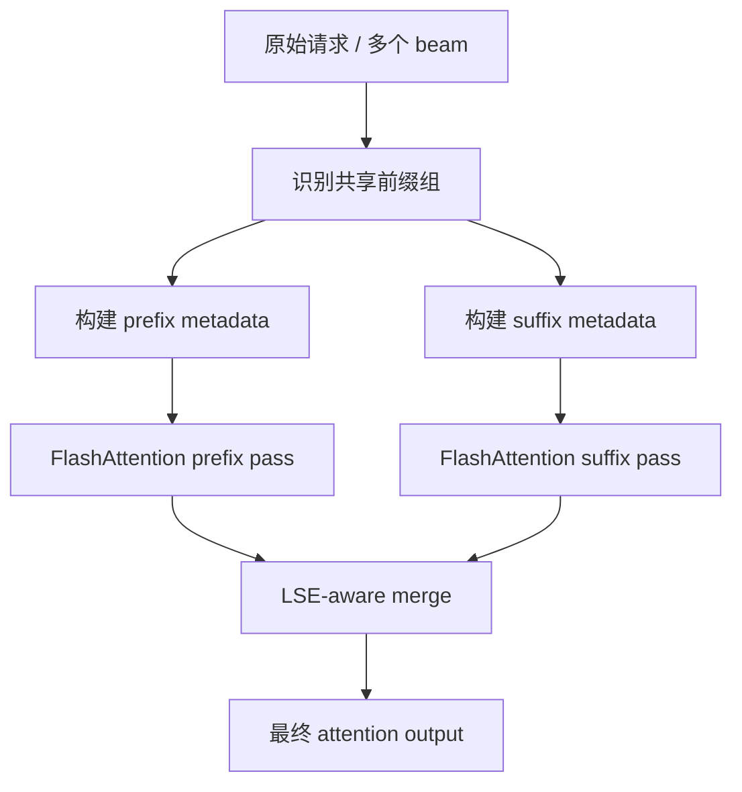

# vllm-gr-js 提交 `141e61fda0b5c8d534aee96295f8e5c245594651` 实现原理详解

## 1. 提交概览

- 提交号：`141e61fda0b5c8d534aee96295f8e5c245594651`
- 提交标题：`Implement Beam Attention backend and optimizations`

这次提交的核心目标，是为 `vllm-gr` 引入一个专门面向 Beam Search / Graph Reuse 场景的 Attention Backend。它没有重新发明一套 attention 算法，而是在 **复用 vLLM 现有 FlashAttention varlen kernel** 的基础上，增加了一层“共享前缀识别 + 前后缀拆分 + 结果融合”的调度与元数据构造逻辑。

一句话概括它的思想：

> 当一个 batch 里的多个 beam 共享很长的 KV 前缀时，不要让每个 beam 都把这段共享前缀重复算一遍；把共享部分合并计算一次，再把各自独有的后缀单独算，最后按 softmax 的数值规则把两部分结果精确合并。

这正是 beam search 场景里最常见、也最值钱的优化点。


## 2. 这次提交改了什么

本次提交涉及的主要文件如下：

- [vllm_gr/v1/attention/backends/beam_attn.py](/D:/code/codexapp/vllm-gr-js/vllm_gr/v1/attention/backends/beam_attn.py)
- [vllm_gr/v1/attention/backends/__init__.py](/D:/code/codexapp/vllm-gr-js/vllm_gr/v1/attention/backends/__init__.py)
- [vllm_gr/__init__.py](/D:/code/codexapp/vllm-gr-js/vllm_gr/__init__.py)
- [tests/kernels/attention/test_cascade_beam_flash_attn.py](/D:/code/codexapp/vllm-gr-js/tests/kernels/attention/test_cascade_beam_flash_attn.py)
- [docs/quickstart.md](/D:/code/codexapp/vllm-gr-js/docs/quickstart.md)

其中真正的主体实现几乎都在：

- [beam_attn.py](/D:/code/codexapp/vllm-gr-js/vllm_gr/v1/attention/backends/beam_attn.py)

这个文件做了五件大事：

1. 注册一个新的 attention backend，名字是 `CUSTOM`
2. 定义这个 backend 的 metadata 结构
3. 构建共享前缀/独占后缀的 block table 和调度元数据
4. 调用 FlashAttention 分别计算 prefix 和 suffix
5. 用 LSE 规则把两次 attention 的结果融合为最终输出


## 3. 为什么 Beam Search 值得做这件事

### 3.1 问题背景

在普通 decode 中，一条请求只有一条序列，attention 计算没有“跨序列重复”。

但在 beam search 里，一个请求会扩展出多个 beam。早期这些 beam 往往共享相同的 prompt，甚至共享很长一段生成前缀。于是会出现这种情况：

- Beam A 的 KV cache = `共享前缀 + A 的后缀`
- Beam B 的 KV cache = `共享前缀 + B 的后缀`
- Beam C 的 KV cache = `共享前缀 + C 的后缀`

如果按常规 attention 路径做，每个 beam 都会完整访问一遍整条 KV 序列。

这就带来两个代价：

1. **重复加载共享 KV 块**
2. **重复对共享前缀做 attention 计算**

当 beam width 很大、共享前缀很长时，这部分重复会很可观。

### 3.2 核心优化思路

这次提交的思路是把一条 attention 拆成两段：

1. `prefix`：多个 beam 共享的 KV 前缀，只算一次
2. `suffix`：每个 beam 自己独有的 KV 后缀，各算各的

然后用 softmax 的可分解性质，将：

- 对 prefix 的 attention 结果
- 对 suffix 的 attention 结果

精确合并成最终 attention 输出。

也就是说，这不是近似优化，而是 **等价变换下的重复消除**。


## 4. Backend 注册机制

### 4.1 注册为 `CUSTOM`

在 [beam_attn.py](/D:/code/codexapp/vllm-gr-js/vllm_gr/v1/attention/backends/beam_attn.py) 中：

```python
@register_backend(AttentionBackendEnum.CUSTOM)
class BeamAttentionBackend(AttentionBackend):
```

这意味着它被注册成 vLLM attention backend 注册表中的 `CUSTOM` 后端。

对应地，[docs/quickstart.md](/D:/code/codexapp/vllm-gr-js/docs/quickstart.md) 也修改了服务启动方式，显式要求：

```bash
--attention-backend CUSTOM
```

这说明从这个提交开始，想走 Beam Attention 路径，服务端需要明确选择这个 backend。

### 4.2 自动导入

在 [vllm_gr/__init__.py](/D:/code/codexapp/vllm-gr-js/vllm_gr/__init__.py) 中，新增了条件导入：

- 仅当 `torch.cuda.is_available()`
- 且 `FlashAttention varlen` 可用

才导入 `BeamAttentionBackend`。

这一步的作用很实用：

1. 让 backend 在支持环境下完成注册
2. 不支持的环境下避免 import 时报错

也就是说，它不是盲目强绑，而是有一个环境探测门槛。


## 5. Backend 的能力边界

`BeamAttentionBackend` 在类方法里声明了自己的适用范围。

### 5.1 支持的数据类型

支持：

- `torch.float16`
- `torch.bfloat16`

### 5.2 头维度限制

`supports_head_size()` 要求：

- `head_size % 8 == 0`
- `head_size <= 256`

这基本符合 FlashAttention 常见的 kernel 约束。

### 5.3 block size 限制

`get_kv_cache_shape()` 与 `supports_combination()` 都要求：

- `block_size` 必须是 16 的倍数

### 5.4 硬件要求

`supports_compute_capability()` 要求 GPU 能力：

- `compute capability >= 8.0`

也就是更偏向 Ampere 及以上。

### 5.5 对上游依赖的要求

这个 backend 强依赖：

- `FlashAttention varlen` 可用

如果不可用，会直接给出不支持理由，而不是静默降级成别的逻辑。

### 5.6 暂不支持的能力

在 `supports_combination()` 里明确拒绝：

- `MLA`
- `sparse attention`

同时对 FP8 KV cache 的支持也取决于 FlashAttention 是否支持 FP8。


## 6. 整体架构：它不是新 kernel，而是新调度层

很多人第一次看这个实现，容易误以为它写了一个全新的 beam attention kernel。其实不是。

更准确地说，它做的是：

1. **识别共享前缀**
2. **重组 query / block table / seq lens**
3. **复用两次 FlashAttention varlen**
4. **做一次数值正确的融合**

所以它的价值主要在：

- 元数据构建
- 批次重排
- 重复计算消除
- 融合逻辑

而不是底层 matmul/softmax 内核本身。


## 7. Metadata 设计：这套优化是靠 metadata 驱动的

### 7.1 `BeamAttentionMetadata`

提交新增了 `BeamAttentionMetadata` 数据类，它在普通 attention metadata 之上，加入了 beam 共享优化所需的字段。

关键字段可以分为四类。

#### 第一类：基础 attention 信息

- `num_actual_tokens`
- `max_query_len`
- `query_start_loc`
- `max_seq_len`
- `seq_lens`
- `block_table`
- `slot_mapping`

这些和普通 varlen attention 的元数据是一脉相承的。

#### 第二类：prefix pass 的元数据

- `cu_prefix_query_lens`
- `prefix_kv_lens`
- `prefix_block_table`
- `prefix_query_max_len`
- `prefix_kv_max_len`
- `prefix_scheduler_metadata`

它们用于描述“共享前缀 attention”这一趟计算。

#### 第三类：suffix pass 的元数据

- `suffix_kv_lens`
- `suffix_block_table`
- `suffix_query_max_len`
- `suffix_kv_max_len`
- `scheduler_metadata`

它们描述“每个 beam 各自后缀 attention”这一趟计算。

#### 第四类：prefix 与原始 query 对齐所需的映射信息

- `prefix_indices`
- `prefix_indices_is_identity`
- `group_first_reqs`
- `suffix_col_indices`

这一组字段非常关键，因为 prefix pass 并不一定按原始请求顺序执行，也不一定覆盖所有请求，所以最后需要知道：

- prefix 输出该对回哪一些 token
- suffix block table 该怎么从原始 block table 偏移出来


## 8. MetadataBuilder 的职责

### 8.1 `BeamAttentionMetadataBuilder`

这个 builder 是整个实现的编排中心。

它的职责不是算 attention，而是回答这几个问题：

1. 当前 batch 中有没有共享前缀可利用
2. 哪些请求可以分到同一个 prefix group
3. 共享前缀有多长
4. prefix pass 和 suffix pass 各自需要什么 block table / seq lens / query lens
5. 最后如何把 block table 更新后同步到 metadata 上

### 8.2 入口：`build()`

`build()` 的关键逻辑很清晰：

1. 先更新调度参数
2. 从 `BEAM_PREFIX_GROUPS_VAR` 这个 `contextvars.ContextVar` 里取出上游准备好的 beam 前缀分组结果
3. 若没有分组信息，退化到标准 metadata
4. 若有分组信息，筛出真正“共享了前缀块”的 group
5. 再按 query 长度做二次过滤
6. 若过滤后仍有共享组，则构建 shared metadata；否则走标准 metadata

也就是说，这个 backend 本身并不在 `build()` 内部重新做 beam tree 推断，它更像是消费上游已经准备好的“哪些请求共享前缀”的信息。

这里用 `contextvars` 很有意思，说明作者想把“beam 分组信息”作为一次执行上下文中的侧带数据传递下来，而不是把大量额外参数硬塞进标准接口。


## 9. 共享组过滤：不是所有共享都值得优化

builder 里有两个启发式阈值：

- `min_tokens_for_sharing = 256`
- `tokens_threshold_for_sharing = 64`

虽然在这份提交截出来的主路径里，这两个阈值没有直接在 `build()` 中显式参与最终分流，但它们明显体现了设计意图：

- 共享太短时，拆分与重组的开销未必划算
- 只有达到一定长度时，才值得走 beam 优化路径

另外，`_filter_groups_by_query_len()` 还做了一个很重要的约束：

- 只保留 `query_len > 0`
- 且 `query_len <= block_size * 2`

这说明作者对 prefix 合并的收益区间有一个经验判断：

- query 太长时，把大量 query 聚合到一个 prefix pass 里不一定总是最优
- 这个优化更适合 decode / 短 query 的 beam 场景

这和 beam search 的典型形态是吻合的，因为 decode 阶段常常是每次只追加很短的一段 token。


## 10. Prefix Metadata 是怎么构造的

`_create_prefix_metadata()` 是这次实现里最关键的函数之一。

它的目标是把“若干共享前缀组”变成一趟 prefix attention 可以直接消费的数据结构。

### 10.1 输入形式

`shared_groups` 的逻辑形态可以理解为：

```text
[(共享块深度, [请求id1, 请求id2, ...]), ...]
```

例如：

```text
[(6, [0,1,2,3]), (4, [4,5,6,7])]
```

表示：

- 第 0~3 个请求共享前 6 个 block
- 第 4~7 个请求共享前 4 个 block

### 10.2 生成 prefix 的 KV 长度

```python
prefix_kv_lens_cpu = group_depths_tensor * self.block_size
```

即：

> 共享深度（单位：block） × block_size = prefix KV 长度（单位：token）

### 10.3 生成 prefix 的 query 索引

prefix pass 有两种情况：

#### 情况 A：identity path

如果所有请求都参与 prefix，且顺序刚好是 `0..n-1`，那么：

- `prefix_indices_is_identity = True`
- 不需要额外索引映射
- 直接用原始 `query`

这是最理想、开销最低的路径。

#### 情况 B：non-identity path

如果只有部分请求参与共享，或者参与顺序和原顺序不一致，就要构造：

- `prefix_indices`

它本质上是一个扁平 gather index，用来从原始 query 张量中抽出属于 prefix pass 的那部分 token。

这一步的关键点是：

- 在 CPU 上先算好索引
- `pin_memory()`
- 再 `to(device, non_blocking=True)`

这体现出作者很在意 host-device 同步开销。

### 10.4 生成 `cu_prefix_query_lens`

它表示 prefix pass 中“每个共享组对应多少 query token”的累计前缀和。

FlashAttention varlen 需要这种 `cu_seqlens_q` 形式的边界数组，来描述一个扁平 query 张量里每段序列的起止位置。

### 10.5 生成 `prefix_block_table`

对于每个共享组，只取该组第一个请求的 block table 前半段作为 prefix block table：

```python
prefix_block_table = common_meta.block_table_tensor[group_first_reqs_tensor][:, :max_prefix_blocks]
```

这在语义上是成立的，因为既然是共享前缀组，那么组内所有请求在这段前缀上的 block table 应该一致。

### 10.6 生成 `shift_amounts`

`shift_amounts` 记录每个请求应该跳过多少共享 block，供 suffix metadata 使用。

这相当于告诉 suffix pass：

> 你的 KV 不再从原始 block table 的第 0 列开始，而是从“共享部分之后”开始。


## 11. Suffix Metadata 是怎么构造的

`_create_suffix_metadata()` 的目标是把每个请求的后缀部分抽出来，形成第二趟 attention 的输入。

### 11.1 后缀长度

```python
suffix_kv_lens = seq_lens - shift_amounts * block_size
```

也就是：

> 原始总长度 - 已被 prefix pass 吃掉的共享长度

### 11.2 为什么还保留每个请求独立的 suffix

因为虽然多个 beam 有共同前缀，但它们的后缀通常不同：

- block table 不同
- 有效 KV 长度也可能不同

因此 suffix pass 仍然按每个请求独立执行，只是每个请求的 block table 都被“左移”了。

### 11.3 通过列偏移构造 `suffix_block_table`

代码核心是：

```python
col_indices = arange(max_suffix_blocks) + shift_amounts
suffix_block_table = gather(original_block_table, col_indices)
```

直观理解：

- 原始 block table：`[prefix blocks | suffix blocks]`
- 新的 suffix block table：把 prefix 部分跳过去，只保留 suffix 部分

这一步非常漂亮，因为它没有复制 KV cache 本身，只是通过 block table 的重排改变了 FlashAttention 看到的逻辑序列。

换句话说：

> 真正被“切分”的不是 KV 数据，而是 KV 数据的索引视图。


## 12. Forward 计算路径：两次 FlashAttention + 一次融合

### 12.1 `BeamAttentionImpl.forward()`

真正执行 attention 的逻辑在 `BeamAttentionImpl.forward()` 里。

它大致分成三段：

1. 如果是 encoder-only / encoder attention，直接走普通 FA 路径
2. 如果是 decoder attention，则先更新 KV cache
3. 根据 metadata 决定走：
   - cascade beam attention
   - 或标准 attention fallback

### 12.2 KV cache 更新

对 decoder attention：

```python
reshape_and_cache_flash(...)
```

先把当前 step 的 key/value 写入 paged KV cache。

这说明 Beam Attention 并没有绕过 vLLM 原本的 paged cache 体系，而是在其上层做复用优化。

### 12.3 触发 beam 优化的条件

只要：

- `attn_metadata.prefix_indices is not None`
  或
- `attn_metadata.prefix_indices_is_identity`

就走 `cascade_attention()`。

否则回退到普通 `flash_attn_varlen_func()`。

这点很重要，因为它保证：

- 有共享时尽量优化
- 没共享时不强行套复杂路径


## 13. `cascade_attention()` 的数学含义

`BeamAttentionImpl.cascade_attention()` 是这次提交的算法核心。

它把 attention 拆成 prefix 和 suffix 两段：

### 13.1 第一步：prefix pass

对共享 KV 前缀做一次：

- `causal=False`
- 使用 `prefix_block_table`
- 使用 `cu_prefix_query_lens`
- 使用 `prefix_kv_lens`

为什么这里可以 `causal=False`？

因为 prefix 本质上是所有 query 都能看的“完整历史共享前缀”，它在被拆出后，不再需要在 prefix 内部再做“只看前半段”的因果裁剪。真正与 query 当前位置相关的因果约束，会在 suffix pass 那边保留下来。

更准确地说，整个路径把“因果性”分摊到了：

- prefix：共享历史部分，按可见历史整体参与
- suffix：当前请求自己的尾部，仍按 `causal=True` 严格处理

### 13.2 第二步：suffix pass

对每个请求自己的后缀做一次：

- `causal=True`
- 使用 `suffix_block_table`
- 使用原始 query 排布
- 使用 `suffix_kv_lens`

这一步保留了标准 decode 的因果结构。

### 13.3 第三步：结果融合

attention 的输出不能简单做加法，因为 softmax 归一化分母不同。

因此实现里保留了：

- `prefix_out`, `prefix_lse`
- `suffix_out`, `suffix_lse`

其中 `lse` 是 log-sum-exp 相关量，用于之后精确恢复整体 softmax 权重。

如果 prefix 与原始 query 对齐是 identity，就调用上游已有的：

```python
merge_attn_states(...)
```

如果 prefix query 做过 gather 重排，就调用本提交新增的：

```python
merge_indexed_attn_states(...)
```


## 14. `merge_indexed_attn_states()` 的实现原理

这是这次提交里最值得仔细看的一个低层细节。

### 14.1 为什么需要 indexed merge

当 prefix pass 只覆盖部分请求，或者 prefix query 被重排过时：

- prefix 输出张量的第 `i` 个 token
- 不一定对应 suffix 输出张量里的第 `i` 个 token

所以不能直接逐元素融合。

必须通过 `prefix_indices` 把 prefix token 映射回原输出位置。

### 14.2 Triton kernel 做了什么

Triton kernel `_merge_indexed_attn_states_kernel` 对每个 token/head：

1. 读取 prefix 的 `lse_p`
2. 读取 suffix 的 `lse_s`
3. 计算：
   - `m = max(lse_p, lse_s)`
   - `se_p = exp(lse_p - m)`
   - `se_s = exp(lse_s - m)`
   - `sum_exp = se_p + se_s`
4. 用这两个分量的 softmax 权重做加权融合：

```text
res = (se_p / sum_exp) * prefix_out + (se_s / sum_exp) * suffix_out
```

这正是把两段 attention 的分子分母重新合并成一次完整 softmax 的标准做法。

### 14.3 为什么要处理 `inf`

代码里专门把 `inf` 转成 `-inf`：

```python
lse_p = where(lse_p == inf, -inf, lse_p)
lse_s = where(lse_s == inf, -inf, lse_s)
```

注释解释了原因：

- FA2 和 FA3 在空序列或 sum-exp 为 0 的边界情况下行为不一致
- 有的会返回 `inf`
- 有的会返回 `-inf`

作者在 merge 时统一修正，避免数值歧义。

这说明实现者不是只关注正常路径，也认真处理了空长度边界。


## 15. 为什么这条路径能加速

这个 backend 的收益来源主要有三部分。

### 15.1 减少共享前缀的重复读取

多条 beam 如果共享长前缀，原始路径要为每条 beam 分别读取相同 KV blocks。

现在 prefix pass 将这部分读取压缩成“每个共享组一次”。

### 15.2 减少共享前缀的重复 attention

原始路径里，多个 beam 对相同 prefix 的 QK、softmax、PV 都重复做。

现在这些共享计算被合并。

### 15.3 仍复用高度优化的 FlashAttention kernel

作者没有手搓一个新的大 kernel，而是仍依赖成熟的 FA varlen 内核，因此：

- 底层算子性能基线高
- 实现风险小
- 更容易兼容上游的调度/缓存体系


## 16. 它和普通 cascade attention 的关系

这个实现本质上是“基于 cascade attention 思路的 beam 化特化版本”。

从代码里也能看出来：

- metadata 结构继承了 cascade attention 的许多字段
- `use_cascade_attention()` 直接返回 `True`
- prefix/suffix 的两阶段 attention 是标准 cascade 结构

只是普通 cascade attention 更常见于“公共前缀推理”场景，而这里它被挪到了 beam / graph reuse 的语境下。

换句话说：

> 这次提交不是从零设计一个新的理论，而是把 vLLM 现有 cascade attention 机制，改造成更适合 beam search 共享 KV 结构的版本。


## 17. 测试是如何验证正确性的

测试文件是：

- [tests/kernels/attention/test_cascade_beam_flash_attn.py](/D:/code/codexapp/vllm-gr-js/tests/kernels/attention/test_cascade_beam_flash_attn.py)

这个测试写得相当扎实，核心思路是：

1. 人工构造一批 query / key_cache / value_cache / block_tables
2. 明确控制“共享前缀长度”和“独占后缀长度”
3. 用两种方式算结果：
   - 参考实现：直接跑标准 `flash_attn_varlen_func`
   - 新实现：跑 `BeamAttentionImpl.cascade_attention`
4. 比较两者输出是否足够接近

### 17.1 `prepare_inputs()` 在做什么

它生成了一组合成数据：

- `batch_size`
- `beam_width`
- `q_seq_len`
- `kv_seq_len`
- `suffix_kv_len`
- `block_tables`

其中 block table 的构造方式很关键：

- 前一部分 block 被设计成同一个 batch 内各 beam 共享
- 后一部分 block 则为每个 beam 单独分配

这正好模拟了 beam search 的真实结构。

### 17.2 参考路径

`run_reference_attention()` 直接把整个 block table 交给标准 FlashAttention，作为“完整 attention”的真值参考。

### 17.3 新路径

`run_cascade_beam_attention()`：

1. 调用 `BeamAttentionBackend.prefix_partition(...)` 得出共享组
2. 手工拼出 prefix/suffix metadata
3. 调用 `BeamAttentionImpl.cascade_attention()`

这说明测试不只是测某个小函数，而是在验证完整的数据重排与融合路径。

### 17.4 覆盖的场景

测试参数覆盖了：

- `batch_size = 1, 4`
- `beam_width = 16, 32`
- 多种 `num_heads / num_kv_heads`
- 多种 `head_size`
- `fp16 / bf16`
- `FA2 / FA3`
- 普通场景
- 只有 suffix 的场景
- 接近 flash-decoding 的场景
- 非 identity prefix path 的场景

特别是 `test_beam_cascade_non_identity_path()` 很重要，它验证了：

- 当某个 batch 的共享前缀被故意打散
- prefix query 不能简单按原顺序 identity 对应时

`merge_indexed_attn_states()` 仍然能得到正确结果。


## 18. 这次 quickstart 修改说明了什么

[docs/quickstart.md](/D:/code/codexapp/vllm-gr-js/docs/quickstart.md) 的修改不是装饰性的，它其实透露了这个 backend 的使用前提。

新增推荐参数包括：

- `--max_num_seqs 1024`
- `--max_num_batched_tokens 16384`
- `--scheduling-policy priority`
- `--attention-backend CUSTOM`

这些参数组合说明：

1. 作者预期这个 backend 主要用于高并发 / 大 batch 的在线服务
2. `priority` 调度更适合 beam 请求的成组处理
3. `CUSTOM` backend 必须显式启用

所以这不是一个“默认路径上的透明小优化”，而是一个 **需要服务端按推荐配置启用的专项后端**。


## 19. 从工程角度看，这次实现的亮点

### 19.1 亮点一：最大化复用上游 FlashAttention 生态

不是重新写 attention 主核，而是复用：

- `flash_attn_varlen_func`
- scheduler metadata
- paged KV cache
- merge_attn_states

这让实现既快又稳。

### 19.2 亮点二：把“共享结构”抽象为 block table 变换

作者没有复制 shared KV 数据，也没有构造一份新的 prefix KV cache。

真正的做法是：

- 保持原始 KV cache 不变
- 通过 `prefix_block_table` / `suffix_block_table` 来改变视图

这在内存和工程复杂度上都更优雅。

### 19.3 亮点三：兼顾 identity 和 non-identity 两条路径

如果所有请求都共享且顺序刚好一致，走 cheapest path。

如果不是，也有 `prefix_indices` + Triton merge 路径兜底。

这说明实现不是只覆盖最理想情况，而是考虑了真实服务里 group 不整齐的场景。

### 19.4 亮点四：避免不必要的同步

多处元数据先在 CPU 算：

- 长度
- cumsum
- index map

然后用：

- `pin_memory()`
- `to(..., non_blocking=True)`

搬到 GPU。

这是一种很成熟的“元数据在 host 构造，算子在 device 执行”的优化套路。


## 20. 可能的局限与代价

这次实现很强，但也不是白拿收益。

### 20.1 前提是“确实存在足够长的共享前缀”

如果 beam 很快分叉、共享很少，那么：

- 分组
- 重排
- 构造 metadata
- 两次 attention
- 一次 merge

这些额外步骤可能抵消收益。

所以它更适合：

- 大 beam width
- 长共享前缀
- 短 query decode

### 20.2 代码路径更复杂

普通 attention 是一次 kernel 调用。

这里变成：

1. prefix pass
2. suffix pass
3. merge pass

再加上 metadata 构建，调试复杂度显著上升。

### 20.3 对上游内部结构有一定耦合

例如 `_create_suffix_metadata()` 里使用了 `common_meta._seq_lens_cpu` 这个私有属性，并在缺失时打印 warning。

这说明它对上游 vLLM 内部实现存在一定耦合；如果上游结构变化，可能需要同步适配。


## 21. 可以把它理解成怎样的数据流

用一张简化逻辑图来描述：



再换成更贴近数据结构的话：

```text
原始 block_table
    -> 拆出 prefix_block_table
    -> 偏移得到 suffix_block_table

原始 query
    -> identity 直接复用
    -> 或通过 prefix_indices 重排成 prefix_query

prefix_out + prefix_lse
suffix_out + suffix_lse
    -> merge
    -> final output
```


## 22. 实现原理总结

如果把这次提交的本质压缩成几句话，可以这样理解：

1. 它新增了一个名为 `CUSTOM` 的 attention backend，专门服务 beam / graph reuse 场景。
2. 它识别一组 beam 中共享的 KV 前缀，把原本一次完整 attention 拆成：
   - 共享 prefix attention
   - 每请求 suffix attention
3. 它复用 FlashAttention varlen kernel 分别计算两部分，不直接复制 KV 数据，而是通过 block table 重排来表达“前缀”和“后缀”。
4. 它利用 log-sum-exp 形式的融合规则，把 prefix 和 suffix 的 attention 结果精确合并。
5. 测试用标准 FlashAttention 作为参考真值，验证了多种形态下新路径与完整 attention 在数值上等价。

所以，从原理层面讲，这次提交的核心不是“新 attention 数学公式”，而是：

> 基于共享前缀结构，把 beam search 中重复的 attention 计算从执行图里剥离出来，并以数值等价的方式复用。

这也是提交标题里 `Beam Attention backend and optimizations` 的真正含义。


## 23. 建议继续追读的源码位置

如果要继续深入，我建议按这个顺序读：

1. [vllm_gr/v1/attention/backends/beam_attn.py](/D:/code/codexapp/vllm-gr-js/vllm_gr/v1/attention/backends/beam_attn.py)
   - 先看 `BeamAttentionMetadata`
   - 再看 `BeamAttentionMetadataBuilder.build`
   - 再看 `_create_prefix_metadata` / `_create_suffix_metadata`
   - 最后看 `BeamAttentionImpl.cascade_attention` 和 `forward`

2. [tests/kernels/attention/test_cascade_beam_flash_attn.py](/D:/code/codexapp/vllm-gr-js/tests/kernels/attention/test_cascade_beam_flash_attn.py)
   - 看输入是如何模拟共享前缀的
   - 看 reference path 与 beam path 的对比方式

3. [docs/quickstart.md](/D:/code/codexapp/vllm-gr-js/docs/quickstart.md)
   - 看服务端是如何启用这个 backend 的

如果你后续需要，我还可以继续把这份分析往下扩成两种版本之一：

- “按函数逐段讲解版”：几乎逐个函数解释源码
- “配图版”：把 block table、prefix/suffix、merge 的过程画成更直观的图
