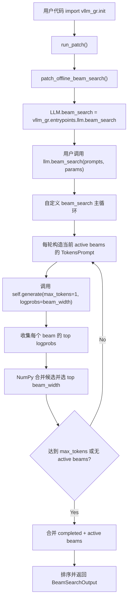
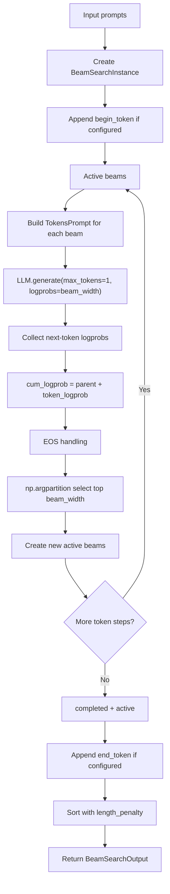

# Commit 057aeca Offline Beam Search Optimization Analysis

分析对象：

```text
057aeca408a4e5cb594b4401ad763f18301d9490
Speed up offline beam_search
AuthorDate: 2026-02-18
CommitDate: 2026-03-04
```

该 commit 位于上游 PR ref：

```text
remotes/up/pr/42
```

本文分析这个提交实现的原理、调用链、性能收益来源、测试验证方式，以及从当前代码视角看存在的实现风险。

## 1. Commit 做了什么

该提交的核心目标是：

**为 offline `LLM.beam_search` 增加 vLLM-GR 专用实现，用更适合生成式推荐大 beam width、短 decode 的方式加速离线 beam search。**

涉及文件：

| 文件 | 变化 | 作用 |
| --- | --- | --- |
| `vllm_gr/entrypoints/llm.py` | 新增 | 实现 offline beam search 替换函数 |
| `vllm_gr/entrypoints/beam_search_patch.py` | 新增 | 把 `vllm.entrypoints.llm.LLM.beam_search` monkey patch 成新实现 |
| `vllm_gr/init.py` | 新增 | import 时自动调用 `run_patch()` |
| `vllm_gr/patch.py` | 修改 | `run_patch()` 增加 offline beam search patch |
| `tests/test_offline_beam_search.py` | 新增 | 增加 offline 原生 / vLLM-GR beam search 对比和内存回归测试 |
| `examples/offline_inference/beam_search/*` | 新增 | 增加 offline beam search 示例 |
| `tests/resources/single_one_rec_prompt.txt` | 新增 | 统一测试 prompt |
| `tests/prompt.txt` | 删除 | prompt 资源迁移到 `tests/resources` |
| `tests/test_serving_beam_search.py` | 修改 | online serving 测试使用新的 prompt 路径 |
| `examples/online_serving/beam_search/*` | 修改 | online 示例复用 prompt 文件，修正端口和调用方式 |

核心代码是：

```text
vllm_gr/entrypoints/llm.py
```

它新增了一个自定义 `beam_search()` 函数，并通过：

```python
LLM.beam_search = beam_search
```

替换 vLLM 原始 offline `LLM.beam_search`。

## 2. 这个提交的背景

OpenOneRec 生成式推荐推理的典型特征：

- prompt 很长，包含用户历史和大量 SID。
- beam width 很大，例如 128 / 512。
- decode 很短，典型 `max_tokens=5`。
- 输出是结构化 SID，常见形式：

```text
<|sid_begin|><s_a_x><s_b_y><s_c_z><|sid_end|>
```

普通 beam search 更像通用文本生成逻辑。对于这种“长 prompt + 大 beam + 短 decode”的场景，性能瓶颈会集中在：

- 每轮 beam 扩展时构造大量 beam prompt。
- 每个 beam 调用一次生成接口。
- 每步都需要从每个 beam 的 top logprobs 中合并候选。
- beam 候选排序和 logprobs 处理开销。

该 commit 没有改模型，也没有改 kernel；它改的是 offline Python 层 beam search 调度方式。

## 3. Patch 入口原理

### 3.1 新增 vllm_gr/init.py

文件：

```text
vllm_gr/init.py
```

代码逻辑：

```python
import os
from vllm_gr.patch import run_patch

if os.getenv("VLLM_GR_AUTOPATCH", "1").lower() not in ("0", "false", "no"):
    run_patch()
```

含义：

- 用户只要执行 `import vllm_gr.init`，就会自动 patch vLLM。
- 可以通过环境变量关闭自动 patch：

```bash
VLLM_GR_AUTOPATCH=0
```

### 3.2 新增 offline patch 文件

文件：

```text
vllm_gr/entrypoints/beam_search_patch.py
```

代码逻辑：

```python
from vllm.entrypoints.llm import LLM
from vllm_gr.entrypoints.llm import beam_search

def patch_offline_beam_search():
    LLM.beam_search = beam_search
```

含义：

- 直接替换 vLLM 的 `LLM.beam_search` 方法。
- 替换后，所有已导入的 `LLM` 类调用 `llm.beam_search(...)` 都会进入 `vllm_gr.entrypoints.llm.beam_search`。

### 3.3 run_patch 增加 offline patch

修改前：

```python
def run_patch():
    patch_beam_search()
    patch_sampling()
```

修改后：

```python
def run_patch():
    patch_beam_search()
    patch_sampling()
    patch_offline_beam_search()
```

其中：

- `patch_beam_search()` 是 online OpenAI serving beam search patch。
- `patch_sampling()` 是 online request 参数转换 patch。
- `patch_offline_beam_search()` 是本 commit 新增的 offline `LLM.beam_search` patch。

## 4. 总体调用链

启用该 commit 后，offline beam search 的调用链如下：



关键变化是：

**不让 vLLM 原始 `LLM.beam_search` 控制流程，而是在 vLLM-GR 自己的 Python 函数里逐 token 调 `self.generate()`。**

## 5. 核心实现详解

核心函数签名：

```python
def beam_search(
    self,
    prompts: list[TokensPrompt | TextPrompt],
    params: BeamSearchParams,
    lora_request: list[LoRARequest] | LoRARequest | None = None,
    use_tqdm: bool = False,
    concurrency_limit: int | None = None,
) -> list[BeamSearchOutput]:
```

它保持了 vLLM `LLM.beam_search` 的接口形态，因此可以直接 monkey patch。

## 6. 参数解析

函数一开始读取：

```python
beam_width = params.beam_width
max_tokens = params.max_tokens
temperature = params.temperature
ignore_eos = params.ignore_eos
length_penalty = params.length_penalty
begin_token = params.begin_token if hasattr(params, "begin_token") else None
end_token = params.end_token if hasattr(params, "end_token") else None
```

这里有两个兼容点：

1. 兼容 vLLM 原生 `BeamSearchParams`。
2. 如果 `BeamSearchParams` 被 vLLM-GR 扩展过，则支持 `begin_token` / `end_token`。

`begin_token` / `end_token` 是 OpenOneRec SID 输出所需的特殊 token：

```text
<|sid_begin|>
<|sid_end|>
```

## 7. begin_token / end_token 处理

提交中对 begin/end token 做了 tokenizer id 转换：

```python
sid_begin_token_id = tokenizer.convert_tokens_to_ids(begin_token)
sid_end_token_id = tokenizer.convert_tokens_to_ids(end_token)
```

如果 token 不合法，会打印 warning 并置 None。

begin token 的作用：

- 初始化时追加到 prompt token 后面。
- 让模型从 SID 起始符之后继续生成。

end token 的作用：

- 最终追加到 completed beams 上。
- 保证输出格式统一。

预留 token 数：

```python
pre_calc = 0 if sid_begin_token_id is None else 1
if sid_end_token_id is not None:
    pre_calc += 1
```

实际模型 decode 轮数：

```python
max_tokens - pre_calc
```

也就是说，如果 `max_tokens=5`，且 begin/end token 都存在，那么模型实际只生成 3 个 token：

```text
begin token: 1
model generated SID body: 3
end token: 1
total: 5
```

## 8. 内部 SamplingParams

该 commit 的关键设计是内部每轮只生成一个 token：

```python
beam_search_params = SamplingParams(
    logprobs=beam_width,
    max_tokens=1,
    temperature=temperature,
    skip_clone=True,
    detokenize=False,
)
```

参数含义：

| 参数 | 含义 | 为什么这样设置 |
| --- | --- | --- |
| `logprobs=beam_width` | 每个 beam 返回 top beam_width 候选 token | beam search 每轮需要扩展候选 |
| `max_tokens=1` | 每次只生成 1 个 token | 外层 beam loop 自己控制步数 |
| `temperature=temperature` | 保持用户配置 | 不改变采样温度语义 |
| `skip_clone=True` | 跳过 SamplingParams clone | 内部复用参数，减少对象复制 |
| `detokenize=False` | 不在每步 detokenize | 最终 best beams 再 decode |

这是性能优化的核心之一。

原理：

- beam search 的本质是逐步扩展。
- 每步只需要当前 beam 的 next-token 分布。
- 不需要每个 step 都生成完整文本。
- 不需要每个 step 都 decode 文本。

## 9. BeamSearchInstance 初始化

对每个 prompt：

1. 提取多模态字段：

```python
multi_modal_data
mm_processor_kwargs
```

2. 获取 prompt tokens：

```python
if "prompt_token_ids" in prompt:
    prompt_tokens = prompt["prompt_token_ids"]
else:
    prompt_tokens = tokenizer.encode(prompt["prompt"])
```

3. 如有 begin token，则追加：

```python
prompt_tokens.append(sid_begin_token_id)
initial_logprobs.append({sid_begin_token_id: Logprob(logprob=0.0)})
```

4. 创建 `BeamSearchInstance`：

```python
BeamSearchInstance(
    prompt_tokens,
    lora_request=lora_req,
    logprobs=initial_logprobs,
    **mm_kwargs,
)
```

每个 instance 初始只有一个 beam，即原始 prompt 对应的 beam。

## 10. concurrency_limit 的批处理逻辑

该实现支持：

```python
concurrency_limit
```

如果用户不传：

```python
concurrency_limit = len(prompts)
```

之后按 prompt 维度分批：

```python
for prompt_start in range(0, len(prompts), concurrency_limit):
    instances_batch = instances[prompt_start : prompt_start + concurrency_limit]
```

这控制的是同时处理多少个输入 prompt，而不是单个 prompt 内 beam width。

如果 `use_tqdm=True` 且 `concurrency_limit` 非空，代码会关闭进度条，因为分批并发时进度条语义不准确。

## 11. 每轮 beam 扩展流程

每个 token step 内部流程：

### 11.1 收集当前所有 active beams

```python
all_beams = list(sum((instance.beams for instance in instances_batch), []))
```

同时计算每个 instance 在 `all_beams` 中的起止位置：

```python
pos = [0] + list(itertools.accumulate(len(instance.beams) for instance in instances_batch))
instance_start_and_end = list(zip(pos[:-1], pos[1:]))
```

原因：

- `self.generate()` 是对所有 active beams 统一调用。
- 返回后还要按原始 prompt instance 切分回去。

### 11.2 当前 beam 转成 TokensPrompt

每个 beam 当前 tokens 都变成一个新的 prompt：

```python
TokensPrompt(prompt_token_ids=beam.tokens)
```

如果 beam 携带多模态字段，也一并传入：

```python
multi_modal_data
mm_processor_kwargs
```

### 11.3 调用 self.generate

```python
output = self.generate(
    prompts_batch,
    sampling_params=beam_search_params,
    use_tqdm=False,
    lora_request=lora_req_batch,
)
```

注意：

- 这里每个 active beam 都作为一个 prompt。
- 每个 prompt 只生成 1 个 token。
- 每个 prompt 返回 top `beam_width` logprobs。

### 11.4 聚合候选 token 和累计 logprob

对每个 beam 输出：

```python
logprobs = result.outputs[0].logprobs[0]
```

截断到 `beam_width`：

```python
if len(logprobs) > logprobs_num:
    logprobs = dict(list(logprobs.items())[:logprobs_num])
```

收集候选 token id：

```python
all_beams_token_id.extend(list(logprobs.keys()))
```

累计分数：

```python
current_beam.cum_logprob + obj.logprob
```

最终形成两个数组：

```python
all_beams_token_id = np.array(all_beams_token_id)
all_beams_logprob = np.array(all_beams_logprob)
```

## 12. EOS 处理

如果 `ignore_eos=False`：

```python
eos_idx = np.where(all_beams_token_id == tokenizer.eos_token_id)[0]
```

对于 EOS 候选：

- 创建 completed beam。
- `finish_reason="stop"`。
- `stop_reason=tokenizer.eos_token_id`。
- 放入 `instance.completed`。

然后把 EOS 候选分数置为负无穷，避免继续扩展：

```python
all_beams_logprob[eos_idx] = -np.inf
```

含义：

- EOS beam 已完成。
- 不再进入下一轮 active beams。

## 13. Top beam 选择优化

该 commit 使用 NumPy `argpartition` 选 top beams：

```python
topn_idx = np.argpartition(np.negative(all_beams_logprob), beam_width)[:beam_width]
```

为什么用 `argpartition`：

- 完整排序复杂度约为 `O(N log N)`。
- 只取 top-k 时，partition 更接近 `O(N)`。
- 对大 beam width 更合适。

候选数规模：

```text
候选数 = 当前 active beams 数 * beam_width
```

当 `beam_width=512` 时，每轮候选数可能是：

```text
512 * 512 = 262144
```

对这种规模，避免完整排序是合理的。

## 14. 新 beam 构造

对每个选中的候选：

```python
beam_idx = idx // beam_width
token_pos = idx % beam_width
current_beam = all_beams[start:end][beam_idx]
```

创建新 beam：

```python
BeamSearchSequence(
    tokens=current_beam.tokens + [int(all_beams_token_id[idx])],
    logprobs=current_beam.logprobs + [logprobs_entry],
    cum_logprob=float(all_beams_logprob[idx]),
    multi_modal_data=current_beam.multi_modal_data,
    mm_processor_kwargs=current_beam.mm_processor_kwargs,
    lora_request=current_beam.lora_request,
)
```

然后：

```python
instance.beams = new_beams
```

这样下一轮只会扩展 top `beam_width` 个 active beams。

## 15. 结束阶段

所有 token steps 结束后：

1. 把剩余 active beams 加入 completed：

```python
instance.completed.extend(instance.beams)
```

2. 如果有 end token，则追加到所有 completed beams：

```python
beam.tokens.append(sid_end_token_id)
beam.logprobs.append({sid_end_token_id: Logprob(logprob=0.0)})
```

3. 按 vLLM 原始排序规则排序：

```python
sort_beams_key = create_sort_beams_key_function(tokenizer.eos_token_id, length_penalty)
sorted_completed = sorted(instance.completed, key=sort_beams_key, reverse=True)
```

4. 取 top `beam_width`：

```python
best_beams = sorted_completed[:beam_width]
```

5. 最终 decode：

```python
beam.text = tokenizer.decode(beam.tokens)
```

6. 返回：

```python
BeamSearchOutput(sequences=best_beams)
```

## 16. 原理图

### 16.1 整体流程



### 16.2 每轮候选合并

```text
Step t active beams:

Beam 0 score = S0
  top tokens: a, b, c ...
  candidate scores: S0+lp(a), S0+lp(b), S0+lp(c)

Beam 1 score = S1
  top tokens: d, e, f ...
  candidate scores: S1+lp(d), S1+lp(e), S1+lp(f)

...

All candidates -> np.argpartition -> keep top beam_width
```

### 16.3 begin/end token 预算

```text
max_tokens = 5
begin_token exists
end_token exists

Actual generated by model = 5 - 1 - 1 = 3

Final output:
  begin_token + generated_1 + generated_2 + generated_3 + end_token
```

## 17. 性能收益来源

该 commit 的优化主要来自 Python / offline orchestration 层。

### 17.1 每步只生成一个 token

生成式推荐 decode 短，beam search 自己控制扩展逻辑，每轮只需要 next-token 分布。

收益：

- 避免 vLLM 内部生成多 token 后再处理 beam。
- 更贴合 beam search 的逐步扩展语义。

### 17.2 detokenize=False

每步只需要 token id 和 logprob，不需要文本。

收益：

- 避免每轮对每个 beam 做 decode。
- 最终只对 best beams decode。

### 17.3 skip_clone=True

`SamplingParams` 在内部循环中重复使用。

收益：

- 减少参数对象复制。

### 17.4 logprobs=beam_width

每个 beam 只取扩展所需的 top `beam_width` token。

收益：

- 避免返回过多 logprobs。
- 配合 `max_logprobs=beam_width` 降低 vLLM 输出处理开销。

测试文件中特意写了：

```python
max_logprobs = beam_width if use_patch else 2 * beam_width
```

说明该 patch 设计目标之一是让 vLLM-GR 路径只需要 `beam_width` 个 logprobs，而不是原始路径常用的 `2 * beam_width`。

### 17.5 NumPy argpartition

只取 top-k，不做完整排序。

收益：

- 大 beam width 下候选选择更快。

### 17.6 统一 prompt 资源

把长 prompt 移到：

```text
tests/resources/single_one_rec_prompt.txt
```

收益不是性能本身，而是让 offline / online 示例和测试复用同一个长推荐 prompt，方便稳定复现。

## 18. 示例脚本

新增：

```text
examples/offline_inference/beam_search/offline_beam_search.py
```

运行示例：

```bash
python offline_beam_search.py \
    --model OpenOneRec/OneRec-1.7B \
    --beam_width 128 \
    --compare latency
```

示例逻辑：

1. 先创建原生 vLLM `LLM`。
2. 如果 `compare != "none"`，先调用原始 `llm.beam_search()` 测 vanilla vLLM。
3. 再 `import vllm_gr.init`，触发 patch。
4. 再次调用同一个 `llm.beam_search()`，此时方法已被替换。
5. 输出 vanilla 和 vLLM-GR 的耗时。

README 中给出的示例结果：

```text
Vanilla vLLM with BW=128 took 4.882346 seconds
vLLM-gr with BW=128 took 0.627150 seconds
```

这说明该 commit 在作者环境中对 offline beam search 有明显加速。

注意：这是示例输出，不应直接当作所有环境的固定收益。实际收益取决于模型、GPU/NPU、beam width、prompt 长度、vLLM 版本和 `max_logprobs` 设置。

## 19. 测试设计

新增测试：

```text
tests/test_offline_beam_search.py
```

测试包含两条路径：

### 19.1 原生 offline beam search

```python
test_offline_beam_search
```

调用：

```python
_run_offline_beam_search(loops, use_patch=False)
```

用于确认 vanilla vLLM 原始 beam search 可运行。

### 19.2 vLLM-GR offline beam search

```python
test_offline_gr_beam_search
```

调用：

```python
_run_offline_beam_search(loops, use_patch=True)
_run_offline_beam_search(loops, use_patch=True)
```

测试点：

- `import vllm_gr.init` 后 `BeamSearchParams` 有 `begin_token`。
- 输出数量等于 `beam_width`。
- 多次运行后 host/GPU memory delta 不超过阈值。

内存阈值：

```python
host <= 500 MB
gpu <= 50 MB
```

这些阈值用于粗略防止内存泄漏。

### 19.3 CUDA 条件

测试文件开头：

```python
if not torch.cuda.is_available():
    pytest.skip("CUDA is not available", allow_module_level=True)
```

说明该测试在没有 CUDA 时跳过。

虽然这个 commit 的核心优化是 Python 层 offline beam search，但测试基于 OpenOneRec/OneRec-1.7B 实际 GPU 推理，因此要求 CUDA。

## 20. 与后续版本的关系

这个 commit 是早期 offline beam search 加速。当前 `main` 上已经在此基础上继续演进，后续重要变化包括：

- 使用 `FlatLogprobs` 替代 dict logprobs。
- 延迟 logprobs 重建，减少中间 beam 复制。
- online 路径增加 `ADD_BATCH` / `BEAM_FORK`。
- scheduler computed blocks cache。
- GPU BeamAttention。
- catalog 约束。

因此，`057aeca` 可以看作：

**vLLM-GR 离线 beam search 优化的第一阶段：先把 offline `LLM.beam_search` 从 vLLM 原始实现替换为面向推荐场景的逐 token、top-k 扩展循环。**

后续提交在它基础上继续解决：

- logprobs 数据结构效率。
- online serving request 提交效率。
- KV cache / prefix cache / attention 共享。

## 21. 实现风险和代码问题

从当前视角看，这个 commit 的实现有几个需要注意的问题。

### 21.1 logprobs 判断条件疑似错误

代码片段：

```python
if (result.outputs[0].logprobs is not None) or (
    len(result.outputs[0].logprobs[0]) < logprobs_num
):
    ...
else:
    raise ValueError(...)
```

这里很可能本意是：

```python
if result.outputs[0].logprobs is not None and len(result.outputs[0].logprobs[0]) >= logprobs_num:
    ...
```

当前写法的问题：

- 如果 `logprobs is not None`，条件直接为 True，即使 logprobs 数量不足也会进入处理。
- 如果 `logprobs is None`，会继续求 `len(result.outputs[0].logprobs[0])`，导致 None 访问异常。

后续版本已经重写了这部分逻辑。

### 21.2 logprobs_entry 类型可能不一致

代码中：

```python
logprobs_entry = list(result.outputs[0].logprobs[0].values())[token_pos]
logprobs=current_beam.logprobs + [logprobs_entry]
```

但 vLLM `BeamSearchSequence.logprobs` 通常期望的是：

```python
list[dict[int, Logprob]]
```

这里追加的是单个 `Logprob` 对象，而不是 `{token_id: Logprob}` 字典。

同一 commit 的 begin/end token 追加使用的是：

```python
{sid_token_id: Logprob(logprob=0.0)}
```

因此中间生成 token 和 begin/end token 的 logprobs 结构可能不一致。

后续版本改为 `FlatLogprobs`，规避了这个问题。

### 21.3 end_token 被追加到所有 completed beams

结束时逻辑：

```python
instance.completed.extend(instance.beams)
if sid_end_token_id is not None:
    for beam in instance.completed:
        beam.tokens.append(sid_end_token_id)
```

这意味着即使某个 beam 已经因为 EOS 完成，也会追加 SID end token。

在生成式推荐 SID 格式下这可能是想要的，因为 end token 是业务结构符；但如果和通用 EOS 语义混用，可能会导致 stop beam 也追加额外 token。

后续版本已经调整为只给 active beams 追加 end token，避免自然 EOS completed beams 被改写。

### 21.4 每轮仍然把每个 active beam 作为完整 prompt 调 generate

这个 commit 优化了 offline Python beam search，但还没有解决更深层问题：

- 每步仍为每个 active beam 构造 `TokensPrompt`。
- 每步仍将每个 beam 作为独立 prompt 传给 `self.generate`。
- 没有 engine 级 `BEAM_FORK`。
- 没有复用父 beam block hashes。
- 没有 scheduler beam prefix group。
- 没有 BeamAttention。

也就是说，这个 commit 是 offline 层优化，不是完整的 beam-aware engine 优化。

### 21.5 monkey patch 粒度较粗

直接做：

```python
LLM.beam_search = beam_search
```

优点：

- 接入简单。
- 用户无需改调用代码。

风险：

- 强依赖 vLLM `LLM.beam_search` 接口兼容。
- 如果上游 vLLM 改了返回结构、BeamSearchSequence 字段或 SamplingParams 行为，patch 可能失效。

## 22. 该 commit 的核心价值

该 commit 的价值可以总结为三点：

1. **首次把 vLLM-GR 的优化从 online serving 扩展到 offline `LLM.beam_search`。**

   用户可以在不启动 OpenAI server 的情况下，直接用 Python `LLM` 接口跑更快的 beam search。

2. **把 beam search 改成显式逐 token 扩展。**

   每步 `max_tokens=1`，用 `logprobs=beam_width` 拿候选，再由外层自己维护 beams。这种写法更适合 OpenOneRec 这类短 SID 生成。

3. **建立了后续优化的基础。**

   后续的 `FlatLogprobs`、延迟 logprobs 重建、online `ADD_BATCH` / `BEAM_FORK` 都是在这个“自定义 beam loop”思想上继续深化。

## 23. 适合汇报的一页总结

### 标题

Commit 057aeca：加速 offline Beam Search

### 背景

OpenOneRec 推理使用大 beam width 和短 SID decode，原始 vLLM offline beam search 在 Python 层和 logprobs 处理上有较高开销。

### 改动

- 新增 `vllm_gr.entrypoints.llm.beam_search`。
- 新增 `patch_offline_beam_search()`，替换 `LLM.beam_search`。
- 新增 `vllm_gr.init`，支持 import 自动 patch。
- 新增 offline benchmark 示例和测试。

### 原理

- 外层 Python 控制 beam search。
- 内层每步调用 `LLM.generate(max_tokens=1, logprobs=beam_width, detokenize=False)`。
- 收集所有 active beams 的 next-token logprobs。
- 用累计 logprob 合并候选。
- 用 `np.argpartition` 选 top beams。
- 最终排序、decode 并返回。

### 收益

- 减少每步 detokenize。
- 减少 SamplingParams clone。
- 只请求 beam search 必要的 top logprobs。
- top-k 选择避免全量排序。
- 对大 beam width、短 decode 的推荐推理更友好。

### 局限

- 仍然是 Python 层优化，没有 engine 级 state fork。
- 每个 active beam 仍作为完整 prompt 调 `generate`。
- 该 commit 中 logprobs 判断和 logprobs_entry 结构存在实现风险。
- 后续提交已用 FlatLogprobs、ADD_BATCH、BEAM_FORK 等继续改进。

## 24. 建议阅读代码顺序

1. `vllm_gr/patch.py`
   - 看 `run_patch()` 如何接入 offline patch。

2. `vllm_gr/init.py`
   - 看 import 自动 patch 机制。

3. `vllm_gr/entrypoints/beam_search_patch.py`
   - 看 `LLM.beam_search` 替换点。

4. `vllm_gr/entrypoints/llm.py`
   - 逐行看自定义 beam search 实现。

5. `examples/offline_inference/beam_search/offline_beam_search.py`
   - 看如何对比 vanilla vLLM 和 vLLM-GR。

6. `tests/test_offline_beam_search.py`
   - 看功能、性能和内存回归验证思路。

## 25. 后续演进建议

如果以该 commit 为起点继续优化，可以按下面路线推进：

1. 修正 logprobs 判断条件和数据结构一致性。
2. 使用 FlatLogprobs 替代 dict logprobs。
3. 中间 beams 保存 parent pointer，最终再重建 logprobs。
4. offline 路径尝试复用 engine 级 fork 能力，减少完整 prompt 重交。
5. 对 candidate selection 做 C++ / vectorized 优化。
6. 增加 profiling metrics：
   - generate time
   - logprobs extraction time
   - candidate selection time
   - beam object construction time
   - final decode time

当前 main 分支中的后续实现已经覆盖了其中一部分，尤其是 FlatLogprobs 和延迟重建。

