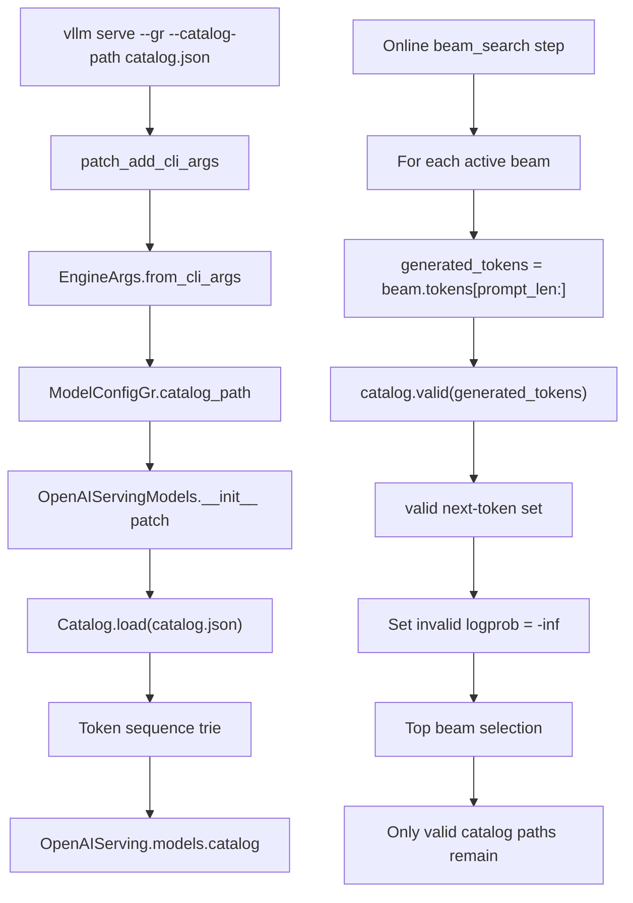
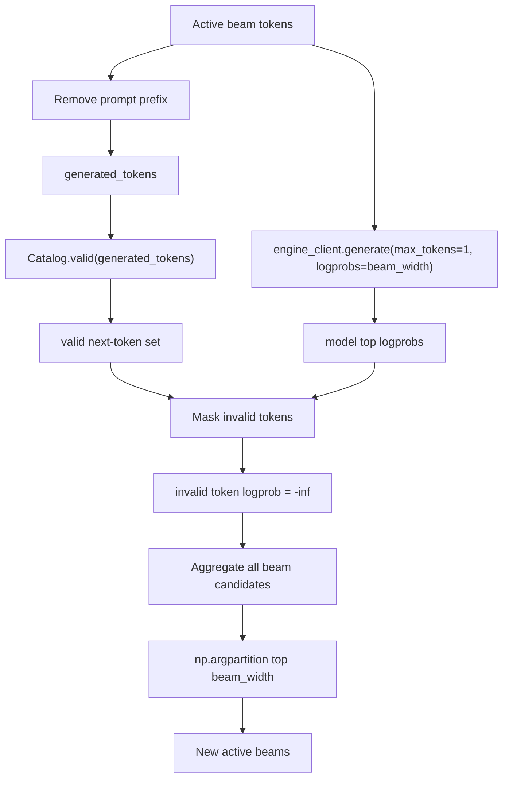

# Commit ff96657 Catalog Valid Constraint Analysis

分析对象：

```text
ff966578ba9f61ebe4c7a7edf41cc97f2320c48e
valid constraint (catalog)
AuthorDate: 2026-03-05
CommitDate: 2026-03-05
```

该 commit 位于上游 PR ref：

```text
remotes/up/pr/43
```

本文分析该提交实现的 catalog 合法性约束机制，包括实现原理、调用链、数据结构、在线 beam search 中的过滤逻辑、测试验证方式、收益来源和实现风险。

## 1. Commit 做了什么

该提交的核心目标是：

**在 online serving 的 beam search 中引入 catalog valid constraint，让模型只能生成 catalog 中存在的合法推荐 item/SID 路径。**

它新增了一个 `--catalog-path` 参数，服务启动时加载 catalog 文件，将 catalog 转成 token trie。beam search 每一步根据当前 beam 已生成 token 查询合法 next-token 集合，并把不合法候选 token 的 logprob 设置为 `-inf`，使 beam selection 不会选择 catalog 外路径。

涉及文件：

| 文件 | 变化 | 作用 |
| --- | --- | --- |
| `vllm_gr/engine/arg_utils.py` | 新增 | 给 vLLM EngineArgs / ModelConfig 注入 `--catalog-path` |
| `vllm_gr/entrypoints/openai/serving_models.py` | 新增 | 实现 `Catalog` trie，并 patch `OpenAIServingModels.__init__` 加载 catalog |
| `vllm_gr/entrypoints/openai/serving_engine.py` | 修改 | online beam search 中并行查询 catalog，屏蔽非法 token |
| `vllm_gr/patch.py` | 修改 | `run_patch()` 增加 CLI 参数 patch 和 serving models patch |
| `tests/test_catalog.py` | 新增 | 单元测试 `Catalog.valid()` |
| `tests/test_serving_catalog.py` | 新增 | 端到端验证 beam search 输出都在 catalog 中 |
| `examples/online_serving/catalog/README.md` | 新增 | catalog 使用说明 |
| `examples/online_serving/catalog/convert_catalog.py` | 新增 | 将 OpenOneRec sid2pid 转成 vLLM-GR catalog JSON |
| `examples/online_serving/catalog/verify_catalog.py` | 新增 | 验证在线 serving 输出是否都在 catalog 中 |
| `examples/online_serving/beam_search/*` | 修改 | 示例调整 |
| `vllm_gr/v1/metrics/stats.py` | 修改 | 增加 `num_generation_tokens` 指标 |

## 2. 业务背景

OpenOneRec 推荐任务生成的不是任意文本，而是结构化 item identifier，常见形式：

```text
<|sid_begin|><s_a_4910><s_b_1179><s_c_181><|sid_end|>
```

其中：

- `<|sid_begin|>`：推荐 item SID 开始 token。
- `<s_a_x>`：第一级 SID 分量。
- `<s_b_y>`：第二级 SID 分量。
- `<s_c_z>`：第三级 SID 分量。
- `<|sid_end|>`：推荐 item SID 结束 token。

问题是：

- 模型可能生成不存在于 item catalog 的 SID。
- beam search 的 beam width 很大，如果大量 beams 被无效 item 占用，会降低有效推荐候选质量。
- 生成式推荐的目标是从真实 item 集合中选出 top-k，而不是生成任意 token 序列。

因此，这个 commit 引入 catalog constraint：

**每一步只允许当前 SID 前缀下仍可能形成合法 catalog item 的 next token 继续参与 beam selection。**

## 3. 总体架构

整体调用链如下：



该提交做了三层改造：

1. 参数层：新增 `--catalog-path`。
2. 模型服务层：加载 catalog 并挂到 `OpenAIServingModels`。
3. beam search 层：每轮用 catalog 过滤候选 token。

## 4. Catalog 数据格式

`Catalog.load()` 期望输入是 JSON list，每个元素是一条 token 序列：

```json
[
  ["<|sid_begin|>", "<s_a_4910>", "<s_b_1179>", "<s_c_181>", "<|sid_end|>"],
  ["<|sid_begin|>", "<s_a_4113>", "<s_b_1354>", "<s_c_7796>", "<|sid_end|>"]
]
```

也就是说，catalog 文件不是 item id 数字表，而是已经转换成 tokenizer token 字符串序列的合法 SID 列表。

服务启动后，会使用模型 tokenizer 将 token 字符串转成 token id：

```python
token_ids = self.tokenizer.convert_tokens_to_ids(seq)
```

然后构建 token id trie。

## 5. convert_catalog.py 原理

新增脚本：

```text
examples/online_serving/catalog/convert_catalog.py
```

作用：

**将 OpenOneRec 的 `sid2pid.json` 转换成 vLLM-GR catalog JSON 格式。**

OpenOneRec 原始 `sid2pid.json` 的 key 是一个整数 SID。脚本按 `BASE = 8192` 把整数 SID 解码成三段：

```python
BASE = 8192

val_a = key // (BASE * BASE)
val_b = (key % (BASE * BASE)) // BASE
val_c = key % BASE
```

然后生成：

```python
tokens = [
    "<|sid_begin|>",
    f"<s_a_{val_a}>",
    f"<s_b_{val_b}>",
    f"<s_c_{val_c}>",
    "<|sid_end|>",
]
```

示例：

```bash
python convert_catalog.py \
  ${OpenOneRecFolder}/benchmark_data/sid2pid.json \
  ${MyFolder}/catalog.json
```

### 解码公式图

```text
integer SID key
    |
    | BASE = 8192
    v
+---------+---------+---------+
|  val_a  |  val_b  |  val_c  |
+---------+---------+---------+
    |         |         |
    v         v         v
<s_a_x>   <s_b_y>   <s_c_z>
```

## 6. Catalog trie 实现

核心文件：

```text
vllm_gr/entrypoints/openai/serving_models.py
```

核心类：

```python
class Catalog:
    def __init__(self, tokenizer):
        self.tokenizer = tokenizer
        self.trie: dict[int, Any] = {}
```

### 6.1 load(path)

加载流程：

1. 读取 catalog JSON。
2. 遍历每条 token 序列。
3. tokenizer 将 token 字符串转成 token id。
4. 按 token id 插入 trie。

伪代码：

```python
for seq in catalog_data:
    token_ids = tokenizer.convert_tokens_to_ids(seq)
    node = self.trie
    for token_id in token_ids:
        if token_id not in node:
            node[token_id] = {}
        node = node[token_id]
```

### 6.2 valid(token_ids)

`valid()` 输入当前已经生成的 token id 前缀，返回下一步合法 token id 集合。

代码逻辑：

```python
def valid(self, token_ids: list[int]) -> set[int]:
    node = self.trie
    for tid in token_ids:
        if tid in node:
            node = node[tid]
        else:
            return set()
    return set(node.keys())
```

含义：

- 如果当前 prefix 在 trie 中存在，返回该 prefix 下所有 child token。
- 如果当前 prefix 不存在，返回空集合。
- 如果 prefix 已经是完整 item，当前节点没有 child，也返回空集合。

### 6.3 trie 示例

假设 catalog：

```json
[
  ["1", "2", "3", "4", "5"],
  ["1", "2", "3", "6", "7"],
  ["8", "9", "10", "11", "12"]
]
```

trie 结构：

```text
root
├── 1
│   └── 2
│       └── 3
│           ├── 4
│           │   └── 5
│           └── 6
│               └── 7
└── 8
    └── 9
        └── 10
            └── 11
                └── 12
```

查询结果：

| 当前 prefix | `valid(prefix)` |
| --- | --- |
| `[]` | `{1, 8}` |
| `[1, 2, 3]` | `{4, 6}` |
| `[1, 2, 3, 4]` | `{5}` |
| `[1, 2, 3, 4, 5]` | `{}` |
| `[99]` | `{}` |

这正是 `tests/test_catalog.py` 覆盖的行为。

## 7. --catalog-path 参数注入

新增文件：

```text
vllm_gr/engine/arg_utils.py
```

这个文件通过 monkey patch vLLM 的 `EngineArgs`，把 catalog path 加入 vLLM server 参数体系。

### 7.1 ModelConfigGr

新增：

```python
@dataclass
class ModelConfigGr(ModelConfig):
    catalog_path: str | None = None
```

### 7.2 patch add_cli_args

原始：

```python
EngineArgs.add_cli_args
```

被替换为：

```python
def add_cli_args(parser):
    parser = origin_add_cli_args(parser)
    model_kwargs = get_kwargs(ModelConfigGr)
    model_group = parser.add_argument_group(...)
    model_group.add_argument("--catalog-path", **model_kwargs["catalog_path"])
    return parser
```

效果：

```bash
vllm serve --gr --catalog-path /path/to/catalog.json OpenOneRec/OneRec-1.7B
```

可以被 CLI parser 正确识别。

### 7.3 patch create_model_config

原始 `EngineArgs.create_model_config()` 会创建 vLLM `ModelConfig`。

该 commit patch 后：

```python
config = origin_create_model_config(self)
config.__class__ = ModelConfigGr
config.catalog_path = getattr(self, "catalog_path", None)
```

含义：

- 不重新创建完整 ModelConfig。
- 直接把已有 config 的 `__class__` 改成 `ModelConfigGr`。
- 再挂上 `catalog_path` 字段。

这种写法简单，但也比较依赖 Python dataclass / vLLM config 的运行时行为。

### 7.4 patch from_cli_args

```python
engine_args = origin_from_cli_args(cls, args)
engine_args.catalog_path = getattr(args, "catalog_path", None)
```

作用：

- CLI 解析出来的 `args.catalog_path` 被放到 `EngineArgs` 实例上。
- 后续 `create_model_config()` 再把它转移到 `ModelConfigGr`。

### 7.5 patch_add_cli_args

统一入口：

```python
def patch_add_cli_args():
    EngineArgs.add_cli_args = add_cli_args
    EngineArgs.create_model_config = create_model_config
    EngineArgs.from_cli_args = classmethod(from_cli_args)
```

`run_patch()` 中新增调用：

```python
patch_add_cli_args()
```

## 8. OpenAIServingModels 加载 catalog

新增文件：

```text
vllm_gr/entrypoints/openai/serving_models.py
```

核心 patch：

```python
_original_init = OpenAIServingModels.__init__

def init_gr(...):
    _original_init(...)
    self.catalog = None
    tokenizer = self.input_processor.tokenizer
    catalog_path = getattr(getattr(self, "model_config", None), "catalog_path", None)
    if catalog_path:
        self.catalog = Catalog(tokenizer)
        self.catalog.load(catalog_path)

def patch_OpenAIServingModels_init():
    OpenAIServingModels.__init__ = init_gr
```

含义：

- 原始 `OpenAIServingModels` 初始化完成后，再挂一个 `catalog` 属性。
- 如果 `model_config.catalog_path` 存在，则加载 catalog。
- 后续 online serving 的 `OpenAIServing` 可以通过：

```python
self.models.catalog
```

访问 catalog。

`run_patch()` 中新增：

```python
patch_OpenAIServingModels_init()
```

## 9. Online beam search 中的 catalog 约束

核心修改文件：

```text
vllm_gr/entrypoints/openai/serving_engine.py
```

该 commit 修改的是 online `OpenAIServing.beam_search` 路径，不是 offline `LLM.beam_search` 路径。

### 9.1 为每个 active beam 创建 catalog task

在每个 token step 中，原本已经为每个 beam 创建模型生成 task：

```python
tasks = []
for i, (individual_prompt, lora_req) in enumerate(...):
    task = asyncio.create_task(
        collect_from_async_generator(
            self.engine_client.generate(...)
        )
    )
    tasks.append(task)
```

该 commit 新增：

```python
catalog_tasks = []
if self.models.catalog is not None:

    def get_valid_tokens_set(beam) -> set[int]:
        generated_tokens = beam.tokens[len(prompt_token_ids):]
        return self.models.catalog.valid(generated_tokens)

    for beam in all_beams:
        catalog_tasks.append(asyncio.to_thread(get_valid_tokens_set, beam))
```

关键点：

- `generated_tokens = beam.tokens[len(prompt_token_ids):]`
- 只取 prompt 后面已经生成的 token。
- 用这些 token 作为 SID prefix 查询 catalog。

如果 prompt token 已经是用户历史，不能拿整个 beam.tokens 查 catalog；必须去掉 prompt 部分，只查生成出的推荐 SID 前缀。

### 9.2 catalog 查询与模型生成并行

原本：

```python
output = [x[0] for x in await asyncio.gather(*tasks)]
```

修改后：

```python
if catalog_tasks:
    all_results = await asyncio.gather(*(tasks + catalog_tasks))
    output = [x[0] for x in all_results[: len(tasks)]]
    valid_tokens_sets = all_results[len(tasks):]
else:
    output = [x[0] for x in await asyncio.gather(*tasks)]
```

含义：

- 模型生成 task 和 catalog 查询 task 一起 `gather`。
- catalog 查询用 `asyncio.to_thread` 放到线程池，不阻塞 event loop。
- 这样 CPU trie 查询可以和模型推理等待时间重叠。

这是一个重要设计：catalog 约束不是等模型返回后才开始查，而是和模型 forward 并行查合法 next-token 集合。

### 9.3 屏蔽非法 token

模型输出后，对每个 beam 的 logprobs 做过滤：

```python
if self.models.catalog is not None and catalog_tasks:
    valid_tokens_set = valid_tokens_sets[i]
    for token_id in list(logprobs.keys()):
        if token_id not in valid_tokens_set:
            logprobs[token_id].logprob = -float("inf")
```

含义：

- 模型仍然返回 top-k logprobs。
- serving 层不改模型 logits，也不改 sampler。
- 只是在 beam search 选择前，把 catalog 外 token 的 logprob 改成 `-inf`。
- 这样 top beam selection 不会选择非法 token。

### 9.4 后续 top-k 选择

该 commit 同时把原先依赖 `minheap_cpp` 的 top beam 选择改回 NumPy `argpartition`：

```python
if all_beams_logprob.size > beam_width:
    topn_idx = np.argpartition(np.negative(all_beams_logprob), beam_width)[:beam_width]
else:
    topn_idx = np.arange(all_beams_logprob.size)
```

原因从 diff 看没有明确说明，但这能避免 catalog 过滤后还依赖 `minheap_cpp` 扩展。屏蔽为 `-inf` 后，`argpartition` 会自然把较高分候选选出来。

### 9.5 EOS 修正

该 commit 增加：

```python
all_beams_logprob[eos_idx] = -np.inf
```

之前 EOS 被加入 completed 后，如果不把分数置为 `-inf`，可能仍然进入 active beam 扩展路径。这个改动保证：

- EOS candidate 只进入 completed。
- 不继续扩展。

## 10. Beam search + Catalog 流程图



## 11. 具体例子

假设 catalog 中有：

```text
<|sid_begin|><s_a_1><s_b_3><s_c_8><|sid_end|>
<|sid_begin|><s_a_1><s_b_4><s_c_2><|sid_end|>
<|sid_begin|><s_a_2><s_b_9><s_c_5><|sid_end|>
```

当当前 beam 已生成：

```text
<|sid_begin|><s_a_1>
```

对应 token ids prefix 查 catalog，合法 next tokens 是：

```text
{<s_b_3>, <s_b_4>}
```

如果模型 top logprobs 返回：

| token | logprob |
| --- | --- |
| `<s_b_3>` | -0.2 |
| `<s_b_7>` | -0.3 |
| `<s_b_4>` | -0.5 |
| `<s_b_9>` | -0.7 |

catalog 过滤后：

| token | logprob |
| --- | --- |
| `<s_b_3>` | -0.2 |
| `<s_b_7>` | `-inf` |
| `<s_b_4>` | -0.5 |
| `<s_b_9>` | `-inf` |

最终 beam selection 只能选择 `<s_b_3>` 或 `<s_b_4>`。

## 12. 测试详解

### 12.1 Catalog 单元测试

文件：

```text
tests/test_catalog.py
```

测试用 mock tokenizer 把字符串数字转成 int：

```python
["1", "2", "3"] -> [1, 2, 3]
```

catalog 数据：

```python
[
    ["1", "2", "3", "4", "5"],
    ["1", "2", "3", "6", "7"],
    ["8", "9", "10", "11", "12"],
]
```

验证：

- 空 prefix 返回 `{1, 8}`。
- `[1,2,3]` 返回 `{4,6}`。
- `[1,2,3,4]` 返回 `{5}`。
- 完整序列返回空集合。
- 非法 prefix 返回空集合。

这验证了 trie 行为正确。

### 12.2 Serving catalog 端到端测试

文件：

```text
tests/test_serving_catalog.py
```

测试逻辑：

1. 调用 `run_patch()`。
2. 构造临时 catalog JSON。
3. 创建 `AsyncEngineArgs`，设置：

```python
setattr(engine_args, "catalog_path", catalog_path)
```

4. 启动 async engine client。
5. 创建 `OpenAIServingModels`，触发 catalog load。
6. 构造 OpenOneRec prompt。
7. 使用 `beam_width=1024`、`max_tokens=5` 做 beam search。
8. 验证所有输出都在 catalog set 中。

测试中额外构造了很多共享前缀的 catalog item：

```python
["<|sid_begin|>", "<s_a_4247>", "<s_b_6120>", f"<s_c_{i}>", "<|sid_end|>"]
```

这有助于确保在某些前缀下存在大量合法候选。

### 12.3 verify_catalog.py

新增工具：

```text
examples/online_serving/catalog/verify_catalog.py
```

功能：

- 读取在线 serving 返回的 JSON。
- 读取 catalog JSON。
- 把 catalog 每条 token list join 成字符串。
- 遍历 response choices。
- 检查 `choice["message"]["content"]` 是否在 catalog set 中。

示例：

```bash
bash examples/online_serving/beam_search/client.sh > result.json
python examples/online_serving/catalog/verify_catalog.py result.json catalog.json
```

## 13. 指标变化

文件：

```text
vllm_gr/v1/metrics/stats.py
```

新增：

```python
num_generation_tokens: int = 0
```

serving beam search 中已有：

```python
num_generation_tokens += len(all_beams)
```

并最终写入：

```python
RequestStateStats(
    beam_search_overhead=...,
    beam_search_decode_time=...,
    num_generation_tokens=num_generation_tokens,
)
```

这个指标用于记录 beam search 中实际参与生成的 token 数量，方便后续分析 beam search decode 工作量和 overhead。

## 14. 性能和质量收益来源

### 14.1 质量收益

catalog constraint 最直接的收益是输出合法性：

- 不会返回 catalog 中不存在的 item。
- top-k 推荐候选都能映射回真实 item。
- 减少无效 SID 对指标的负面影响。

### 14.2 beam 利用率收益

没有 catalog 时：

```text
beam slots = valid candidates + invalid candidates
```

有 catalog 后：

```text
beam slots ≈ valid candidates only
```

因此同样的 beam width 下，有效候选更多。

### 14.3 潜在延迟收益

README 中说：

> Limiting the available items increases accuracy and enables reducing the search space to get the same accuracy but with less latency.

含义：

- 如果 catalog constraint 提升了有效 beam 利用率，可以用更小 beam width 达到同样 accuracy。
- beam width 降低后，推理延迟会下降。

注意：该 commit 的实现是在模型返回 top logprobs 后屏蔽非法 token，并不是在模型 logits/sampling 前缩小词表。因此单次模型 forward 的词表计算没有减少。延迟收益主要来自：

- 可以降低 beam width。
- 避免无效路径继续扩展。
- 减少后续 beam steps 的无效候选。

### 14.4 CPU 并行收益

catalog 查询放在：

```python
asyncio.to_thread(...)
```

并和模型生成 tasks 一起 `gather`。

这意味着 trie 查询可以与 engine generation 等待重叠，减少额外 wall time。

## 15. 与后续 main 分支的关系

当前 main 分支仍保留了这个 commit 的核心思路，但后续实现有一些改进：

- `Catalog.load()` 中 invalid token 判断从 `token_id < 0` 演进为更稳妥的 `token_id is None` / `-1` 检查。
- online beam search 后续又加入 `ADD_BATCH` / `BEAM_FORK`。
- logprobs 后续改为 `FlatLogprobs`，catalog mask 逻辑也相应调整。
- `convert_catalog.py` 后续移动到了 benchmark tools 体系中，形成更完整的 OpenOneRec catalog 生成工具。

因此，`ff96657` 是 catalog valid constraint 的第一版实现。

## 16. 实现风险和注意点

### 16.1 只过滤返回的 top logprobs，不改变模型 logits

该实现只对 `result.outputs[0].logprobs[0]` 中已经返回的 token 做 mask。

风险：

- 如果合法 token 不在模型返回的 top `logprobs_num` 中，它不会被补进候选集。
- 当 catalog 约束很强时，可能出现 top logprobs 中大部分 token 都被置 `-inf`，但合法 token 未返回。

缓解：

- 增大 `max_logprobs` / `beam_width`。
- 后续可以考虑在 sampler 前做 logits mask，而不是输出后过滤。

### 16.2 valid set 为空时的行为

如果：

```python
valid_tokens_set = set()
```

则当前 beam 的所有 returned logprobs 都会被置为 `-inf`。

这通常意味着：

- 当前 prefix 已经不是 catalog 前缀。
- 或 prefix 已经完整结束，没有下一 token。
- 或 catalog 缺少该路径。

风险：

- 如果所有 beams 都进入空 valid set，`argpartition` 仍可能从 `-inf` 中选出 beams，导致继续扩展无效路径。

后续可以增加：

- 空 valid set 时直接终止该 beam。
- 或把完整 catalog item 作为 completed beam。
- 或对 `<|sid_end|>` 做更明确的终止语义。

### 16.3 修改 Logprob 对象本身

代码直接做：

```python
logprobs[token_id].logprob = -float("inf")
```

风险：

- 如果这些 Logprob 对象在其他地方被复用，可能造成副作用。
- 更稳妥的做法是构造新的 masked score 数组，而不是原地改对象。

后续 FlatLogprobs 版本已经更偏向构造独立 logprob list。

### 16.4 catalog load 时 token 校验不够稳妥

该 commit 中：

```python
if token_id < 0:
    raise ValueError(...)
```

但 tokenizer 可能返回：

- `None`
- `-1`
- list 中混合无效值

如果返回 `None`，`token_id < 0` 会报 TypeError。

后续应检查：

```python
if token_id is None or token_id == -1:
    ...
```

### 16.5 `config.__class__ = ModelConfigGr` 比较激进

`create_model_config()` 中直接修改：

```python
config.__class__ = ModelConfigGr
```

风险：

- 依赖 `ModelConfig` 和 `ModelConfigGr` 内存布局兼容。
- 如果 vLLM `ModelConfig` 变复杂，例如 slots、frozen dataclass、pydantic model 等，可能失效。

更稳妥方式是：

- 使用 wrapper。
- 或 upstream 正式增加 plugin config。
- 或只用 `setattr(config, "catalog_path", ...)`，不改 `__class__`。

### 16.6 只覆盖 online serving beam search

该 commit 的 catalog mask 加在：

```text
vllm_gr/entrypoints/openai/serving_engine.py
```

因此主要影响 online OpenAI serving beam search。

offline `LLM.beam_search` 在这个 commit 中没有接入 catalog constraint。

如果需要 offline accuracy benchmark 也受 catalog 约束，需要额外把类似逻辑加入 offline beam loop，或者统一 beam search 过滤接口。

## 17. 该 commit 的核心价值

该 commit 的价值可以总结为：

1. **把推荐系统的业务约束引入生成过程。**

   模型不再自由生成任意 SID，而是在 catalog trie 中逐步走合法路径。

2. **提升 beam search 的有效候选利用率。**

   beam slots 不再被明显无效的 item/SID 路径占用。

3. **提供完整可用链路。**

   包括 CLI 参数、ModelConfig、catalog load、beam search mask、转换工具、验证工具和端到端测试。

4. **为后续更深层 token mask / constrained decoding 打基础。**

   当前是在 logprobs 返回后过滤；后续可以进一步下沉到 sampler logits mask。

## 18. 适合汇报的一页总结

### 标题

Commit ff96657：Catalog Valid Constraint

### 背景

OpenOneRec 生成的是结构化 SID，但模型可能生成 catalog 中不存在的 item。无效 SID 会占用 beam width，降低推荐有效性。

### 改动

- 新增 `--catalog-path`。
- 新增 `Catalog` trie。
- patch `OpenAIServingModels.__init__`，服务启动时加载 catalog。
- online beam search 每步查询合法 next token。
- 非法 token logprob 置为 `-inf`。
- 新增 catalog 转换、验证工具和测试。

### 原理

```text
当前 beam 已生成 SID prefix
        ↓
Catalog trie 查询合法下一 token 集合
        ↓
模型返回 top logprobs
        ↓
不在合法集合中的 token logprob = -inf
        ↓
beam selection 只保留合法 catalog 路径
```

### 收益

- 输出 item 保证存在于 catalog。
- beam slots 更集中在有效推荐候选。
- 可在保持效果的前提下降低 beam width，从而降低延迟。

### 局限

- 只过滤已返回 top logprobs，合法 token 不在 top-k 中时不会补充。
- valid set 为空时仍需更明确的终止策略。
- 当前实现原地修改 Logprob 对象。
- 第一版只作用于 online serving beam search。

## 19. 建议阅读代码顺序

1. `vllm_gr/engine/arg_utils.py`
   - 先看 `--catalog-path` 如何进入 EngineArgs / ModelConfig。

2. `vllm_gr/entrypoints/openai/serving_models.py`
   - 看 `Catalog` trie 和 `OpenAIServingModels.__init__` patch。

3. `vllm_gr/entrypoints/openai/serving_engine.py`
   - 看 beam search 中如何创建 catalog tasks、如何 mask logprobs。

4. `tests/test_catalog.py`
   - 用小数据理解 trie 行为。

5. `tests/test_serving_catalog.py`
   - 看端到端如何确保生成结果在 catalog 中。

6. `examples/online_serving/catalog/convert_catalog.py`
   - 看 OpenOneRec sid2pid 如何转换成 SID token 序列。

7. `examples/online_serving/catalog/verify_catalog.py`
   - 看结果验证方式。

## 20. 后续优化建议

### 20.1 下沉到 logits mask

当前是 post-logprobs filtering。更理想方式是在 sampler 前对 logits 做 mask：

- 非法 token logits 直接设为 `-inf`。
- 合法 token 不需要已经在 top returned logprobs 中。
- 可以减少无效 top-k 占用。

### 20.2 批量化 catalog 查询

当前每个 beam 一个 `asyncio.to_thread`：

```python
for beam in all_beams:
    catalog_tasks.append(asyncio.to_thread(...))
```

大 beam width 下可能产生很多线程池任务。

可优化为：

- 一次批量查询所有 beams。
- C++ trie 批量查询。
- beam 上缓存 trie node，下一步 O(1) 进入 child node。

### 20.3 beam 状态携带 catalog node

当前每次查询都从 root 按 generated_tokens 重新遍历。

如果 beam 结构中维护当前 trie node：

```text
parent beam trie node + selected token -> child beam trie node
```

则无需每步从 root 重新扫描 prefix。

这与 `BEAM_FORK` 的 parent-child 结构非常适合结合。

### 20.4 valid set 为空时终止 beam

建议增加逻辑：

- 如果 valid set 为空且 beam 已以 `<|sid_end|>` 结束，则进入 completed。
- 如果 valid set 为空但未结束，则丢弃该 beam。
- 避免 `-inf` beam 继续扩展。

### 20.5 catalog 内存优化

大型 catalog 可能有百万级 item。

Python dict trie 内存开销较高，可考虑：

- compact trie。
- array-based trie。
- C++ extension。
- prefix level 分层 map。
- minimal deterministic automaton。

## 21. 和推荐任务的关系

该 commit 是把推荐系统传统的“候选集约束”重新引入生成式推荐推理。

传统推荐：

```text
候选召回 -> 排序 -> 只在候选 item 中选
```

生成式推荐如果不加约束：

```text
LLM 可能生成任意 SID token 序列
```

catalog constraint 后：

```text
LLM 生成过程被限制在真实 item catalog 的 token trie 上
```

这让生成式推荐更接近真实线上推荐系统的 item universe 约束。

