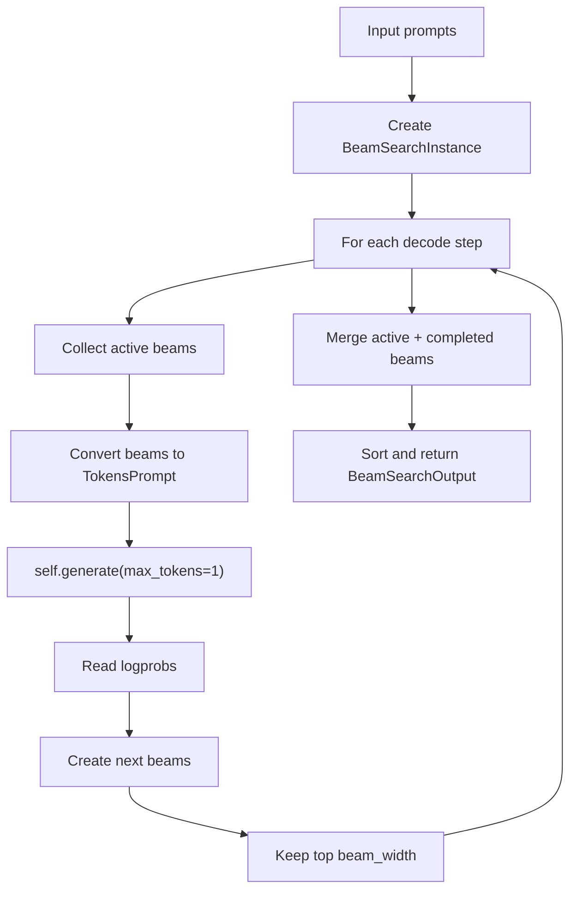
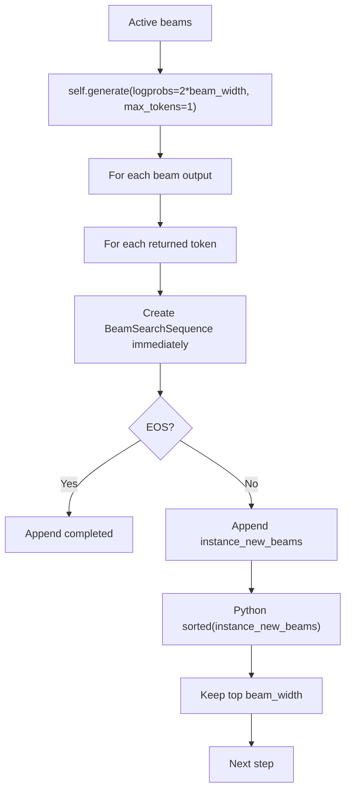
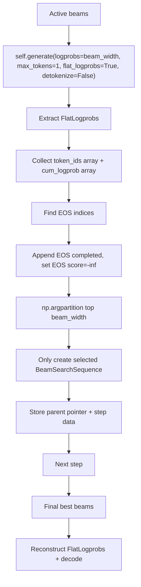

# vLLM 原生 LLM.beam_search 与 vLLM-GR 自定义 beam_search 对比分析

本文分析 `vllm-gr-js` 中为什么通过自定义 `beam_search` 替代 vLLM 原生 `LLM.beam_search`，并详细对比两者在执行流程、参数设置、候选选择、logprobs 处理、EOS / begin-end token、性能路径和适用场景上的差异。

对比对象：

```text
vLLM 原生实现:
D:\code\codexapp\vllm\vllm\entrypoints\llm.py
LLM.beam_search

vLLM-GR 自定义实现:
D:\code\codexapp\vllm-gr-js\vllm_gr\entrypoints\llm.py
vllm_gr.entrypoints.llm.beam_search
```

## 1. 总结结论

vLLM 原生 `LLM.beam_search` 是通用 beam search 实现，设计上更接近 HuggingFace beam search：每一步为每个 beam 取 `2 * beam_width` 个候选，逐个构造新 beam，排序后保留 top `beam_width`。

vLLM-GR 自定义 `beam_search` 是针对生成式推荐场景优化的版本，核心变化包括：

- 候选数从 `2 * beam_width` 降为 `beam_width`。
- 每步禁用 detokenize，最后统一 decode。
- 使用 `flat_logprobs=True`，减少 dict / object 开销。
- 用 `np.argpartition` 一次性从所有候选中选 top beams，避免每个候选都构造对象再排序。
- 中间 beam 不复制完整 logprobs，而是用 parent pointer 延迟重建。
- 支持推荐 SID 的 `begin_token` / `end_token`。
- EOS 处理后显式把 EOS 候选分数置为 `-inf`，避免继续扩展。

一句话概括：

**vLLM 原生实现更通用；vLLM-GR 自定义实现牺牲一部分通用 beam search 保守策略，换取 OpenOneRec / 生成式推荐大 beam、短 decode 场景下更低的 Python 和 logprobs 开销。**

## 2. 替换机制

`vllm-gr-js` 不是修改 vLLM 源码，而是 monkey patch。

文件：

```text
vllm_gr/entrypoints/beam_search_patch.py
```

核心代码：

```python
from vllm.entrypoints.llm import LLM
from vllm_gr.entrypoints.llm import beam_search

def patch_offline_beam_search():
    LLM.beam_search = beam_search
```

`run_patch()` 中调用：

```python
patch_offline_beam_search()
```

因此，只要执行：

```python
import vllm_gr.init
```

或通过 `vllm-gr-js` 的 patch 入口调用 `run_patch()`，之后：

```python
llm.beam_search(...)
```

实际调用的就是：

```python
vllm_gr.entrypoints.llm.beam_search
```

## 3. 两者共同点

两者整体框架相似，因为 vLLM-GR 自定义版本是在 vLLM 原生版本基础上改造的。

共同点：

- 函数签名基本一致：

```python
beam_search(
    prompts,
    params,
    lora_request=None,
    use_tqdm=False,
    concurrency_limit=None,
)
```

- 都使用 `BeamSearchInstance` 维护每个输入 prompt 的 beam 状态。
- 都使用 `BeamSearchSequence` 表示单条 beam。
- 都用 `self.generate()` 每轮生成 1 个 token。
- 都支持文本 prompt 和 `TokensPrompt`。
- 都支持 LoRA request。
- 都支持多模态字段：
  - `multi_modal_data`
  - `mm_processor_kwargs`
- 都支持 `concurrency_limit` 按 prompt 批处理。
- 都最终返回：

```python
list[BeamSearchOutput]
```

共同的高层流程：



## 4. 关键差异总览

| 维度 | vLLM 原生 `LLM.beam_search` | vLLM-GR 自定义 `beam_search` |
| --- | --- | --- |
| 设计目标 | 通用 beam search | 生成式推荐大 beam / 短 decode |
| 每步 logprobs 数 | `2 * beam_width` | `beam_width` |
| `detokenize` | 默认行为，未显式关闭 | `detokenize=False` |
| logprobs 结构 | dict/list `Logprob` | `FlatLogprobs` |
| 中间 beam logprobs | 每个新 beam 复制历史 | parent pointer 延迟重建 |
| 候选选择 | 先创建所有候选 beam，再排序 | 先聚合分数，`np.argpartition` 选 top，再创建 beam |
| 排序频率 | 每个 instance 每步完整排序 | 每步 top-k partition，最终排序 |
| begin/end token | 不支持 | 支持 `begin_token` / `end_token` |
| max_tokens 语义 | 全部都是模型生成 token | begin/end token 会占用 token budget |
| EOS 处理 | EOS beam 加入 completed，不进入 active | EOS beam 加入 completed，并显式设为 `-inf` |
| decode 文本 | 最终 decode | 最终 decode |
| 适用性 | 更通用 | 更适合 OpenOneRec SID 生成 |
| 风险 | 上游稳定 | monkey patch，依赖内部结构 |

## 5. SamplingParams 差异

### 5.1 vLLM 原生实现

原生实现中：

```python
beam_search_params = SamplingParams(
    logprobs=2 * beam_width,
    max_tokens=1,
    temperature=temperature,
    skip_clone=True,
)
```

特点：

- 每个 beam 返回 `2 * beam_width` 个候选。
- 没有显式设置 `detokenize=False`。
- 没有使用 `flat_logprobs=True`。

为什么是 `2 * beam_width`：

原生代码注释说明它参考 HuggingFace transformers beam search 实现。多取一倍候选的原因通常是：

- 某些候选可能是 EOS。
- 某些候选可能会被过滤。
- 多取候选可以保证去掉完成项后仍有足够 active beams。

这是更保守、通用的 beam search 策略。

### 5.2 vLLM-GR 自定义实现

vLLM-GR 中：

```python
beam_search_params = SamplingParams(
    logprobs=logprobs_num,
    max_tokens=1,
    temperature=temperature,
    skip_clone=True,
    detokenize=False,
    flat_logprobs=True,
)
```

其中：

```python
logprobs_num = beam_width
```

变化：

- `logprobs` 从 `2 * beam_width` 降为 `beam_width`。
- 显式关闭 `detokenize`。
- 启用 `flat_logprobs`。

### 5.3 性能影响

假设 `beam_width=512`：

| 项目 | vLLM 原生 | vLLM-GR |
| --- | --- | --- |
| 每个 beam 返回候选数 | 1024 | 512 |
| 每步最大候选量 | 512 * 1024 = 524288 | 512 * 512 = 262144 |
| logprobs 结构 | dict/object | flat arrays |

vLLM-GR 每步需要处理的候选规模大约减半，同时 logprobs 数据结构更轻。

这对生成式推荐很重要，因为推荐场景通常：

- beam width 很大。
- max tokens 很小。
- Python 候选处理占比明显。

## 6. begin_token / end_token 差异

### 6.1 vLLM 原生实现

原生 `LLM.beam_search` 只读取：

```python
beam_width
max_tokens
temperature
ignore_eos
length_penalty
```

不支持：

```python
begin_token
end_token
```

因此原生实现无法直接表达 OpenOneRec SID 生成中的：

```text
<|sid_begin|>
...
<|sid_end|>
```

### 6.2 vLLM-GR 自定义实现

vLLM-GR 增加：

```python
begin_token = params.begin_token if hasattr(params, "begin_token") else None
end_token = params.end_token if hasattr(params, "end_token") else None
```

转换为 token id：

```python
sid_begin_token_id = tokenizer.convert_tokens_to_ids(begin_token)
sid_end_token_id = tokenizer.convert_tokens_to_ids(end_token)
```

begin token 处理：

- prompt 初始化时追加到 prompt tokens。
- 初始 logprobs 中加入 begin token 的 0 分。

end token 处理：

- 结束时追加到 active beams。
- 最终重建 logprobs 时也补 end token 的 0 分。

### 6.3 max_tokens 语义差异

vLLM 原生：

```text
模型实际 decode steps = max_tokens
```

vLLM-GR：

```python
pre_calc = 0 if sid_begin_token_id is None else 1
if sid_end_token_id is not None:
    pre_calc += 1

token_iter = range(max_tokens - pre_calc)
```

也就是说：

```text
模型实际 decode steps = max_tokens - begin_token_count - end_token_count
```

例子：

```text
max_tokens = 5
begin_token = <|sid_begin|>
end_token = <|sid_end|>

模型实际生成 3 个 token
最终序列 5 个 token:
begin + generated_1 + generated_2 + generated_3 + end
```

这非常贴合 OpenOneRec 的 SID 格式：

```text
<|sid_begin|><s_a_x><s_b_y><s_c_z><|sid_end|>
```

## 7. 候选生成和选择差异

### 7.1 vLLM 原生方式

原生实现对每个 beam 的每个 returned token 立即构造 `BeamSearchSequence`：

```python
for token_id, logprob_obj in logprobs.items():
    new_beam = BeamSearchSequence(
        tokens=current_beam.tokens + [token_id],
        logprobs=current_beam.logprobs + [logprobs],
        cum_logprob=current_beam.cum_logprob + logprob_obj.logprob,
        ...
    )

    if token_id == eos_token_id:
        instance.completed.append(new_beam)
    else:
        instance_new_beams.append(new_beam)
```

然后完整排序：

```python
sorted_beams = sorted(instance_new_beams, key=sort_beams_key, reverse=True)
instance.beams = sorted_beams[:beam_width]
```

特点：

- 先为所有候选创建 beam 对象。
- 再排序。
- 候选对象数量很大时 Python 开销明显。

### 7.2 vLLM-GR 方式

vLLM-GR 先只收集 token id 和累计 logprob：

```python
all_beams_token_id.extend(token_ids_pos)
all_beams_logprob.extend(current_beam.cum_logprob + lp for lp in logprobs_pos)
```

转成 NumPy：

```python
all_beams_token_id = np.array(all_beams_token_id)
all_beams_logprob = np.array(all_beams_logprob)
```

用 `argpartition` 取 top beam_width：

```python
topn_idx = np.argpartition(np.negative(all_beams_logprob), beam_width)[:beam_width]
```

只有入选的候选才创建 `BeamSearchSequence`：

```python
for idx in topn_idx:
    new_beam = BeamSearchSequence(...)
```

### 7.3 差异本质

```text
vLLM 原生:
  所有候选 -> 创建 BeamSearchSequence -> Python sorted -> 截断

vLLM-GR:
  所有候选分数 -> NumPy argpartition -> 只为 top-k 创建 BeamSearchSequence
```

### 7.4 性能影响

假设：

```text
beam_width = 512
当前 active beams = 512
```

原生：

```text
候选数 = 512 * 1024 = 524288
可能创建大量 BeamSearchSequence 对象
完整排序大量 Python 对象
```

vLLM-GR：

```text
候选数 = 512 * 512 = 262144
先用 NumPy 选 top 512
只创建 512 个新 BeamSearchSequence
```

这是自定义实现最重要的 Python 层优化之一。

## 8. Logprobs 处理差异

### 8.1 vLLM 原生实现

原生实现使用普通 logprobs 结构：

```python
logprobs = result.outputs[0].logprobs[0]
```

通常是：

```python
dict[int, Logprob]
```

每个新 beam 都保存：

```python
current_beam.logprobs + [logprobs]
```

这意味着：

- 每个候选 beam 都会复制一次 logprobs 历史 list。
- logprobs list 随 decode steps 增长。
- 大 beam width 时会产生大量 list 拷贝和 dict 引用。

### 8.2 vLLM-GR 实现

vLLM-GR 内部使用：

```python
flat_logprobs=True
```

每个 output 的 logprobs 是 `FlatLogprobs`。

提取时调用：

```python
extract_and_dedup_flat_logprobs(flat, logprobs_num)
```

该函数返回：

```python
token_ids_pos
logprobs_pos
ranks_pos
decoded_pos
```

中间 beam 不保存完整 logprobs list，而是：

```python
new_beam.logprobs = initial_logprobs
new_beam._lp_parent = current_beam
new_beam._lp_step_data = cached
```

最终只对 best beams 调：

```python
reconstruct_beam_logprobs(beam, initial_logprobs, sid_end_token_id)
```

### 8.3 延迟重建原理

vLLM-GR 把 beam 的 logprobs 历史表示为一条 parent 链：

```text
best_beam
  _lp_parent -> parent beam
      _lp_parent -> parent beam
          _lp_parent -> initial beam
```

每个节点只记录当前 step 的 flat logprobs：

```text
_lp_step_data = (token_ids, logprobs, ranks, decoded_tokens)
```

最终重建时：

1. 从 best beam 沿 parent 链往回走。
2. 收集每一步的 `_lp_step_data`。
3. reverse 成正序。
4. 逐步 append 到新的 `FlatLogprobs`。

### 8.4 性能影响

原生方式：

```text
每一步为大量候选 beam 复制 logprobs 历史
```

vLLM-GR：

```text
中间只挂 parent pointer
最终只给 top beams 重建 logprobs
```

复杂度直观对比：

| 项目 | vLLM 原生 | vLLM-GR |
| --- | --- | --- |
| 中间 beam logprobs | 每个候选复制历史 | parent pointer |
| 重建时机 | 每步创建 beam 时 | 最终 best beams |
| 数据结构 | dict/list | FlatLogprobs arrays |
| 对大 beam 的影响 | Python 内存和对象开销高 | 明显降低 |

## 9. FlatLogprobs 去重差异

vLLM-GR 使用：

```python
extract_and_dedup_flat_logprobs(flat, logprobs_num)
```

原因：

FlatLogprobs 中可能包含：

```text
[sampled_token, top1, top2, ..., topK]
```

如果 sampled token 同时也在 top-k 中，可能重复。

vLLM-GR 的策略：

- 如果第 0 个 sampled token 在后面的 top-k 中重复，则跳过 sampled token。
- 否则取前 `logprobs_num` 个。
- 返回正好用于 beam search 的候选集合。

原生实现没有这个 flat logprobs 去重逻辑，因为它不使用 `flat_logprobs=True`。

## 10. EOS 处理差异

### 10.1 vLLM 原生实现

原生逻辑：

```python
if token_id == tokenizer.eos_token_id and not ignore_eos:
    instance.completed.append(new_beam)
else:
    instance_new_beams.append(new_beam)
```

特点：

- EOS 候选构造成 new_beam。
- EOS beam 加入 completed。
- 非 EOS beam 加入 active list。

### 10.2 vLLM-GR 实现

vLLM-GR 先从扁平候选数组中找 EOS：

```python
eos_idx = np.where(all_beams_token_id == tokenizer.eos_token_id)[0]
```

对 EOS 候选：

- 创建 completed beam。
- 设置 parent pointer。
- 放入 `instance.completed`。

然后：

```python
all_beams_logprob[eos_idx] = -np.inf
```

这样 EOS 不会再被后续 `argpartition` 选为 active beam。

### 10.3 差异

| 项目 | vLLM 原生 | vLLM-GR |
| --- | --- | --- |
| EOS 检测位置 | 遍历每个 token 时 | NumPy 数组统一检测 |
| EOS completed | 是 | 是 |
| EOS 是否可能继续参与 top-k | 逻辑上不会加入 active | 分数显式置 `-inf` |
| 实现方式 | Python 对象流 | 数组流 |

vLLM-GR 的处理更适合它的数组化候选选择流程。

## 11. 排序和 length_penalty 差异

### 11.1 vLLM 原生

每一步：

```python
sorted_beams = sorted(instance_new_beams, key=sort_beams_key, reverse=True)
instance.beams = sorted_beams[:beam_width]
```

最终：

```python
sorted_completed = sorted(instance.completed, key=sort_beams_key, reverse=True)
best_beams = sorted_completed[:beam_width]
```

也就是说，原生实现每一步 active beams 排序时使用 `sort_beams_key`，它会考虑 length penalty / EOS 等规则。

### 11.2 vLLM-GR

每一步：

```python
topn_idx = np.argpartition(np.negative(all_beams_logprob), beam_width)[:beam_width]
```

这里是按 raw cumulative logprob 选 top beams。

最终：

```python
sorted_completed = sorted(instance.completed, key=sort_beams_key, reverse=True)
best_beams = sorted_completed[:beam_width]
```

最终排序仍使用 `sort_beams_key`。

### 11.3 语义差异

这是一个重要差异：

- vLLM 原生每一步 active beam pruning 都使用 `sort_beams_key`。
- vLLM-GR 每一步 pruning 使用 raw cumulative logprob，最终才使用 `sort_beams_key`。

如果 `length_penalty` 对中间步骤影响明显，两者可能产生不同 beam 路径。

在 OpenOneRec 场景中：

- SID 输出长度固定或接近固定。
- decode 很短。
- length penalty 通常影响较小。

因此 vLLM-GR 选择用更快的 raw logprob partition 是合理的工程取舍。

## 12. 输出文本 decode 差异

两者都最终 decode：

```python
beam.text = tokenizer.decode(beam.tokens)
```

但 vLLM-GR 在每步 `SamplingParams` 中显式：

```python
detokenize=False
```

原生没有显式关闭。

影响：

- vLLM-GR 避免每一步 `generate()` 为每个 beam 生成文本字段。
- 最终只对 best beams decode。

这对 beam width 很大的场景非常关键。

## 13. 多模态和 LoRA 差异

两者都保留了：

```python
multi_modal_data
mm_processor_kwargs
lora_request
```

vLLM-GR 在新 beam 构造时同样传递：

```python
multi_modal_data=current_beam.multi_modal_data
mm_processor_kwargs=current_beam.mm_processor_kwargs
lora_request=current_beam.lora_request
```

因此从接口兼容角度，vLLM-GR 没有明显削弱这部分能力。

## 14. concurrency_limit 差异

两者基本一致：

```python
if concurrency_limit is None:
    concurrency_limit = len(prompts)
```

然后按 prompt 分批：

```python
for prompt_start in range(0, len(prompts), concurrency_limit):
    instances_batch = instances[prompt_start : prompt_start + concurrency_limit]
```

注意：

`concurrency_limit` 控制的是同时处理多少个 input prompt，不是单个 prompt 内的 beam 数。

## 15. 执行流程对比图

### 15.1 vLLM 原生流程



### 15.2 vLLM-GR 流程



## 16. 性能差异拆解

### 16.1 候选数量减少

原生：

```text
每个 beam 返回 2 * beam_width candidates
```

vLLM-GR：

```text
每个 beam 返回 beam_width candidates
```

对于 `beam_width=512`，候选量减半。

### 16.2 Python 对象创建减少

原生：

```text
为所有候选创建 BeamSearchSequence
```

vLLM-GR：

```text
先用 NumPy 选 top-k，再只为 top-k 创建 BeamSearchSequence
```

### 16.3 排序成本降低

原生：

```text
Python sorted 大量 BeamSearchSequence
```

vLLM-GR：

```text
NumPy argpartition 数值数组
```

### 16.4 logprobs 拷贝降低

原生：

```text
current_beam.logprobs + [logprobs]
```

vLLM-GR：

```text
_lp_parent + _lp_step_data
```

### 16.5 detokenize 开销降低

vLLM-GR 每步不 detokenize，只最终 decode。

## 17. 语义差异和可能影响结果的点

两者不是完全等价实现，以下差异可能导致输出 beam 不完全一致。

### 17.1 候选数不同

原生每步取 `2 * beam_width`。

vLLM-GR 每步取 `beam_width`。

如果某些 top candidates 是 EOS 或后续被过滤，原生可能有更多后备候选。

### 17.2 pruning key 不同

原生每步用 `sort_beams_key`。

vLLM-GR 每步用 raw cumulative logprob。

最终排序两者都用 `sort_beams_key`，但中间被剪掉的 beam 可能不同。

### 17.3 begin/end token 改变 token budget

vLLM-GR 如果设置 begin/end token，会减少实际模型生成步数。

原生无此逻辑。

### 17.4 logprobs 表示不同

原生返回普通 logprobs list/dict。

vLLM-GR 最终重建 `FlatLogprobs`。

下游如果强依赖 logprobs 的具体 Python 类型，可能有兼容问题。

### 17.5 动态属性依赖

vLLM-GR 在 `BeamSearchSequence` 上挂：

```python
_lp_parent
_lp_step_data
```

如果上游 `BeamSearchSequence` 未来加 `__slots__`，该方式会失效。

## 18. 为什么 vLLM-GR 的取舍适合 OpenOneRec

OpenOneRec SID 生成通常是：

```text
<|sid_begin|><s_a_x><s_b_y><s_c_z><|sid_end|>
```

特点：

- 输出长度固定或近似固定。
- beam width 很大。
- 每一步只关心 top item/SID path。
- 最终目标是 top-k 推荐候选，不是开放文本多样性。

因此：

- `2 * beam_width` 的保守候选策略可以降为 `beam_width`。
- 每步 length penalty 的影响不大。
- detokenize 可以完全推迟。
- logprobs 只需要最终 best beams 完整保留。
- Python 对象创建和排序开销值得重点优化。

这就是 vLLM-GR 自定义 beam_search 的设计依据。

## 19. 代码级差异定位表

| 功能点 | vLLM 原生位置 | vLLM-GR 位置 |
| --- | --- | --- |
| 函数定义 | `vllm/vllm/entrypoints/llm.py:592` | `vllm_gr/entrypoints/llm.py:26` |
| SamplingParams | `logprobs=2*beam_width` | `logprobs=beam_width, detokenize=False, flat_logprobs=True` |
| begin/end token | 无 | `params.begin_token`, `params.end_token` |
| prompt 初始化 | `BeamSearchInstance(... logprobs=None)` | append begin token, initial `FlatLogprobs` |
| logprobs 提取 | `result.outputs[0].logprobs[0]` | `extract_and_dedup_flat_logprobs` |
| 候选对象创建 | 所有候选都创建 | 只给 top-k 创建 |
| top-k 方法 | `sorted(..., key=sort_beams_key)` | `np.argpartition` |
| 中间 logprobs | list copy | parent pointer |
| 最终 logprobs | 已在每步构造 | `reconstruct_beam_logprobs` |
| EOS | 遍历 token 时判断 | 数组中查 eos index |
| end token | 无 | active beams 追加 end token |

## 20. 当前 vLLM-GR 自定义实现的风险

### 20.1 与原生语义不是严格等价

主要因为：

- 每步候选数不同。
- 每步 pruning key 不同。
- 支持 begin/end token 后 max_tokens 语义不同。

这对推荐任务通常可接受，但对通用文本 beam search 可能不完全等价。

### 20.2 依赖 FlatLogprobs

如果 vLLM 的 `flat_logprobs` 参数或 `FlatLogprobs` 内部结构变化，`extract_and_dedup_flat_logprobs()` 和 `reconstruct_beam_logprobs()` 都需要同步更新。

### 20.3 动态 parent pointer

动态挂 `_lp_parent` / `_lp_step_data` 是性能优化，但不是强类型字段。上游类结构变化会有兼容风险。

### 20.4 只优化 offline LLM.beam_search 的 Python 层

这份 `vllm_gr.entrypoints.llm.beam_search` 仍然每一步把每个 active beam 作为一个完整 prompt 调 `self.generate()`。

它没有 online `ADD_BATCH` / `BEAM_FORK` 那种 engine 级 request state 复用。

因此它解决的是 offline beam loop 的 Python/logprobs 开销，不解决 engine 内部完整 request 重建问题。

## 21. 一页汇报总结

### 标题

vLLM 原生 beam_search vs vLLM-GR 自定义 beam_search

### 核心差异

vLLM 原生实现偏通用：

- 每步取 `2 * beam_width` 候选。
- 为所有候选创建 beam 对象。
- 每步完整排序。
- 每个 beam 复制 logprobs 历史。

vLLM-GR 实现偏推荐推理：

- 每步只取 `beam_width` 候选。
- `detokenize=False`。
- `flat_logprobs=True`。
- 先用 NumPy top-k，再创建 beam 对象。
- 中间 beam 用 parent pointer，最终重建 logprobs。
- 支持 `<|sid_begin|>` / `<|sid_end|>`。

### 为什么更快

因为 OpenOneRec 是大 beam、短 decode、固定结构 SID 输出。vLLM-GR 减少了候选数、对象创建、排序、logprobs 复制和中间 decode。

### 代价

不是严格等价的通用 beam search。候选数更少，中间 pruning 不使用 length penalty key，且依赖 vLLM 内部 `FlatLogprobs` 和动态 beam 属性。

## 22. 建议后续验证

如果要确认自定义 beam_search 对业务是否安全，建议做三类对比：

1. 输出一致性
   - 小 beam width、固定 seed、相同 prompt 下比较原生和 vLLM-GR 输出 top-k overlap。

2. 指标一致性
   - 在 OpenOneRec recommendation task 上比较 HitRate / NDCG / MRR。

3. 性能拆解
   - 分别统计 generate time、logprobs extraction、candidate selection、beam construction、final decode。

对于推荐场景，最终应以业务指标和 latency 为准，而不是要求与原生 beam search token-by-token 完全一致。

