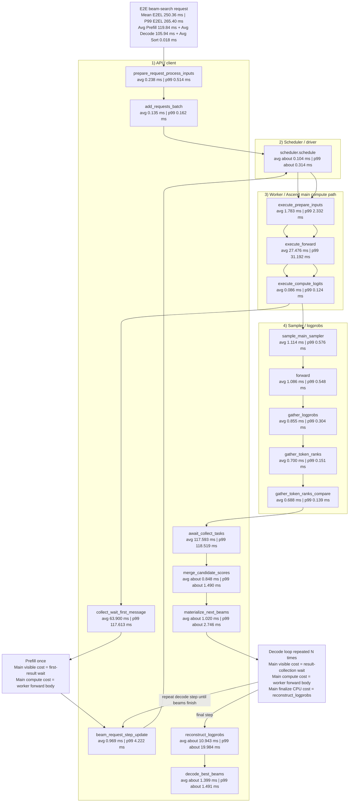

# Prefill And Decode Hotspots

This note turns the latest function-profile snapshot into a bottleneck-oriented
prefill/decode comparison table.

Data source:

- latest `function_hotspots.csv` snapshot reviewed on July 21, 2026
- latest `performance_timeline.csv` snapshot reviewed on July 21, 2026
- latest 100-request serving benchmark reviewed on July 21, 2026
- units below are microseconds (`us`)
- `Avg us` is the mean duration per invocation
- `P99 us` is the tail latency per invocation

## 100-request benchmark summary

The previous small-sample summary is superseded by this 100-request run:

| Metric | Value |
|---|---:|
| Successful requests | 100 |
| Failed requests | 0 |
| Benchmark duration | 25.06 s |
| Request throughput | 3.99 req/s |
| Output token throughput | 2553.89 tok/s |
| Total token throughput | 22985.67 tok/s |
| Mean TTFT | 245.80 ms |
| Median TTFT | 241.47 ms |
| P99 TTFT | 260.03 ms |
| Mean E2EL | 250.36 ms |
| Median E2EL | 246.11 ms |
| P99 E2EL | 265.40 ms |
| Avg Prefill Time | 119.84 ms |
| Avg Decode Time | 105.94 ms |
| Avg Sort Time | 0.018 ms |
| Total Beam Time | 225.80 ms |

Quick reading:

- `Avg Prefill Time` + `Avg Decode Time` = `225.78 ms`, which almost exactly
  matches `Total Beam Time = 225.80 ms`
- `Mean E2EL = 250.36 ms` is about `24.56 ms` above total beam time, so the
  remaining budget is mainly serving/framework overhead outside the beam core
- `P99 TTFT = 260.03 ms` and `P99 E2EL = 265.40 ms` are both relatively tight,
  which means the current bottlenecks are stable costs rather than rare spikes

## Reading guide

Use the numbers this way:

- large `Avg us` means stable cost and usually a real bottleneck
- large `P99 us` with smaller `Avg us` means tail spikes or shape sensitivity
- if a parent and child row are almost the same size, the child already explains
  most of the parent cost
- diagram nodes below are call-chain landmarks, so parent/child timings are for
  attribution and are not meant to be summed directly

## Layered flowchart

The diagram below is a single end-to-end measured path: one prefill step,
followed by repeated decode steps, then final beam reconstruction and output.
It is grouped by framework layer, and it annotates the main timings directly on
the critical path. Phase totals come from the 100-request benchmark, and node
timings come from the latest hotspot snapshots.

## Layer roll-up

This table follows the hierarchy `E2E -> phase -> framework layer -> hotspot`,
so the parent/child relationship is visible instead of flattened into peer rows.

| Level | Scope | Representative timing | How to read it |
|---|---|---:|---|
| E2E | Full request | `250.36 ms` avg, `265.40 ms` p99 | Total time of one full beam-search request |
| ├─ Prefill phase | First step | `119.84 ms` avg | First request step until the first visible result |
| │  ├─ API / client | First-result wait | `63.900 ms` avg, `117.613 ms` p99 | Largest visible wait on the prefill path |
| │  ├─ Scheduler / driver | `scheduler.schedule` | `0.104 ms` avg, `0.314 ms` p99 | Scheduler cost itself is light |
| │  ├─ Worker / Ascend | `execute_prepare_inputs` | `1.783 ms` avg, `2.332 ms` p99 | Input and metadata preparation before forward |
| │  └─ Worker / Ascend | `execute_forward` | `27.476 ms` avg, `31.192 ms` p99 | Main prefill compute block |
| ├─ Decode phase | Repeated loop | `105.94 ms` avg | Average stage cost of the repeated decode loop |
| │  ├─ API / client | `await_collect_tasks` | `117.593 ms` avg, `118.519 ms` p99 | Largest decode-side wait envelope |
| │  ├─ API / client | `beam_request_step_update` | `0.969 ms` avg, `4.222 ms` p99 | Per-step decode update cost |
| │  ├─ Worker / Ascend | `execute_forward` | `27.476 ms` avg, `31.192 ms` p99 | Main worker compute block reused every decode step |
| │  ├─ Sampler / logprobs | `sample_main_sampler` | `1.114 ms` avg, `0.576 ms` p99 | Sampler wrapper is no longer a primary bottleneck |
| │  ├─ Sampler / logprobs | `gather_logprobs` | `0.855 ms` avg, `0.304 ms` p99 | Main sampler cost is still logprob gathering |
| │  ├─ Sampler / logprobs | `gather_token_ranks_compare` | `0.688 ms` avg, `0.139 ms` p99 | Tightest hotspot inside the sampler |
| │  └─ API / client | `merge_candidate_scores` + `materialize_next_beams` | `0.848 + 1.020 ms` avg | Candidate merge and next-beam materialization |
| └─ Finalize / output | Tail convergence | `10.943 + 1.399 ms` avg | Rebuild outputs after beam convergence |
|    ├─ API / client | `reconstruct_logprobs` | `10.943 ms` avg, `19.984 ms` p99 | Largest CPU-side tail step |
|    └─ API / client | `decode_best_beams` | `1.399 ms` avg, `1.491 ms` p99 | Final text reconstruction and output |

E2E reading:

- one request is not "prefill graph + decode graph" placed side by side; it is
  one continuous path: prefill once, then decode many times, then finalize
- the prefill/decode split in the benchmark lines up with that lifecycle:
  `119.84 ms` for the first step, then `105.94 ms` for the repeated decode work
- the decode loop keeps re-entering the same scheduler and worker-forward chain
  on every step
- `reconstruct_logprobs` and `decode_best_beams` belong at the tail of the full
  E2E request, after the decode loop converges

## Prefill hotspots

Prefill is the first beam-search cycle: request preparation, first worker
execution, and waiting for the first visible result. The worker-side compute
chain below is also reused later by decode, but here it should be read as the
main body of prefill compute because it sits directly behind `Avg Prefill Time =
119.84 ms`.

| Layer | Function | Avg us | P99 us | Bottleneck reading |
|---|---:|---:|---:|---|
| Request wait | `collect_wait_first_message` | 63900.417 | 117612.803 | Largest visible prefill-side wait; most time is spent before the first result arrives |
| Request wait | `await_collect_tasks` | 117593.158 | 118519.247 | Full request-side wait envelope around prefill collection |
| Request prep | `prepare_request_process_inputs` | 237.964 | 514.114 | Low overhead; request input processing is not the main prefill bottleneck |
| Request prep | `add_requests_batch` | 135.324 | 162.256 | Batch submission itself is cheap |
| Worker forward | `execute_forward` | 27476.405 | 31191.904 | Large top-level worker forward block |
| Worker forward | `_generate_process_reqs_hidden_states` | 27471.257 | 31186.773 | Nearly equal to `execute_forward`; little overhead outside hidden-state generation |
| Worker forward | `execute_model_call` | 27462.409 | 31177.447 | Nearly equal to parent; hotspot already narrowed to model call |
| Worker forward | `execute_model_call_forward` | 27452.176 | 31165.154 | Now confirmed separately; model forward body explains almost all of `execute_model_call` |
| Worker prepare | `execute_prepare_inputs` | 1782.870 | 2331.676 | Moderate setup cost before model forward |
| Worker prepare | `_prepare_inputs` | 1403.645 | 1758.189 | Main share of request/input metadata build |
| Worker preprocess | `execute_preprocess` | 39.073 | 56.049 | Not a bottleneck |
| Worker post-forward | `execute_compute_logits` | 86.001 | 123.662 | Small compared with model forward |

Prefill reading:

- the dominant visible prefill time is still "wait until the first result can
  be observed"
- inside that wait, the biggest worker compute block is the forward chain down
  to `execute_model_call_forward`
- request preparation and batch submission exist, but they are much smaller
  than the first-result wait plus worker forward

## Decode hotspots

These numbers come directly from the latest decode-style beam-search loop.

| Layer | Function | Avg us | P99 us | Bottleneck reading |
|---|---:|---:|---:|---|
| Request wait | `await_collect_tasks` | 117593.158 | 118519.247 | Largest request-side wait block |
| Request step | `beam_request_step_update` | 969.074 | 4222.165 | Small compared with wait time |
| Request merge | `merge_candidate_scores` | about 847.943 | about 1489.770 | Minor compared with wait and worker compute |
| Request merge | `materialize_next_beams` | about 1020.353 | about 2745.560 | Visible but still secondary |
| Request finalize | `reconstruct_logprobs` | about 10943.290 | about 19984.300 | Largest post-collect decode-side CPU step |
| Request finalize | `decode_best_beams` | about 1399.240 | about 1491.000 | Small compared with logprob reconstruction |
| Worker forward | `execute_forward` | 27476.405 | 31191.904 | Decode also re-enters the same heavy worker forward chain |
| Worker forward | `_generate_process_reqs_hidden_states` | 27471.257 | 31186.773 | Little decode overhead outside hidden-state generation |
| Worker forward | `execute_model_call` | 27462.409 | 31177.447 | Worker hotspot already narrowed to model call |
| Worker forward | `execute_model_call_forward` | 27452.176 | 31165.154 | Model forward body explains almost all of decode-side worker compute |
| Worker prepare | `execute_prepare_inputs` | 1782.870 | 2331.676 | Moderate decode-side setup before forward |
| Worker prepare | `_prepare_inputs` | 1403.645 | 1758.189 | Main share of decode input metadata build |
| Worker post-forward | `execute_compute_logits` | 86.001 | 123.662 | Small compared with model forward |

Notes:

- `collect_wait_tail_messages` did not surface as a hotspot in the latest run.
- That means the dominant request-side wait is not the tail drain after partial
  output; it is waiting for the first visible result.

## Decode sampler hotspots

This is the clearest hotspot chain in the latest sample.

| Layer | Function | Avg us | P99 us | Bottleneck reading |
|---|---:|---:|---:|---|
| Sampler wrapper | `sample_main_sampler` | 1114.238 | 575.703 | Sampler is no longer the dominant decode hotspot in this snapshot |
| Sampler core | `forward` | 1086.476 | 548.390 | Wrapper overhead remains negligible |
| Logprobs gather | `gather_logprobs` | 854.965 | 304.463 | Most sampler cost is still in logprob gathering |
| Token rank | `gather_token_ranks` | 699.775 | 150.504 | Main hotspot inside logprob gather |
| Token rank core | `gather_token_ranks_compare` | 688.293 | 138.883 | Nearly identical to parent; rank comparison kernel is still the real bottleneck |
| Top-k gather | `gather_topk_logprobs` | 28.176 | 28.673 | Minor compared with rank comparison |
| Token logprob | `gather_token_logprobs` | 23.211 | 26.547 | Minor compared with rank comparison |
| Sampling dispatch | `sample` | 57.140 | 66.879 | Minor |
| Greedy path | `greedy_sample` | 35.859 | 41.579 | Minor |

Conclusion:

- sampler-side bottleneck is already localized very tightly
- `gather_token_ranks_compare` explains almost all of `gather_token_ranks`

## Attention / fused kernel hotspots

These are real costs, but they are not the main bottlenecks in the latest
sample compared with model forward and token-rank gathering.

| Layer | Function | Avg us | P99 us | Bottleneck reading |
|---|---:|---:|---:|---|
| Fused QKV/RoPE | `split_qkv_rmsnorm_rope_gr_impl` | 288.999 | 423.111 | Noticeable but far below model forward |
| Fused launch | `launch_split_qkv_rmsnorm_rope_kernel` | 127.160 | 150.953 | Kernel launch only |
| Rotary cache | `convert_sin_cos_cache` | 77.376 | 168.442 | Small |
| Beam attention | `attention_forward` | 369.953 | 677.157 | Wrapper remains visible but not dominant |
| Beam merge | `cascade_npu_merge_attention` | 172.746 | 203.852 | Largest attention sub-step in this snapshot |
| Beam std | `cascade_npu_std_attention` | 104.809 | 118.802 | Standard attention kernel |
| Beam prefix | `cascade_npu_prefix_attention` | 99.760 | 123.320 | Prefix attention |
| Beam suffix | `cascade_npu_suffix_attention` | 117.137 | 132.951 | Suffix attention |
| Beam mapping | `build_beam_mappings` | 319.233 | 505.180 | Metadata build cost |
| Beam tensors | `create_beam_tensors` | 207.920 | 512.357 | Tensor materialization cost |

## Timeline cross-check

Against the 100-request benchmark summary above, the prefill/decode split reads
cleanly in the two CSV views:

- `Avg Prefill Time = 119.84 ms` lines up with the first-result waiting block
  plus the worker forward path needed to produce the first beam outputs
- in `performance_timeline.csv`, prefill is still best read through the coarse
  stages `prepare_request_batch`, `add_requests_batch`, and
  `gather_beam_results`
- `Avg Decode Time = 105.94 ms` lines up with the later beam-update cycles,
  where request waiting and worker forward still dominate, while sampler and
  logprob reconstruction remain secondary but visible
- in `performance_timeline.csv`, decode is best read through
  `beam_request_step`, `collect_beam_result`, `merge_candidate_scores`,
  `materialize_next_beams`, `reconstruct_logprobs`, and `decode_best_beams`
- `Avg Sort Time = 0.018 ms` matches the CSV view that `sort_completed` is
  negligible

## Current bottleneck summary

Based on the latest hotspot snapshot and the 100-request benchmark run, the
clearest bottlenecks are:

1. Request-side waiting before the first result message:
   - `collect_wait_first_message`
   - `await_collect_tasks`
2. Worker-side model forward body:
   - `execute_forward`
   - `_generate_process_reqs_hidden_states`
   - `execute_model_call`
   - `execute_model_call_forward`
3. Sampler-side token rank computation:
   - `gather_token_ranks`
   - `gather_token_ranks_compare`

## Suggested next focus

If more profiling time is available, prioritize in this order:

1. inspect whether `gather_token_ranks_compare` can be reduced or replaced
2. correlate `collect_wait_first_message` with worker-side forward duration
3. decide whether further model-forward splitting is still worth the overhead
