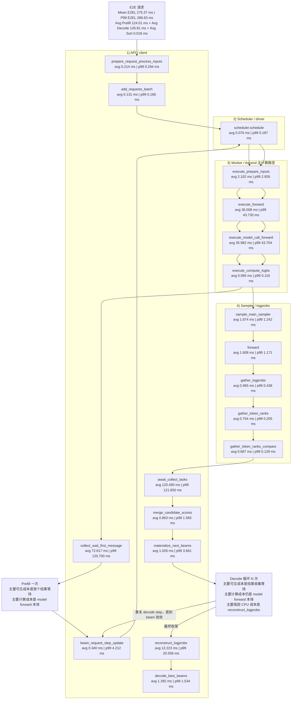

# Prefill 和 Decode 热点分析

这份说明基于 2026 年 7 月 23 日的最新 100 请求数据，整理一次 beam-search
请求从 prefill 进入多次 decode，再到最终输出的完整热点链路。

数据来源：

- 最新 `function_hotspots.csv`，查看时间为 2026 年 7 月 23 日
- 最新 `performance_timeline.csv`，查看时间为 2026 年 7 月 23 日
- 最新 100 请求 benchmark 汇总，查看时间为 2026 年 7 月 23 日
- 下表单位均为微秒 `us`
- `Avg us` 表示单次调用平均耗时
- `P99 us` 表示单次调用尾延迟

## 100 请求汇总

| 指标 | 数值 |
|:---|---:|
| Successful requests | 100 |
| Failed requests | 0 |
| Benchmark duration | 27.56 s |
| Request throughput | 3.63 req/s |
| Output token throughput | 2322.08 tok/s |
| Total token throughput | 20899.28 tok/s |
| Mean TTFT | 270.85 ms |
| Median TTFT | 268.73 ms |
| P99 TTFT | 284.64 ms |
| Mean E2EL | 275.37 ms |
| Median E2EL | 273.47 ms |
| P99 E2EL | 288.83 ms |
| Avg Prefill Time | 124.01 ms |
| Avg Decode Time | 126.81 ms |
| Avg Sort Time | 0.018 ms |
| Total Beam Time | 250.83 ms |

快速解读：

- `Avg Prefill Time + Avg Decode Time + Avg Sort Time = 250.838 ms`，和 `Total Beam Time = 250.83 ms` 基本一致
- `Mean E2EL = 275.37 ms` 比 `Total Beam Time` 多出约 `24.54 ms`，主要是 beam 核心之外的 serving / framework 开销
- `P99 TTFT = 284.64 ms`、`P99 E2EL = 288.83 ms` 都比较紧，说明当前瓶颈更像稳定成本，而不是偶发尖刺

## 读图方式

- `Avg us` 大，通常就是稳定瓶颈
- 父节点和子节点如果大小接近，说明子节点已经解释了大部分父节点耗时
- 图中的节点是调用链定位点，父子耗时用于归因，不应该直接相加

## E2E 主流程图

## 调用层次汇总

`E2E 整体请求 -> Prefill（一次）-> Decode loop（多次）-> Finalize / output（一次）`

| 调用层次 | 调用链 / 模块 | 平均耗时 | 说明 |
|:---|:---|---:|:---|
| 1. E2E 整体请求 |  | `275.37 ms` | 一次完整 beam-search 请求总时长 |
| 1.1 Prefill（只执行一次） |  | `124.01 ms` | 首次请求准备、首次 worker 执行、等待第一个可见结果 |
| 1.1.1 | API / client：`prepare_request_process_inputs` -> `add_requests_batch` -> `collect_wait_first_message` | `0.214 + 0.131 + 72.617 ms` | prefill 侧最显眼的可见时间主要是首个结果等待 |
| 1.1.2 | Scheduler / driver：`scheduler.schedule` | `0.076 ms` | 调度步本身很轻 |
| 1.1.3 | Worker / Ascend：`execute_prepare_inputs` -> `execute_forward` -> `execute_model_call_forward` -> `execute_compute_logits` | `2.102 + 36.008 + 35.982 + 0.085 ms` | prefill 的核心计算链，主大头已经收敛到 model forward 本体 |
| 1.2 Decode loop（重复 N 次） |  | `126.81 ms` | 后续每一轮 decode step 的平均阶段耗时 |
| 1.2.1 | API / client：`beam_request_step_update` | `0.340 ms` | 每轮 decode 的入口更新 |
| 1.2.2 | Scheduler / driver：`scheduler.schedule` | `0.076 ms` | 每轮 decode 都会重新调度 |
| 1.2.3 | Worker / Ascend：`execute_prepare_inputs` -> `execute_forward` -> `execute_model_call_forward` -> `execute_compute_logits` | `2.102 + 36.008 + 35.982 + 0.085 ms` | 每轮 decode 都会重复进入同一条 worker 主干 |
| 1.2.4 | Sampler / logprobs：`sample_main_sampler` -> `forward` -> `gather_logprobs` -> `gather_token_ranks_compare` | `1.674 + 1.608 + 0.965 + 0.687 ms` | decode 内部采样和 logprobs 路径，最紧的热点是 `gather_token_ranks_compare` |
| 1.2.5 | API / client：`await_collect_tasks` -> `merge_candidate_scores` -> `materialize_next_beams` | `120.490 + 0.863 + 1.026 ms` | 结果收集等待最大，随后做候选合并和下一轮 beam 物化 |
| 1.2.x 重复回到 1.2.1 |  | 直到 beam 收敛 | decode 不是一次性的，而是重复进入同一条循环链路 |
| 1.3 Finalize / output（只执行一次） |  | `12.223 + 1.392 ms` | beam 收敛后只做一次最终结果重建和输出 |
| 1.3.1 | API / client：`reconstruct_logprobs` | `12.223 ms` | 尾部 CPU 处理大头 |
| 1.3.2 | API / client：`decode_best_beams` | `1.392 ms` | 最终文本恢复与输出 |

## Prefill 热点

| 层次 | 函数 | Avg us | P99 us | 瓶颈解读 |
|:---|:---|---:|---:|:---|
| Request wait | `collect_wait_first_message` | 72617.382 | 120700.015 | prefill 侧最显眼的可见等待，首个结果出现前的大头 |
| Request wait | `await_collect_tasks` | 120490.491 | 121649.736 | prefill 收集包络 |
| Request prep | `prepare_request_process_inputs` | 214.429 | 294.079 | 输入处理开销很小 |
| Request prep | `add_requests_batch` | 131.133 | 166.183 | batch 提交本身很轻 |
| Worker forward | `execute_forward` | 36007.637 | 43729.522 | worker 顶层 forward 大块 |
| Worker forward | `_generate_process_reqs_hidden_states` | 36002.614 | 43724.400 | 几乎等于 `execute_forward`，说明外层包裹开销极小 |
| Worker forward | `execute_model_call` | 35993.435 | 43714.858 | hotspot 已收敛到模型调用本身 |
| Worker forward | `execute_model_call_forward` | 35982.164 | 43704.159 | model forward body 几乎解释了整个 worker forward |
| Worker prepare | `execute_prepare_inputs` | 2101.777 | 2925.992 | model forward 之前的输入和元数据准备 |
| Worker prepare | `_prepare_inputs` | 1723.514 | 2309.344 | request / attention metadata 构建主体 |
| Worker preprocess | `execute_preprocess` | 40.731 | 57.775 | 不是瓶颈 |
| Worker post-forward | `execute_compute_logits` | 84.876 | 115.773 | 相对 forward 很小 |

Prefill 解读：

- 可见时间大头仍然是“等首个结果出现”
- worker 计算大头已经不再是模糊的 `execute_forward`，而是进一步收敛到 `execute_model_call_forward`
- 请求准备和 batch 提交都远小于首个结果等待和 model forward

## Decode 热点

| 层次 | 函数 | Avg us | P99 us | 瓶颈解读 |
|:---|:---|---:|---:|:---|
| Request wait | `await_collect_tasks` | 120490.491 | 121649.736 | decode 侧最大的等待包络 |
| Request step | `beam_request_step_update` | 339.854 | 4211.501 | 每轮 decode 入口更新，远小于等待大头 |
| Request merge | `merge_candidate_scores` | 862.523 | 1564.520 | 合并候选分数，不是主瓶颈 |
| Request merge | `materialize_next_beams` | 1026.047 | 3661.360 | 下一轮 beam 物化，可见但次要 |
| Request finalize | `reconstruct_logprobs` | 12223.240 | 20557.510 | decode 收尾阶段最大的 CPU 步骤 |
| Request finalize | `decode_best_beams` | 1391.720 | 1534.080 | 最终文本恢复 |
| Worker forward | `execute_forward` | 36007.637 | 43729.522 | decode 也会重复进入同一条 heavy forward 链 |
| Worker forward | `_generate_process_reqs_hidden_states` | 36002.614 | 43724.400 | decode 几乎没有 hidden-state generation 之外的额外开销 |
| Worker forward | `execute_model_call` | 35993.435 | 43714.858 | worker hotspot 已收敛到 model call |
| Worker forward | `execute_model_call_forward` | 35982.164 | 43704.159 | model forward body 几乎解释了全部 decode 侧 worker 主计算 |
| Worker prepare | `execute_prepare_inputs` | 2101.777 | 2925.992 | decode 侧 forward 前准备成本 |
| Worker prepare | `_prepare_inputs` | 1723.514 | 2309.344 | decode metadata 构建主体 |
| Worker post-forward | `execute_compute_logits` | 84.876 | 115.773 | 相对 forward 很小 |

Decode 解读：

- decode 不是线性一次走完，而是 `step_update -> schedule -> worker -> sampler -> collect -> merge -> next_beams -> 再次 step_update`
- 每轮循环里，最大的计算块仍然是 `execute_model_call_forward`
- 尾部 CPU 大头最明显的是 `reconstruct_logprobs`

## Decode sampler 热点

| 层次 | 函数 | Avg us | P99 us | 瓶颈解读 |
|:---|:---|---:|---:|:---|
| Sampler wrapper | `sample_main_sampler` | 1674.432 | 1241.633 | sampler 外层包装，已经不是主导热点 |
| Sampler core | `forward` | 1607.598 | 1171.366 | wrapper 开销可以忽略 |
| Logprobs gather | `gather_logprobs` | 964.650 | 438.214 | sampler 主要成本仍在 logprob gather |
| Token rank | `gather_token_ranks` | 753.680 | 205.380 | rank 计算是主要子热点 |
| Token rank core | `gather_token_ranks_compare` | 687.242 | 128.981 | 几乎解释了全部 `gather_token_ranks` |
| Top-k gather | `gather_topk_logprobs` | 32.674 | 42.207 | 次要 |
| Token logprob | `gather_token_logprobs` | 24.667 | 30.522 | 次要 |
| Sampling dispatch | `sample` | 141.391 | 171.348 | 次要 |
| Greedy path | `greedy_sample` | 39.511 | 51.664 | 次要 |

结论：

- sampler 侧瓶颈已经定位得很紧
- `gather_token_ranks_compare` 解释了绝大部分 `gather_token_ranks`

## Attention / fused kernel 热点

| 层次 | 函数 | Avg us | P99 us | 瓶颈解读 |
|:---|:---|---:|---:|:---|
| Beam attention wrapper | `attention_forward` | 605.137 | 1146.172 | wrapper 可见，但远不是主瓶颈 |
| Fused QKV/RoPE | `split_qkv_rmsnorm_rope_gr_impl` | 286.276 | 408.657 | 明显存在，但远低于 model forward |
| Fused launch | `launch_split_qkv_rmsnorm_rope_kernel` | 127.872 | 144.794 | kernel launch 本身 |
| Rotary cache | `convert_sin_cos_cache` | 76.660 | 159.010 | 次要 |
| Beam merge | `cascade_npu_merge_attention` | 188.017 | 230.974 | attention 子步骤里最大的一项 |
| Beam std | `cascade_npu_std_attention` | 116.301 | 135.011 | standard attention kernel |
| Beam prefix | `cascade_npu_prefix_attention` | 110.724 | 138.820 | prefix attention |
| Beam suffix | `cascade_npu_suffix_attention` | 140.620 | 178.070 | suffix attention |
| Beam mapping | `build_beam_mappings` | 323.065 | 584.867 | metadata build 成本 |
| Beam tensors | `create_beam_tensors` | 223.650 | 657.655 | tensor materialization 成本 |

结论：

- 这些 attention / fused kernel 都是真实成本
- 但它们都不足以解释 `36 ms` 级别的 worker forward 主体
- 当前 forward 大头仍然在 `execute_model_call_forward`

## Timeline 交叉验证

结合 `performance_timeline.csv` 看，这次 100 请求数据有三条很清楚的对齐关系：

1. `Avg Prefill Time = 124.01 ms`
   - 对齐 `gather_beam_results = 120.522 ms`
   - 对齐 `prefill_submit_to_visible = 120.706 ms`
   - 说明 prefill 的 request-visible 时间，主要就是首轮结果等待链

2. `prefill_engine_compute = 118.958 ms`
   - 对齐 `prefill_exec_submit = 39.703 ms`
   - 对齐 `prefill_sample_submit = 3.426 ms`
   - 对齐 `prefill_wait_model_output = 74.397 ms`
   - 其中最大块仍然是 `prefill_wait_model_output`

3. `prefill_wait_model_output = 74.397 ms`
   - 对齐 `prefill_async_output_get_output = 74.541 ms`
   - 对齐 `prefill_async_gpu_output_sync = 74.219 ms`
   - 说明“首轮计算完成后到结果真正可见”这段等待，主因就是 async output 的 device-to-host sync

## 重点结论

根据这次最新结果，最清楚的三个瓶颈是：

1. 首个结果前的等待
   - `collect_wait_first_message`
   - `await_collect_tasks`
   - `prefill_async_gpu_output_sync`
2. worker 侧模型 forward 主干
   - `execute_forward`
   - `_generate_process_reqs_hidden_states`
   - `execute_model_call`
   - `execute_model_call_forward`
3. sampler 侧 token rank compare
   - `gather_token_ranks`
   - `gather_token_ranks_compare`

一句话总结：

> 当前最大瓶颈仍然是 async output 的 device-to-host sync；在 worker 计算层里，forward 大头已经进一步收敛到 `execute_model_call_forward`。

## 下一步建议

如果继续往下拆，优先级建议是：

1. 继续拆 `prefill_async_gpu_output_sync`
2. 继续拆 `execute_model_call_forward` 的 model layer forward
3. 如果还要压 decode，再看 `gather_token_ranks_compare`
