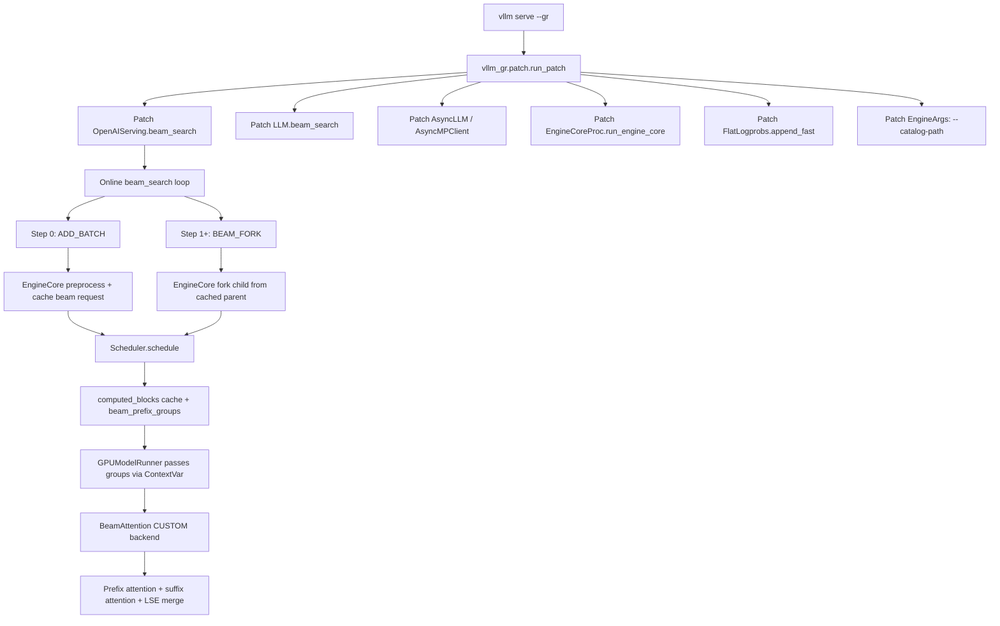

# vLLM-GR-JS Optimization Guide

本文是一份面向继续开发和优化的学习指南，目标是帮助你系统掌握 `vllm-gr-js` 对 vLLM / vLLM-Ascend 推理路径做了哪些改造、每个改造解决什么问题、代码在哪里、如何验证，以及后续优化应该从哪里入手。

本文以当前仓库代码为准，而不是以早期 `docs/DESIGN.md` / `docs/PRD.md` 为准。当前 `vllm-gr-js` 的实际重点不是 HSTU 模型执行器，而是围绕 OpenOneRec / Qwen3 生成式推荐推理场景，对 vLLM 0.14 的 beam search serving 路径做专门优化。

## 1. 背景和目标

OpenOneRec 的训练代码在原仓库中，推理侧直接使用 Qwen3 风格的生成模型完成推荐任务。推荐任务与普通聊天生成的差异非常明显：

- beam width 很大，常见 `n=128`、`512`，测试里甚至有 `1024`。
- decode 步数很短，例如 SID 只生成几段 token，通常 `max_tokens=5` 左右。
- 同一个请求内部所有 beams 共享同一个长 prompt / user history / item context 前缀。
- 输出格式高度结构化，例如 `<|sid_begin|><s_a_x><s_b_y><s_c_z><|sid_end|>`。
- 业务目标通常是低延迟地拿到 top-k 推荐候选，而不是长文本生成。

普通 vLLM 的 beam search 路径能工作，但不是为这种场景设计的。`vllm-gr-js` 的核心目标是减少以下开销：

- Python 层 beam search 循环、对象复制、logprobs 构造和排序开销。
- 每个 beam 作为独立 request 反复进入 engine 的提交开销。
- 每个 beam 重复构造完整 token prompt、重复计算 block hash 的开销。
- scheduler 中重复查询相同 prefix cache 的开销。
- attention 中每个 beam 重复读取和计算共享 prefix KV 的开销。
- 无效 SID 路径占用 beam 预算的问题。
- 多 GPU / 多进程 serving 时 API server Python 前端成为瓶颈的问题。

## 2. 仓库定位

`vllm-gr-js` 不是全量 fork vLLM，而是一个扩展包。它通过 monkey patch 改写 vLLM 的若干运行时入口。

最重要的入口文件：

- `vllm_gr/patch.py`
- `vllm_gr/init.py`
- `vllm_gr/entrypoints/cli/main.py`
- `vllm_gr/entrypoints/openai/serving_engine.py`
- `vllm_gr/entrypoints/llm.py`
- `vllm_gr/v1/engine/*`
- `vllm_gr/v1/attention/backends/beam_attn.py`
- `vllm_gr/logprobs.py`
- `vllm_gr/entrypoints/openai/serving_models.py`

启用方式主要有两种：

```bash
vllm serve MODEL --gr ...
```

或在 Python 进程中：

```python
import vllm_gr.init
```

`vllm_gr/init.py` 会在默认情况下自动调用 `run_patch()`。如果设置 `VLLM_GR_AUTOPATCH=0` / `false` / `no`，则不会自动 patch。

## 3. 总体架构

当前优化可以分成七层：

1. CLI / import 层：识别 `--gr`，加载 patch。
2. API 参数层：把 OpenAI chat request 的 `n`、`vllm_xargs` 转成 beam search 参数。
3. Beam search orchestration 层：重写 offline 和 online beam search。
4. Engine client 层：增加 `ADD_BATCH` 和 `BEAM_FORK`。
5. EngineCore 层：缓存 beam request 状态，fork child request。
6. Scheduler / worker 层：缓存 prefix cache 查询，向 attention 传递 beam prefix group。
7. Attention backend 层：GPU 上用 BeamAttention 复用共享 prefix。

整体调用关系如下：



## 4. 启动和 patch 机制

### 4.1 CLI 入口

文件：`vllm_gr/entrypoints/cli/main.py`

逻辑：

- 如果命令中包含 `serve` 和 `--gr`，说明用户要启动 vLLM-GR 专用路径。
- 如果 `--kv-transfer-config` 中包含 `LMCacheConnectorV1`，设置 `VLLM_GR_LMCACHE_PATCH=1`。
- 调用 `run_patch()`。
- 删除 `--gr`，再调用原始 vLLM CLI。

这意味着 `--gr` 不是 vLLM 原生参数，而是 `vllm-gr-js` 自己消费的开关。

### 4.2 run_patch 做了什么

文件：`vllm_gr/patch.py`

`run_patch()` 会执行：

- `patch_flat_logprobs()`
- `patch_beam_search()`
- `patch_sampling()`
- `patch_add_cli_args()`
- `patch_OpenAIServingModels_init()`
- `patch_offline_beam_search()`
- `patch_batch_and_fork()`
- 可选 patch LMCache adapter

这里有一个 `_PATCHED` guard，防止重复 patch。

注意：这个仓库大量依赖 vLLM 私有类和方法签名。升级 vLLM 时，最容易出问题的是：

- `OpenAIServing`
- `ChatCompletionRequest`
- `AsyncLLM`
- `AsyncMPClient`
- `EngineCoreProc`
- `Scheduler`
- `GPUModelRunner`
- `FlatLogprobs`

## 5. Beam Search 参数扩展

### 5.1 begin_token / end_token

文件：`vllm_gr/sampling_params.py`

`BeamSearchParams` 继承 vLLM 原始 `BeamSearchParams`，额外增加：

- `begin_token`
- `end_token`

对 OpenOneRec 推荐 SID 很重要。典型请求：

```json
{
  "use_beam_search": true,
  "n": 128,
  "max_tokens": 5,
  "vllm_xargs": {
    "begin_token": "<|sid_begin|>",
    "end_token": "<|sid_end|>"
  }
}
```

beam search 内部会在 prompt 后追加 begin token，结束时为 active beams 追加 end token。

### 5.2 OpenAI request 到 beam params 的转换

文件：`vllm_gr/entrypoints/openai/protocol.py`

核心映射：

- `n` -> `beam_width`
- `max_tokens` -> `max_tokens`
- `temperature` -> `temperature`
- `ignore_eos` -> `ignore_eos`
- `length_penalty` -> `length_penalty`
- `vllm_xargs.begin_token` -> `begin_token`
- `vllm_xargs.end_token` -> `end_token`

这让普通 OpenAI chat completions 请求可以携带 vLLM-GR 的 beam search 扩展。

## 6. Offline Beam Search 优化

文件：`vllm_gr/entrypoints/llm.py`

offline 路径 patch 的是：

```python
LLM.beam_search = vllm_gr.entrypoints.llm.beam_search
```

### 6.1 每步只生成一个 token

内部构造：

```python
SamplingParams(
    logprobs=beam_width,
    max_tokens=1,
    temperature=temperature,
    skip_clone=True,
    detokenize=False,
    flat_logprobs=True,
)
```

含义：

- beam search 本身控制多步循环。
- vLLM 每次只负责“从当前 beam 前缀生成下一个 token 的 top logprobs”。
- `detokenize=False` 避免每步生成文本，最终再统一 decode。
- `flat_logprobs=True` 使用轻量结构，减少 Python dict/list 对象开销。
- `skip_clone=True` 用于内部参数，避免不必要 clone。

### 6.2 top beam 选择用 argpartition

每步会形成 `beam_width * logprobs_num` 个候选。代码用：

```python
np.argpartition(np.negative(all_beams_logprob), beam_width)[:beam_width]
```

而不是完整排序。复杂度更适合大 beam width。

### 6.3 延迟 logprobs 重建

原始做法容易在每个 new beam 上复制完整历史 logprobs，导致步数增长时复制成本累积。

当前做法：

- 每个 beam 动态挂 `_lp_parent`。
- 每个 beam 动态挂 `_lp_step_data`。
- 中间步骤只存“父指针 + 当前步 top logprobs”。
- 最终只对 best beams 调 `reconstruct_beam_logprobs()`。

文件：`vllm_gr/logprobs.py`

收益：

- 中间 beam 不再复制 6 个 FlatLogprobs 内部数组。
- 从接近 `O(beams * steps^2)` 的拷贝降到最终 `O(beams * steps)`。

风险：

- 依赖 `BeamSearchSequence` 是普通 dataclass 且没有 `__slots__`。
- 如果上游 vLLM 给这个类加了 `__slots__`，动态属性会失效。

### 6.4 FlatLogprobs append_fast

文件：

- `vllm_gr/logprobs.py`
- `vllm_gr/logprobs_patch.py`

优化点：

- `token_ids.extend(...)`
- `logprobs.extend(...)`
- ranks / decoded tokens 是 list 时直接 extend。
- ranks / decoded tokens 是 iterator 时用 `itertools.islice` 限长。

这比逐元素 append 更适合 beam search 大量短数组追加。

## 7. Online Beam Search 优化

文件：`vllm_gr/entrypoints/openai/serving_engine.py`

online 路径 patch 的是：

```python
OpenAIServing.beam_search = vllm_gr.entrypoints.openai.serving_engine.beam_search
```

online 场景比 offline 更复杂，因为它要经过：

- API server
- AsyncLLM
- EngineCore client
- ZMQ
- EngineCore child process
- OutputProcessor
- RequestOutputCollector

因此 online 优化重点不仅是 beam search 算法，还包括 request 提交、状态复用和输出队列管理。

### 7.1 priority 作为 beam group id

online beam search 开始时设置：

```python
priority = int(time.perf_counter() * 1_000_000)
```

同一个逻辑 beam search 请求的所有 beams 共用这个 priority。

作用：

- scheduler 可以把同一个 beam search 请求下的 beams 当成同组。
- 后续 `_compute_beam_prefix_groups()` 按 priority 分组。
- priority scheduling 也让一组 beams 有类似调度优先级。

启动时建议配：

```bash
--scheduling-policy priority
```

### 7.2 ADD_BATCH：批量提交 beams

问题：标准路径中，每个 beam 都单独 add request。大 beam width 时，Python async、ZMQ 和 output queue 注册开销很高。

解决：增加新 EngineCore request type：`ADD_BATCH`。

相关文件：

- `vllm_gr/v1/engine/core_client_patch.py`
- `vllm_gr/v1/engine/core_client.py`
- `vllm_gr/v1/engine/async_llm.py`
- `vllm_gr/v1/engine/core.py`
- `vllm_gr/v1/engine/engine_core_patch.py`

客户端侧流程：

1. `prepare_request_fn()` 同步准备 request 和 queue，但不发送。
2. `_add_requests_batch_fn()` 批量发送 prepared requests。
3. `add_requests_async()` 发送 `EngineCoreRequestType.ADD_BATCH`。

EngineCore 子进程侧：

1. 替换 `EngineCoreProc.process_input_sockets`。
2. 遇到 `ADD_BATCH` 时解码 `list[EngineCoreRequest]`。
3. 对每个 request 调 `preprocess_add_request`。
4. 调 `_cache_beam_request()` 缓存 beam 状态。
5. 放入原始 `ADD` 队列。

收益：

- 第 0 步 beams 一次性提交。
- 减少 Python coroutine / ZMQ message / queue setup 开销。

### 7.3 BEAM_FORK：从父 beam 状态 fork 子 beam

这是 online 路径最核心的优化。

问题：beam search 第 1 步以后，每个 beam 都是从上一轮 beam 加一个 token 得到的。如果还按完整 prompt 重新进 engine，会重复做：

- 完整 token list 构造。
- 完整 request 构造。
- 完整 block hash 扫描。
- prefix cache 查询。
- request metadata 搬运。

解决：增加新 EngineCore request type：`BEAM_FORK`。

核心类型：`vllm_gr/v1/engine/types.py`

```python
class BeamForkRequest:
    parent_ids: list[str]
    child_ids: list[str]
    token_ids: list[int]
    abort_ids: list[str]
    sampling_params: SamplingParams
    eos_token_id: int | None
    priority: int
    data_parallel_rank: int | None
    lora_request: LoRARequest | None
    cache_salt: str | None
    trace_headers: Mapping[str, str] | None
```

EngineCore 侧核心函数：

- `_cache_beam_request()`
- `_handle_beam_fork()`

`_cache_beam_request()` 缓存：

- `all_token_ids`
- `block_hashes`
- `eos_token_id`
- `lora_request`
- `cache_salt`
- `mm_features`
- `prompt_embeds`
- `num_prompt_tokens`

`_handle_beam_fork()` 做：

1. 根据 `parent_id` 找 cached parent。
2. 构造 `child_token_ids = cached["all_token_ids"] + [token_id]`。
3. 创建 vLLM `Request`。
4. `block_hasher=None`，跳过 Request 初始化中的完整 hash。
5. 复制父 `block_hashes`。
6. 如果 `request_block_hasher` 存在，只对新完整 block 增量 hash。
7. 缓存 child request。
8. 把 child request 作为 `ADD` 入队。
9. 删除 parent ids 和 abort ids 的 beam cache。

这让后续 decode steps 变成轻量 fork，而不是完整 add request。

### 7.4 BEAM_FORK 的生命周期

online beam search 内部状态：

- `prev_beam_internal_ids`: 上一步 engine 内部 request ids。
- `fork_info`: 下一步需要从哪个 parent beam fork 哪个 token。

每轮逻辑：

1. 第 0 轮没有 `fork_info`，走 `ADD_BATCH`。
2. 模型返回每个 beam 的 top logprobs。
3. CPU 侧选出 top beams。
4. 构造 `fork_info = [(parent_beam_idx, token_id), ...]`。
5. 下一轮走 `BEAM_FORK`。
6. 没被选中的 parent request ids 进入 `abort_ids`。
7. 结束时用一次空 `BEAM_FORK` 清理剩余 beam cache。

如果某个 child parent 不在 cache：

- EngineCore 写一个 error output。
- 客户端不会无限等待。

如果中途模型返回 `finish_reason="error"`：

- serving path 会先发 cleanup `BEAM_FORK` 清理 cache。
- 然后返回 error `RequestOutput`。

## 8. Scheduler 优化

文件：`vllm_gr/v1/engine/engine_core_patch.py`

函数：`apply_scheduler_patch()`

它 patch：

```python
Scheduler.schedule
```

### 8.1 get_computed_blocks 缓存

问题：同一个 beam group 的 beams 共享大量 prefix，scheduler 对每个 beam 调 `kv_cache_manager.get_computed_blocks(req)` 会重复做相同或相似查询。

优化：

- 在一次 `schedule()` 调用内部临时替换 `self.kv_cache_manager.get_computed_blocks`。
- 使用 dict 缓存结果。
- 额外维护 `last_key / last_res` 快路径。

cache key：

- `req.num_tokens`
- `req.skip_reading_prefix_cache`
- `last_hash`

其中 `last_hash` 取最后一个 relevant full block hash。如果没有 hash，则用 `request_id` 兜底。

缓存阈值：

```python
cache_th = 256
```

只有 prefix cache 命中 tokens 数大于 256 才认为值得缓存。

收益：

- 大共享前缀 beam group 中，后续 beams 可以复用第一个 beam 的 computed blocks 查询结果。
- 减少 scheduler CPU 开销。
- 保持 prefix cache stats 统计更新。

### 8.2 beam_prefix_groups 计算

函数：

- `_get_lcp()`
- `_compute_beam_prefix_groups()`

目标：

- 找出同一 beam group 内各 requests 共享多少 block prefix。
- 给 BeamAttention backend 提供 prefix/suffix 拆分依据。

逻辑：

1. 从 `scheduler_output.num_scheduled_tokens.keys()` 拿本轮 scheduled request ids。
2. 按 `requests[req_id].priority` 分组。
3. 对同组 request 的 `block_hashes` 求 longest common prefix。
4. 如果共享 block 数太少，则 depth 置 0，不启用共享 attention。

阈值：

```python
min_group_th = 256 // block_size
```

即共享前缀至少约 256 tokens 才值得启用共享 prefix attention。

最终把结果挂到：

```python
output.beam_prefix_groups
```

## 9. GPUModelRunner 到 Attention 的 metadata 传递

文件：`vllm_gr/v1/engine/engine_core_patch.py`

函数：`apply_worker_patches()`

问题：scheduler 算出来的是 request id 维度的 groups，而 attention builder 构造 metadata 时需要 batch index 维度。

解决：

- patch `GPUModelRunner.execute_model`。
- 从 `scheduler_output.beam_prefix_groups` 读取 request-id groups。
- patch `GPUModelRunner._build_attention_metadata`。
- 用 `self.input_batch.req_ids` 建立 `req_id -> batch index` 映射。
- 翻译为 `(depth, [batch_indices])`。
- 通过 `ContextVar` `BEAM_PREFIX_GROUPS_VAR` 传给 BeamAttention metadata builder。

好处：

- 不需要改 vLLM attention metadata builder 的公共接口。
- 只在当前 execute_model 调用上下文中传递 beam group，不污染全局状态。

风险：

- 依赖 `GPUModelRunner.execute_model` 和 `_build_attention_metadata` 私有签名。
- 升级 vLLM 时要重点回归这里。

## 10. BeamAttention GPU 后端

文件：`vllm_gr/v1/attention/backends/beam_attn.py`

注册方式：

```python
@register_backend(AttentionBackendEnum.CUSTOM)
class BeamAttentionBackend(AttentionBackend):
    ...
```

启用方式：

```bash
--attention-backend CUSTOM
```

### 10.1 适用条件

`vllm_gr/__init__.py` 只有在以下条件满足时才导入注册：

- `torch.cuda.is_available()`
- `is_flash_attn_varlen_func_available()`

BeamAttentionBackend 自身限制：

- dtype：`torch.float16` / `torch.bfloat16`
- head size：`<= 256` 且是 8 的倍数
- block size：16 的倍数
- compute capability：`>= 8.0`
- 支持 decoder / encoder / encoder-only / encoder-decoder attention type
- 不支持 MLA
- 不支持 sparse attention
- fp8 KV cache 依赖 FlashAttention fp8 支持

### 10.2 核心思想

普通 attention：

```text
beam0: attend [shared_prefix + suffix0]
beam1: attend [shared_prefix + suffix1]
beam2: attend [shared_prefix + suffix2]
...
```

共享 prefix 被重复读取和计算。

BeamAttention：

```text
prefix pass:
  group attend [shared_prefix]

suffix pass:
  each beam attend [suffix_i]

merge:
  LSE merge(prefix_out, prefix_lse, suffix_out, suffix_lse)
```

它不是简单相加，而是基于 attention softmax 的 log-sum-exp 做正确归一化合并。

### 10.3 Metadata 构造

类：`BeamAttentionMetadataBuilder`

入口：

```python
build(common_prefix_len, common_attn_metadata, fast_build=False)
```

流程：

1. 从 `BEAM_PREFIX_GROUPS_VAR` 读取 beam groups。
2. 如果没有 groups，走标准 metadata。
3. 过滤 depth 为 0 的 group。
4. 用 query length 过滤不适合优化的 group。
5. 构造 shared metadata。

query length 过滤：

- query length 必须 `> 0`
- query length 必须 `<= block_size * 2`

这符合推荐 beam search 的短 decode 特征。长 query 时 prefix/suffix 分拆的收益可能不稳定。

### 10.4 Prefix metadata

函数：`_create_prefix_metadata()`

构造：

- `prefix_block_table`
- `cu_prefix_query_lens`
- `prefix_kv_lens`
- `prefix_indices`
- `prefix_query_max_len`
- `prefix_kv_max_len`
- `shift_amounts`
- `group_first_reqs`

关键点：

- 每个共享 group 取第一个 request 的 block table 作为 prefix block table。
- `prefix_kv_lens = group_depth * block_size`。
- 如果 prefix query 覆盖所有 requests 且顺序一致，走 identity path，不需要 `prefix_indices` gather。
- 如果不是 identity path，构造 `prefix_indices`，只取参与 prefix sharing 的 query rows。
- 尽量在 CPU tensor 上计算 lens / indices，再用 pinned memory + non_blocking 搬到 GPU，减少同步。

### 10.5 Suffix metadata

函数：`_create_suffix_metadata()`

构造：

- `suffix_block_table`
- `suffix_kv_lens`
- `suffix_query_max_len`
- `suffix_kv_max_len`
- `suffix_col_indices`

核心思想：

- 每个 request 的 suffix 从共享 prefix depth 后开始。
- 用 `shift_amounts` 构造 column indices。
- 用 `torch.gather(block_table, 1, suffix_col_indices)` 得到 suffix block table。

### 10.6 Forward 计算

类：`BeamAttentionImpl`

核心函数：`cascade_attention()`

Prefix pass：

```python
flash_attn_varlen_func(
    q=prefix_query,
    k=key_cache,
    v=value_cache,
    causal=False,
    block_table=prefix_block_table,
    return_softmax_lse=True,
)
```

Suffix pass：

```python
flash_attn_varlen_func(
    q=query,
    k=key_cache,
    v=value_cache,
    causal=True,
    block_table=suffix_block_table,
    return_softmax_lse=True,
    out=output,
)
```

Merge：

- identity path：使用 vLLM `merge_attn_states`
- non-identity path：使用自定义 Triton kernel `_merge_indexed_attn_states_kernel`

Triton merge 的数学逻辑：

```text
m = max(lse_prefix, lse_suffix)
se_prefix = exp(lse_prefix - m)
se_suffix = exp(lse_suffix - m)
output = (se_prefix * prefix_out + se_suffix * suffix_out) / (se_prefix + se_suffix)
```

这保证 prefix/suffix 分开算后与完整 attention 的结果一致。

### 10.7 验证

测试文件：

- `tests/kernels/attention/test_cascade_beam_flash_attn.py`

测试覆盖：

- batch size 1 / 4 / 3
- beam width 16 / 32
- q seq len 1 / 4 / 8
- kv seq len 16 / 32 / 64 / 128
- suffix kv len 4 / 8
- head size 128 / 192 / 256
- dtype fp16 / bf16
- FlashAttention 2 / 3
- soft cap None / 50
- identity path 和 non-identity path

验证方式：BeamAttention 输出与标准 FlashAttention varlen 输出 `torch.testing.assert_close(atol=1e-2, rtol=1e-2)`。

## 11. Catalog 约束优化

文件：

- `vllm_gr/engine/arg_utils.py`
- `vllm_gr/entrypoints/openai/serving_models.py`
- `vllm_gr/entrypoints/openai/serving_engine.py`

### 11.1 --catalog-path

`patch_add_cli_args()` 给 vLLM `EngineArgs` 增加：

```bash
--catalog-path PATH
```

并把路径写入 `ModelConfigGr.catalog_path`。

### 11.2 Catalog trie

类：`Catalog`

加载 JSON：

```json
[
  ["<|sid_begin|>", "<s_a_1>", "<s_b_2>", "<s_c_3>", "<|sid_end|>"],
  ...
]
```

内部转成 token id trie：

```text
root
  token_a
    token_b
      token_c
```

`valid(token_ids)` 返回当前前缀下合法的下一 token 集合。

### 11.3 与 beam search 并行

online beam search 每步：

1. 对每个 beam 计算已生成 token。
2. 调 `catalog.valid(generated_tokens)`。
3. 这一步通过 `asyncio.to_thread` 启动，和 engine step 并行。
4. engine output 回来后，非法 token 的 logprob 设置为 `-inf`。

收益：

- 避免 beam 扩展到无效 SID。
- 提高 top beams 的业务有效性。
- 对结构化推荐输出非常关键。

注意：

- 这是 CPU trie 查询。
- beam width 极大时，catalog 查询自身也可能成为 CPU 热点。
- 后续可考虑批量化 trie 查询、C++ 实现、或者把合法 token mask 下沉到更靠近 sampling 的位置。

## 12. Data Parallelism 支持

相关文件：

- `vllm_gr/entrypoints/openai/serving_engine.py`
- `vllm_gr/v1/engine/core_client.py`
- `vllm_gr/v1/engine/types.py`
- `tests/test_dp_beam_search_unit.py`
- `docs/data_parallelism.md`

### 12.1 vLLM 内部 DP rank 透传

online beam search 会检查：

```python
self.engine_client.vllm_config.parallel_config.data_parallel_size
```

如果 `data_parallel_size > 1`，则用 round-robin 选一个 rank。

这个 rank 会传给：

- `prepare_request`
- `register_beam_output`
- `BeamForkRequest.data_parallel_rank`
- cleanup `BeamForkRequest`

目的：

- 同一个 beam search 的所有 beams 和后续 forks 固定在同一个 data parallel rank。
- 避免 parent beam cache 在 rank A，但 child fork 被发到 rank B。

### 12.2 AsyncMPClient DP routing

`add_requests_async()`：

- DP client 有 `get_core_engine_for_request`。
- 第一个 request 决定 chosen engine。
- 其余 requests 手动登记到同一个 `reqs_in_flight` engine。

`beam_fork_async()`：

- 如果 `fork_request.data_parallel_rank` 非空，直接取 `self.core_engines[rank]`。
- child ids 登记到 `reqs_in_flight`。
- abort ids 从 `reqs_in_flight` 删除。

### 12.3 FIRST_REQ 和 current_wave

代码还兼容：

- engines idle 时发 `FIRST_REQ` 给 coordinator。
- client 上如果有 `current_wave`，则传给 batch requests / fork request。

这些是 vLLM DP 调度机制相关的兼容点。

### 12.4 多进程 + Nginx DP

`docs/data_parallelism.md` 推荐更实用的 scaling 方式：

- 启动多个独立 `vllm serve --gr` 进程。
- 每个进程绑一张 GPU。
- 用 Nginx `least_conn` 做负载均衡。

原因：

- 高 beam search 下 API server 前端 Python 也会成为瓶颈。
- 多进程可以绕开单进程 GIL / event loop / tokenization / request orchestration 限制。

这与 vLLM 内部 DP rank 透传是两层不同的扩展方式。

## 13. LMCache 支持

文件：

- `docs/lmcache.md`
- `vllm_gr/3rd_party/lmcache/integration/vllm/vllm_v1_adapter.py`
- `vllm_gr/patch.py`
- `vllm_gr/v1/engine/engine_core_patch.py`

### 13.1 为什么需要 patch LMCache

`BEAM_FORK` 创建的 child beam request 可能没有完整的 allocated block / slot mapping metadata。原始 LMCache adapter 对 request metadata 的假设更接近普通 vLLM request。

如果不 patch，可能出现：

- 无 allocated blocks 的 request 被错误处理。
- slot_mapping 为 None 的 request 被拿去 load/save KV。
- fork beam 的 cache metadata 与 LMCache 请求追踪不兼容。

### 13.2 patch 内容

`patch_installed_lmcache_adapter()` 做三类 patch：

1. `RequestTracker.from_new_request`
   - 兼容 `block_ids` 为空。
   - 兼容 `block_ids` 是 list 或 nested list。

2. `ReqMeta.from_request_tracker`
   - 如果 `allocated_block_ids` 为空，则返回 None。
   - 表示这个 request 跳过 LMCache KV 管理。

3. `LMCacheConnectorV1Impl`
   - `start_load_kv`
   - `save_kv_layer`
   - `wait_for_save`

   这些函数执行前临时过滤 `slot_mapping is None` 的 requests，执行后恢复。

### 13.3 启用方式

如果命令行中含：

```bash
--kv-transfer-config '{"kv_connector":"LMCacheConnectorV1", "kv_role":"kv_both"}'
```

CLI 会设置：

```bash
VLLM_GR_LMCACHE_PATCH=1
```

EngineCore child process 中也会根据 config 或 env 再 patch 一次，因为 multiprocessing spawn 不继承父进程 monkey patch。

## 14. NPU / GPU 边界

这是继续优化时必须明确的一点。

### 14.1 GPU 路径

GPU 可以使用全部优化：

- Python beam search 优化
- FlatLogprobs 优化
- ADD_BATCH
- BEAM_FORK
- scheduler computed blocks cache
- beam_prefix_groups
- GPUModelRunner patch
- BeamAttention CUSTOM backend
- catalog
- DP
- LMCache patch

其中 BeamAttention 依赖 CUDA + FlashAttention varlen。

### 14.2 NPU 路径

当前仓库的 Ascend 支持主要体现在：

- `pyproject.toml` 依赖允许 `vllm==0.14.*`
- `docs/quickstart-ascend.md` 指导安装 `vllm-ascend==0.14.0rc1`
- Python / engine 层 patch 理论上可以运行在 vLLM-Ascend 暴露兼容 API 的前提下

但当前代码没有看到 NPU 版 BeamAttention kernel。

也就是说，NPU 当前主要吃到：

- online/offline beam search CPU 侧优化
- FlatLogprobs 优化
- ADD_BATCH / BEAM_FORK
- catalog 约束
- scheduler 层部分优化
- LMCache 兼容 patch

NPU 暂时吃不到：

- CUDA FlashAttention varlen BeamAttention
- Triton merge kernel
- `--attention-backend CUSTOM` 对 CUDA custom backend 的效果

后续如果目标是 NPU 上继续优化，最有价值的方向之一就是做 Ascend / CANN 版本的 shared-prefix beam attention，或者在 vLLM-Ascend 现有 attention backend 中接入等价 prefix/suffix metadata。

## 15. 与 vLLM 原始路径的核心差异

### 15.1 原始 online beam search

简化理解：

```text
for step in max_tokens:
    for beam in beams:
        submit full prompt tokens as a request
    wait outputs
    build candidates
    sort / select top beams
```

问题：

- 每个 beam 都是完整 request。
- 每步大量 Python / ZMQ / queue 操作。
- 完整 token list 和 block hash 重复处理。
- 共享 prefix 在 scheduler 和 attention 中重复处理。

### 15.2 vllm-gr-js online beam search

```text
step 0:
    prepare all beams
    submit ADD_BATCH
    EngineCore caches beam request states

step 1+:
    select parent beam + token
    send BEAM_FORK
    EngineCore creates child from cached parent
    only append one token
    reuse block hashes incrementally

scheduler:
    cache computed_blocks
    compute beam_prefix_groups

attention:
    prefix pass for shared prefix
    suffix pass for per-beam suffix
    merge attention states
```

这就是整个仓库最重要的设计。

## 16. 测试体系

推荐按以下顺序看测试。

### 16.1 ADD_BATCH / BEAM_FORK 单元测试

文件：`tests/test_batch_and_fork_unit.py`

覆盖：

- `BeamForkRequest` msgpack 序列化
- runtime enum 注入
- beam cache 存储和清理
- fork child request
- parent 缺失时 error output
- client patch 是否挂载
- beam search 是否第 0 步 ADD_BATCH、第 1 步 BEAM_FORK
- cleanup 是否 abort 剩余 beam ids
- begin/end token 和 EOS 逻辑

这是理解 engine 改造最重要的测试文件。

### 16.2 DP 单元测试

文件：`tests/test_dp_beam_search_unit.py`

覆盖：

- rank selection
- ADD_BATCH DP routing
- BEAM_FORK DP routing
- `reqs_in_flight` tracking
- `FIRST_REQ`
- `current_wave`
- `data_parallel_rank` 序列化

### 16.3 BeamAttention kernel 测试

文件：`tests/kernels/attention/test_cascade_beam_flash_attn.py`

覆盖：

- shared prefix / suffix block table 构造
- identity path
- non-identity path
- FlashAttention 2/3
- fp16/bf16
- 多 head size

这是理解 GPU attention 优化正确性的关键。

### 16.4 Offline / serving beam search 集成测试

文件：

- `tests/test_offline_beam_search.py`
- `tests/test_serving_beam_search.py`
- `tests/test_serving_catalog.py`

覆盖：

- OpenOneRec/OneRec-1.7B 实际模型
- `beam_width=512` / `1024`
- begin/end token
- memory leak 粗略检测
- catalog 约束输出验证

这些测试依赖 CUDA 和模型下载，不适合每次都跑，但适合优化后做回归。

## 17. 学习路线

建议按下面顺序掌握，不要直接从 `beam_attn.py` 开始。

### 阶段 1：掌握 patch 入口

读：

- `vllm_gr/init.py`
- `vllm_gr/patch.py`
- `vllm_gr/entrypoints/cli/main.py`

目标：

- 明白 `--gr` 如何生效。
- 明白哪些 vLLM 类被替换。
- 明白 child process 为什么要重新 patch。

练习：

- 在 `run_patch()` 每个 patch 后打日志，启动 `vllm serve --gr` 看调用顺序。

### 阶段 2：掌握 beam search 主循环

读：

- `vllm_gr/entrypoints/openai/serving_engine.py`
- `vllm_gr/entrypoints/llm.py`
- `vllm_gr/logprobs.py`

目标：

- 画出每一步 beam 扩展流程。
- 理解 `FlatLogprobs` 为什么能减少内存和 CPU 开销。
- 理解 `_lp_parent` / `_lp_step_data` 如何重建最终 logprobs。

练习：

- 用小 beam width 手动打印 `all_beams_token_id`、`all_beams_logprob`、`topn_idx`、`fork_info`。

### 阶段 3：掌握 ADD_BATCH / BEAM_FORK

读：

- `vllm_gr/v1/engine/types.py`
- `vllm_gr/v1/engine/async_llm.py`
- `vllm_gr/v1/engine/core_client.py`
- `vllm_gr/v1/engine/core.py`
- `tests/test_batch_and_fork_unit.py`

目标：

- 明白 `prepare_request` 和真正发送 request 为什么拆开。
- 明白 `BEAM_FORK` 如何避免完整 prompt 重建。
- 明白 beam cache 如何创建、使用和清理。

练习：

- 构造 parent ids / child ids / token ids，手动调用 `_handle_beam_fork()`，观察 input queue。

### 阶段 4：掌握 scheduler 和 prefix group

读：

- `vllm_gr/v1/engine/engine_core_patch.py`

重点函数：

- `_get_lcp`
- `_compute_beam_prefix_groups`
- `apply_scheduler_patch`
- `apply_worker_patches`

目标：

- 理解 block hash 如何代表 prefix。
- 理解 priority 为什么能作为 beam group id。
- 理解 `beam_prefix_groups` 如何从 request ids 翻译成 batch indices。

练习：

- 用几组假的 `block_hashes` 调 `_compute_beam_prefix_groups()`，验证 LCP depth。

### 阶段 5：掌握 BeamAttention

读：

- `vllm_gr/v1/attention/backends/beam_attn.py`
- `tests/kernels/attention/test_cascade_beam_flash_attn.py`

建议顺序：

1. `BeamAttentionBackend` 支持条件。
2. `BeamAttentionMetadata` 字段。
3. `BeamAttentionMetadataBuilder.build()`。
4. `_create_prefix_metadata()`。
5. `_create_suffix_metadata()`。
6. `BeamAttentionImpl.cascade_attention()`。
7. `_merge_indexed_attn_states_kernel()`。

目标：

- 能解释 prefix/suffix attention 为什么能和完整 attention 等价。
- 能解释 identity path 和 non-identity path 的区别。
- 能解释为什么要用 LSE merge。

练习：

- 把测试中的 `batch_size=1, beam_width=2, block_size=16` 简化，手动画 block table。

### 阶段 6：掌握 catalog / DP / LMCache

读：

- `vllm_gr/entrypoints/openai/serving_models.py`
- `vllm_gr/engine/arg_utils.py`
- `docs/data_parallelism.md`
- `docs/lmcache.md`
- `vllm_gr/3rd_party/lmcache/integration/vllm/vllm_v1_adapter.py`

目标：

- 理解结构化推荐输出如何用 trie 约束。
- 理解 DP 下为什么必须固定 rank。
- 理解 LMCache 为什么需要过滤 fork beam 的 metadata。

## 18. 性能瓶颈分析方法

继续优化前建议先区分瓶颈类型。

### 18.1 CPU beam orchestration 瓶颈

表现：

- GPU 利用率不高。
- beam width 增大后 latency 非线性增加。
- Python CPU 高。
- API server 单进程吞吐上不去。

重点看：

- `serving_engine.py`
- `logprobs.py`
- catalog 查询
- output queue 等待
- `np.argpartition`

可尝试：

- profiling `beam_search_overhead`
- 用 Nginx 多进程横向扩展
- 把 catalog 查询 C++ 化或批量化
- 评估 `minheap_cpp` 是否应该接入

### 18.2 EngineCore / scheduler 瓶颈

表现：

- 每步 request 提交和调度时间高。
- prefix cache hit 高但 scheduler CPU 仍高。

重点看：

- ADD_BATCH 是否生效
- BEAM_FORK 是否生效
- `get_computed_blocks` 缓存命中
- `beam_prefix_groups` 是否产生非 0 depth

可尝试：

- 打印 `beam_prefix_groups`
- 统计 `get_computed_blocks` 调用次数
- 调整共享阈值 `256`

### 18.3 GPU attention 瓶颈

表现：

- GPU 利用率高。
- 长 prompt + 大 beam width 下 decode step 慢。
- 使用 `--attention-backend CUSTOM` 后才有明显变化。

重点看：

- BeamAttention 是否实际注册。
- `BEAM_PREFIX_GROUPS_VAR` 是否有非空 groups。
- shared groups 是否被 query len filter 掉。
- prefix depth 是否超过阈值。

可尝试：

- 比较 `--attention-backend CUSTOM` 和默认 backend。
- 在 `BeamAttentionMetadataBuilder.build()` 打统计。
- 调整 `min_tokens_for_sharing`、`tokens_threshold_for_sharing`、scheduler prefix threshold。

### 18.4 NPU 后端瓶颈

表现：

- Python/engine 优化生效，但 attention 侧没有 CUSTOM backend 收益。

重点看：

- vLLM-Ascend 是否支持同等 request / scheduler patch。
- NPU attention backend 是否能接收 prefix/suffix metadata。
- CANN/Ascend 能否实现 LSE merge 或复用已有 cascade attention。

可尝试：

- 先确认 ADD_BATCH / BEAM_FORK 在 NPU 上功能正确。
- 再做 NPU equivalent BeamAttention。

## 19. 后续优化方向

### 19.1 NPU BeamAttention

当前最大缺口。目标是在 Ascend 上实现与 CUDA BeamAttention 等价的：

- shared prefix metadata
- suffix metadata
- prefix attention
- suffix attention
- LSE merge

实现方式可能有三种：

1. 在 vLLM-Ascend attention backend 中增加 beam prefix/suffix 路径。
2. 写独立 CANN custom op。
3. 利用现有 Ascend flash attention / paged attention 能力做两次 attention，再加 merge op。

优先级建议最高，因为这能把 GPU 上最重要的共享 prefix attention 优化带到 NPU。

### 19.2 Catalog 查询加速

当前 catalog 是 Python trie + set，且每个 beam 每步查一次。可优化：

- C++ trie。
- 批量查询所有 beams。
- 将 trie 状态保存在 beam 对象中，避免每次从 root 遍历 generated tokens。
- 如果 SID 层级固定，改成层级数组查表。
- 在 sampling 前做 token mask，而不是拿到 logprobs 后再置 `-inf`。

### 19.3 Beam candidate selection 加速

当前实际使用 `np.argpartition`。仓库里有 `vllm_gr/csrc/minheap.cpp`，但未接入。

可评估：

- `beam_width=128/512/1024` 下 `np.argpartition` 是否是热点。
- catalog 约束后是否可以用 striped minheap 提前停止。
- 把 EOS / invalid token filter 合并进 C++ candidate selection。

### 19.4 减少 monkey patch 脆弱性

风险最高的 patch：

- enum runtime 注入 `ADD_BATCH` / `BEAM_FORK`
- 替换 `EngineCoreProc.process_input_sockets`
- 替换 `EngineCoreProc.run_engine_core`
- patch `GPUModelRunner._build_attention_metadata`
- patch dataclass dynamic attrs

长期方向：

- upstream 到 vLLM 正式扩展点。
- 或封装版本检查，遇到不兼容 vLLM 版本时提前报错。
- 给每个 patch 增加最小 API signature 检查。

### 19.5 Beam cache 内存和生命周期监控

当前有 cleanup，但可以增加：

- beam_cache size 指标。
- fork parent miss 计数。
- abort_ids 计数。
- request error cleanup 计数。
- 长时间残留 beam cache 检测。

这对 production 稳定性很重要。

### 19.6 更细的 metrics

当前 `RequestStateStats` 增加：

- `beam_search_overhead`
- `beam_search_decode_time`
- `num_generation_tokens`

可以继续拆：

- catalog time
- engine wait time
- candidate selection time
- logprobs reconstruction time
- ADD_BATCH submit time
- BEAM_FORK submit time
- scheduler prefix group count
- prefix shared depth average

这样后续优化才有明确归因。

## 20. 快速定位表

| 主题 | 文件 |
| --- | --- |
| patch 总入口 | `vllm_gr/patch.py` |
| 自动 patch | `vllm_gr/init.py` |
| CLI `--gr` | `vllm_gr/entrypoints/cli/main.py` |
| OpenAI beam search | `vllm_gr/entrypoints/openai/serving_engine.py` |
| Offline beam search | `vllm_gr/entrypoints/llm.py` |
| beam 参数扩展 | `vllm_gr/sampling_params.py` |
| request 参数转换 | `vllm_gr/entrypoints/openai/protocol.py` |
| FlatLogprobs 优化 | `vllm_gr/logprobs.py` |
| ADD_BATCH / BEAM_FORK 类型 | `vllm_gr/v1/engine/types.py` |
| AsyncLLM patch 方法 | `vllm_gr/v1/engine/async_llm.py` |
| AsyncMPClient patch 方法 | `vllm_gr/v1/engine/core_client.py` |
| EngineCore 子进程处理 | `vllm_gr/v1/engine/core.py` |
| EngineCore patch 总逻辑 | `vllm_gr/v1/engine/engine_core_patch.py` |
| BeamAttention | `vllm_gr/v1/attention/backends/beam_attn.py` |
| catalog | `vllm_gr/entrypoints/openai/serving_models.py` |
| CLI catalog 参数 | `vllm_gr/engine/arg_utils.py` |
| LMCache patch | `vllm_gr/3rd_party/lmcache/integration/vllm/vllm_v1_adapter.py` |
| DP 文档 | `docs/data_parallelism.md` |
| LMCache 文档 | `docs/lmcache.md` |
| Ascend 安装 | `docs/quickstart-ascend.md` |

## 21. 推荐启动命令

GPU online serving：

```bash
vllm serve OpenOneRec/OneRec-1.7B \
  --gr \
  --max-logprobs 1024 \
  --max-num-seqs 1024 \
  --max-num-batched-tokens 16384 \
  --scheduling-policy priority \
  --attention-backend CUSTOM \
  --default-chat-template-kwargs '{"enable_thinking": false}'
```

带 catalog：

```bash
vllm serve OpenOneRec/OneRec-1.7B \
  --gr \
  --catalog-path /path/to/catalog.json \
  --max-logprobs 1024 \
  --max-num-seqs 1024 \
  --max-num-batched-tokens 16384 \
  --scheduling-policy priority \
  --attention-backend CUSTOM \
  --default-chat-template-kwargs '{"enable_thinking": false}'
```

Ascend / NPU：

```bash
pip install vllm-ascend==0.14.0rc1
vllm serve OpenOneRec/OneRec-1.7B \
  --gr \
  --max-logprobs 1024 \
  --max-num-seqs 1024 \
  --max-num-batched-tokens 16384 \
  --scheduling-policy priority \
  --default-chat-template-kwargs '{"enable_thinking": false}'
```

注意：NPU 上当前不要默认假设 `--attention-backend CUSTOM` 有 CUDA BeamAttention 的效果，需要结合 vLLM-Ascend 实测。

## 22. 一句话总结

`vllm-gr-js` 的核心不是“换模型”，而是把 vLLM 的 beam search serving 路径改造成适合生成式推荐的执行方式：

- 用 flat logprobs 和延迟重建降低 Python beam search 开销。
- 用 `ADD_BATCH` 降低第一步大批量 beam request 提交开销。
- 用 `BEAM_FORK` 复用父 beam request 状态，避免每步完整 prompt 重建和 hash。
- 用 scheduler computed-block cache 减少共享 prefix 的重复 cache 查询。
- 用 beam prefix groups 把共享前缀传到 attention。
- GPU 上用 BeamAttention 把 shared prefix 和 per-beam suffix 拆开计算，再正确合并。
- 用 catalog trie 约束结构化 SID 生成，减少无效 beam。
- 用 DP / 多进程部署缓解 API server 和 Python orchestration 瓶颈。

掌握这个仓库的关键，是先理解 `ADD_BATCH + BEAM_FORK` 的 engine 生命周期，再理解 scheduler 如何产生共享 prefix groups，最后理解 GPU BeamAttention 如何利用这些 groups 做 prefix/suffix attention 复用。
