# vLLM-GR-JS 汇报PPT材料

本文是一份用于制作汇报 PPT 的结构化材料。它不是完整代码学习手册，而是面向听众解释“为什么要做、做了什么、原理是什么、收益来自哪里、后续还能怎么优化”的汇报提纲。

建议 PPT 主题：

**vLLM-GR-JS：面向生成式推荐 Beam Search 推理的 vLLM 优化**

建议页数：12-16 页。

建议汇报时长：20-30 分钟。

## 1. 汇报主线

### 一句话结论

`vllm-gr-js` 不是替换模型，而是把 vLLM 的通用推理路径改造成适合生成式推荐大 beam search 的执行路径：减少 Python/Engine 请求开销，复用 beam 共享前缀，在 GPU 上用 shared-prefix attention 降低重复 KV 读取和计算，并用 catalog 约束保证生成结果有效。

### 核心叙事

1. OpenOneRec 推理不是普通聊天生成，而是“大 beam、短 decode、共享长前缀、结构化 SID 输出”。
2. 原始 vLLM 可以跑 beam search，但每个 beam 反复作为完整 request 进入 engine，CPU、调度、KV cache 查询和 attention 都有重复。
3. `vllm-gr-js` 的优化是分层做的：
   - beam search 循环更轻。
   - 第一步批量提交 beams。
   - 后续步骤从父 beam 状态 fork 子 beam。
   - scheduler 识别 beam 共享前缀。
   - GPU attention 把共享 prefix 和独立 suffix 拆开计算。
   - catalog 约束无效 SID。
4. GPU 和 NPU 的优化边界不同：Python/Engine 层可共享，CUDA BeamAttention 当前只覆盖 GPU。
5. 后续优化重点是 NPU shared-prefix attention、catalog 加速和减少 monkey patch 脆弱性。

## 2. PPT 页面建议

## Slide 1. 标题页

### 标题

vLLM-GR-JS：面向生成式推荐 Beam Search 推理的 vLLM 优化

### 副标题

OpenOneRec / Qwen3 推理场景下的大 beam search 加速方案分析

### 讲解要点

- 本次汇报目标是讲清楚 `vllm-gr-js` 这个仓库做了哪些推理优化。
- 重点不是训练，也不是模型结构，而是推理系统。
- 重点场景是生成式推荐：给定用户上下文，通过 LLM 生成推荐 item 的结构化 ID。

### 配图建议

放一个简单关系图：

```text
OpenOneRec/Qwen3 推理任务
        ↓
vLLM 通用推理框架
        ↓
vLLM-GR-JS 针对 Beam Search 的推荐场景优化
        ↓
GPU / NPU Serving
```

## Slide 2. 业务场景：生成式推荐推理有什么不同

### 标题

生成式推荐不是普通聊天生成

### 讲解要点

普通 LLM serving 常见特点：

- 输出较长。
- beam width 通常较小或不用 beam search。
- 请求之间前缀不一定强共享。
- 输出自由文本。

OpenOneRec 生成式推荐特点：

- beam width 很大，例如 128、512、1024。
- decode 很短，常见只生成 5 个左右 token。
- 同一个请求内所有 beams 共享长 prompt / user history。
- 输出是结构化 SID，例如 `<|sid_begin|><s_a_x><s_b_y><s_c_z><|sid_end|>`。
- 目标是拿到 top-k 推荐候选。

### 推荐图表

| 对比项 | 普通聊天生成 | 生成式推荐推理 |
| --- | --- | --- |
| 输出长度 | 长 | 短 |
| beam width | 小或不用 | 很大 |
| 前缀共享 | 弱 | 同请求内极强 |
| 输出形式 | 自由文本 | 结构化 item/SID |
| 主要瓶颈 | decode 计算 | beam orchestration + prefix 重复 |

### PPT 讲法

这一页要让听众意识到：通用 LLM 推理系统的优化目标不完全适合推荐推理。推荐推理的瓶颈不只是模型 forward，还有大量 beam 管理和共享前缀重复处理。

## Slide 3. 原始 vLLM Beam Search 的重复开销

### 标题

原始路径：每个 beam 都像一个完整请求

### 讲解要点

原始 beam search 可以抽象成：

1. 每一轮把当前所有 beams 都作为独立 prompt 提交。
2. 每个 beam 都重新经过 request 构造、hash、调度、KV cache 查询。
3. attention 计算时，每个 beam 都重复读共享 prefix KV。
4. Python 层还要反复构造 logprobs、复制 beam 状态、排序。

### 推荐流程图

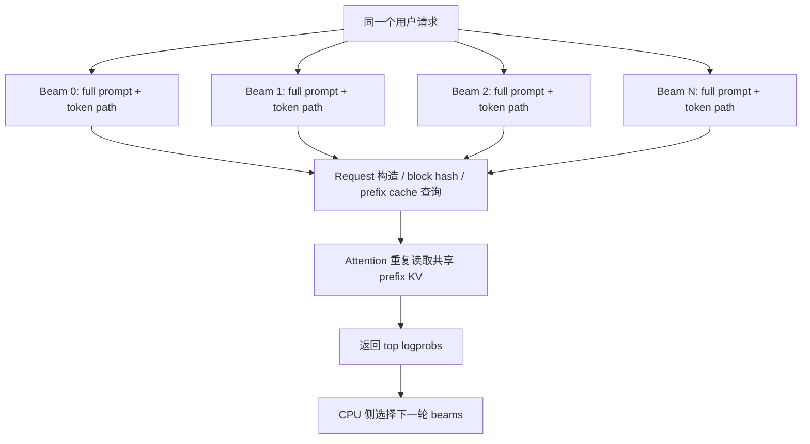

### 图中强调

用红色标注“重复”：

- full prompt 重复处理
- block hash 重复计算
- prefix cache 重复查询
- shared KV 重复 attention

### PPT 讲法

原始路径的问题不是“不能跑”，而是没有利用 beam search 内部高度结构化的关系。所有 beams 的前缀几乎完全一样，但系统把它们当作彼此独立的请求处理。

## Slide 4. vLLM-GR-JS 的总体方案

### 标题

总体思路：从“独立请求”变成“共享状态的 beam group”

### 讲解要点

`vllm-gr-js` 做了一个分层优化：

- API 层：支持 OpenAI chat request 中使用 beam search 和 SID begin/end token。
- Beam 层：降低 logprobs 和 beam 状态复制开销。
- Engine 层：增加 `ADD_BATCH` 和 `BEAM_FORK`。
- Scheduler 层：识别同一 beam group 的共享 block prefix。
- Attention 层：GPU 上把 shared prefix 和 per-beam suffix 拆开算。
- 业务约束层：catalog trie 限制合法 SID 生成路径。

### 推荐架构图

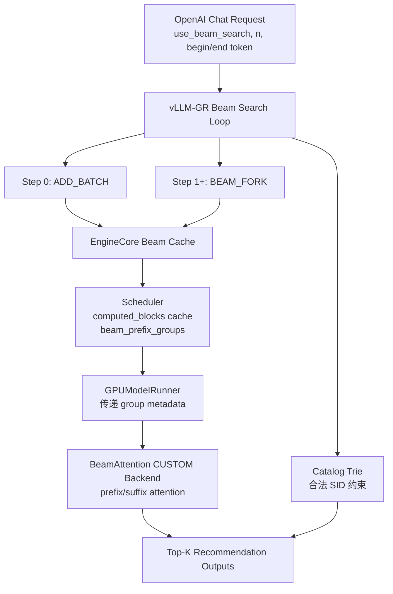

### PPT 讲法

这一页给出全局地图，后面每页展开一层。核心变化是：系统显式知道这些 beams 属于同一个逻辑请求，并围绕这个事实复用状态。

## Slide 5. 优化一：FlatLogprobs 和延迟重建

### 标题

Beam 循环轻量化：减少 Python 对象复制

### 讲解要点

原始 beam search 中，每个 beam 会携带 logprobs 历史。大 beam width 下，如果每一步为每个新 beam 复制完整 logprobs，会造成明显 CPU 和内存开销。

`vllm-gr-js` 做了三件事：

- 使用 `flat_logprobs=True`，用连续数组替代复杂 dict/list。
- `FlatLogprobs.append_fast` 用 `extend` 替代逐元素 append。
- 中间 beam 不复制完整 logprobs，只保存 parent pointer 和当前 step data，最后只对 best beams 重建。

### 推荐示意图

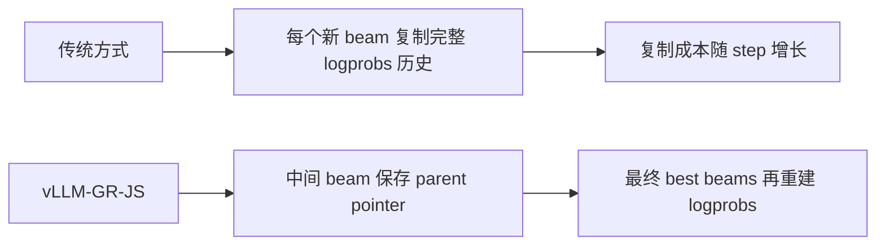

### 推荐表格

| 项目 | 原始方式 | vLLM-GR-JS |
| --- | --- | --- |
| logprobs 表示 | dict/list 为主 | FlatLogprobs |
| 中间 beam 状态 | 复制历史 | parent pointer |
| 重建时机 | 每步 | 最终 best beams |
| 主要收益 | 无 | 降低 Python CPU 和内存 |

### PPT 讲法

这个优化不改变模型结果，只改变 beam search 内部 bookkeeping 的方式。它特别适合“beam 很大、decode 很短但候选很多”的场景。

## Slide 6. 优化二：ADD_BATCH 批量提交

### 标题

第一步优化：一次提交所有初始 beams

### 讲解要点

beam search 第 0 步需要从初始 prompt 扩展出多个 beams。如果逐个 `add_request`，会产生大量 Python async、ZMQ 和 output queue 注册开销。

`ADD_BATCH` 的做法：

1. 在 `AsyncLLM` 侧先 prepare 所有 requests。
2. 注册 output queue，但不立即发送。
3. 一次性用 `ADD_BATCH` 发给 EngineCore。
4. EngineCore 子进程批量 decode 后逐个 preprocess 并缓存 beam state。

### 推荐时序图

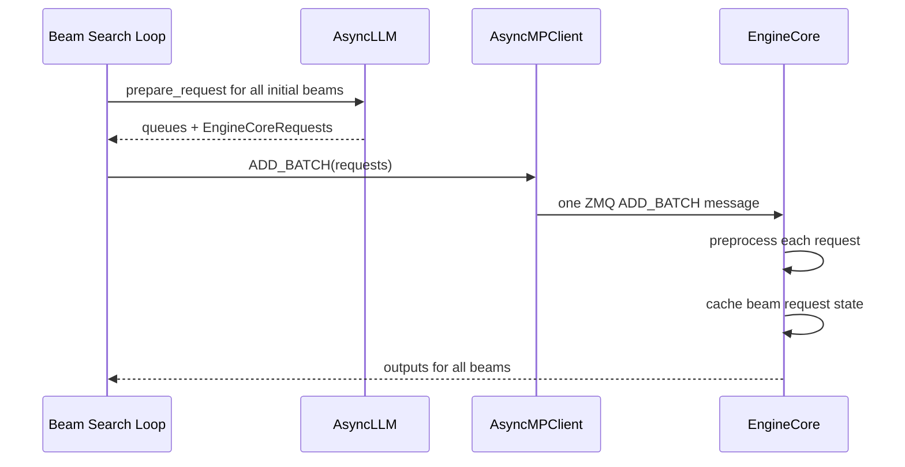

### 图中强调

`many add_request messages` 变成 `one ADD_BATCH message`。

### PPT 讲法

这一步解决的是在线 serving 的请求提交开销。它不改变模型 forward，但让大 beam width 请求更像一个批处理单元，而不是 N 个独立请求。

## Slide 7. 优化三：BEAM_FORK 复用父 beam 状态

### 标题

后续步骤优化：从父 beam fork 子 beam

### 讲解要点

beam search 第 1 步以后，每个新 beam 都是“某个父 beam + 一个新 token”。这意味着没必要重新从完整 token prompt 构造 request。

`BEAM_FORK` 做法：

- EngineCore 缓存父 beam 的 token ids、block hashes、EOS、LoRA、多模态信息等。
- 下一轮只发送：
  - parent id
  - child id
  - appended token id
  - abort ids
- EngineCore 在子进程中从 cached parent 创建 child request。
- 复制父 `block_hashes`，只增量计算新完整 block hash。

### 推荐核心示意图

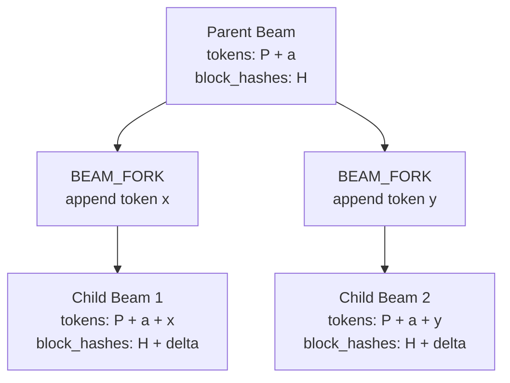

### 推荐对比表

| 步骤 | 原始路径 | BEAM_FORK 路径 |
| --- | --- | --- |
| prompt | 每步完整传入 | 只传 parent id + token |
| Request 构造 | 从完整 token list 构造 | 从 cached parent fork |
| block hash | 重新处理完整序列 | 复制父 hash + 增量 hash |
| 未选中 beams | 常规 abort | fork request 中携带 abort_ids |
| 状态清理 | 分散 | beam cache 统一清理 |

### PPT 讲法

`BEAM_FORK` 是这个仓库最关键的 engine 级优化。它把 beam search 的数学结构显式暴露给 EngineCore，让后续步骤不再把每个 beam 当成全新的完整请求。

## Slide 8. ADD_BATCH + BEAM_FORK 的完整生命周期

### 标题

从第 0 步到结束：beam cache 生命周期

### 讲解要点

完整流程：

1. 第 0 步：`ADD_BATCH` 创建初始 beams。
2. EngineCore 缓存初始 beam request state。
3. CPU 侧选择 top beams，构造 `fork_info`。
4. 第 1 步以后：`BEAM_FORK` 创建 children。
5. 未选中的 parent ids 作为 `abort_ids` 清理。
6. 最后发送 cleanup `BEAM_FORK` 删除剩余 cache。

### 推荐流程图

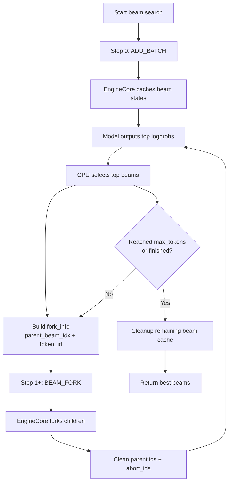

### PPT 讲法

这页重点讲状态管理。性能优化容易引入状态泄漏，所以代码里专门处理了 parent miss、error output、abort ids 和最终 cleanup。

## Slide 9. Scheduler：识别共享前缀

### 标题

Scheduler 层：从 block hash 找到共享 prefix

### 讲解要点

要做 shared-prefix attention，首先要知道哪些 beams 共享哪些 KV blocks。`vllm-gr-js` 在 scheduler 输出中增加 `beam_prefix_groups`。

做法：

- 同一个 beam search 请求的 beams 使用相同 priority。
- scheduler 按 priority 分组。
- 在组内比较 `block_hashes`。
- 用 longest common prefix 找共享 block depth。
- 共享前缀太短时不启用，避免额外 overhead。

### 推荐示意图

```text
Beam Group: priority = 12345

Beam 0 block hashes: [A, B, C, D0]
Beam 1 block hashes: [A, B, C, D1]
Beam 2 block hashes: [A, B, C, D2]
Beam 3 block hashes: [A, B, C, D3]

Longest Common Prefix = [A, B, C]
Shared depth = 3 blocks
```

### 推荐表格

| Beam | Block Hash Sequence | 共享部分 | 独立部分 |
| --- | --- | --- | --- |
| 0 | A B C D0 | A B C | D0 |
| 1 | A B C D1 | A B C | D1 |
| 2 | A B C D2 | A B C | D2 |
| 3 | A B C D3 | A B C | D3 |

### PPT 讲法

这里的关键是 block hash。vLLM 的 prefix cache 本来就基于 block hash，`vllm-gr-js` 利用它判断 beams 是否真的共享 KV block，而不是只看 token 文本。

## Slide 10. Scheduler：computed_blocks 缓存

### 标题

减少重复 prefix cache 查询

### 讲解要点

除了计算共享前缀，scheduler 还 patch 了 `get_computed_blocks`。

问题：

- 同组 beams 高度共享 prefix。
- 每个 beam 都查询一次 computed blocks，CPU 侧有重复。

优化：

- 在一次 `Scheduler.schedule()` 内缓存查询结果。
- key 由 token 数、skip prefix cache 标志和最后 relevant block hash 组成。
- 只有 cache hit tokens 超过阈值时才缓存。

### 推荐图

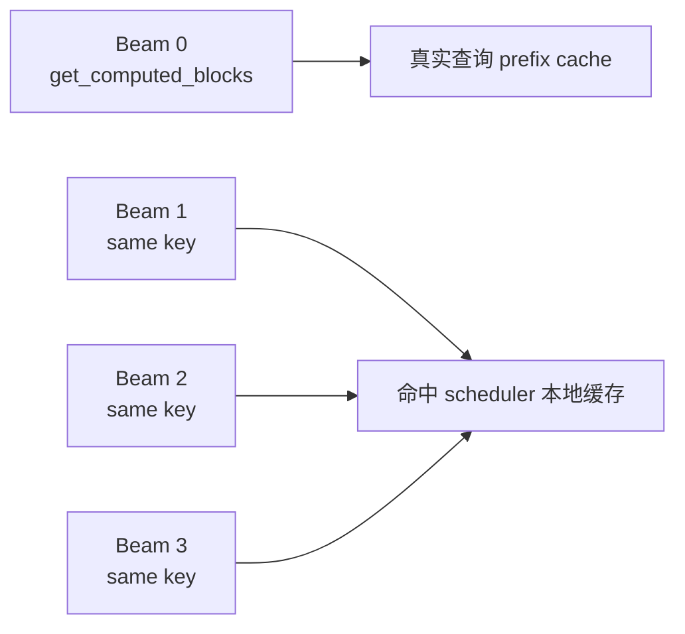

### PPT 讲法

这一层优化的目标是减少 CPU scheduler 的重复工作。它和 BeamAttention 是配套关系：前者识别并缓存共享前缀信息，后者在模型 attention 中利用这些信息。

## Slide 11. GPU BeamAttention：prefix/suffix 拆分

### 标题

GPU 层：共享 prefix 只算一次

### 讲解要点

这是 GPU 上最重的优化。对同一 beam group：

- prefix 是共享的。
- suffix 是每个 beam 独有的。

BeamAttention 把 attention 拆成两次：

1. Prefix attention：对共享 prefix 做 grouped attention，非 causal。
2. Suffix attention：对每个 beam 的独立 suffix 做 causal attention。
3. 用 LSE merge 合并两个 attention state。

### 推荐主图

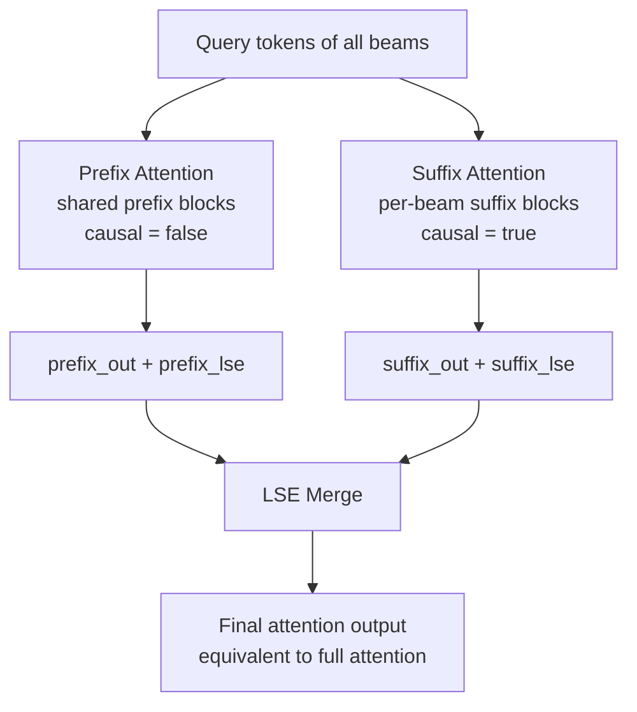

### 推荐 block table 图

```text
Full attention block table:

Beam 0: [A, B, C, D0]
Beam 1: [A, B, C, D1]
Beam 2: [A, B, C, D2]

BeamAttention:

Prefix block table: [A, B, C]     shared
Suffix block table:
  Beam 0: [D0]
  Beam 1: [D1]
  Beam 2: [D2]
```

### PPT 讲法

这页要讲清楚一个核心事实：BeamAttention 不是近似，它通过 LSE merge 保持和完整 attention 等价。优化来自减少共享 prefix KV 的重复读取和重复计算。

## Slide 12. LSE Merge 为什么正确

### 标题

Prefix/Suffix 分开算后如何保持数学等价

### 讲解要点

attention 的 softmax 分母覆盖 prefix 和 suffix 两部分。如果分开算，需要用 log-sum-exp 重新归一化。

BeamAttention 分别得到：

- `prefix_out`
- `prefix_lse`
- `suffix_out`
- `suffix_lse`

合并逻辑：

```text
m = max(prefix_lse, suffix_lse)
prefix_weight = exp(prefix_lse - m)
suffix_weight = exp(suffix_lse - m)

output =
  (prefix_weight * prefix_out + suffix_weight * suffix_out)
  / (prefix_weight + suffix_weight)
```

### 推荐公式图

```text
Full Attention:
  softmax([S_prefix, S_suffix]) · [V_prefix, V_suffix]

Split Attention:
  prefix_out = softmax(S_prefix) · V_prefix
  suffix_out = softmax(S_suffix) · V_suffix

LSE Merge:
  用 prefix_lse 和 suffix_lse 恢复全局 softmax 权重
```

### PPT 讲法

这页用于解释原理可信度。prefix/suffix 分开算不是简单拼接，而是保留 softmax 的 log-sum-exp 信息，所以可以恢复完整 attention 的归一化结果。

## Slide 13. Catalog 约束：让 beam 只走合法 SID

### 标题

业务约束优化：无效 SID 不占 beam 预算

### 讲解要点

推荐输出是结构化 SID，不是任意文本。很多 token 路径在业务上无效。

`vllm-gr-js` 增加 catalog trie：

- 把合法 SID 序列加载成 token trie。
- 每个 beam 根据已生成 token 查询合法下一 token。
- 非法 token 的 logprob 置为 `-inf`。
- catalog 查询用 `asyncio.to_thread` 与模型 step 并行。

### 推荐图

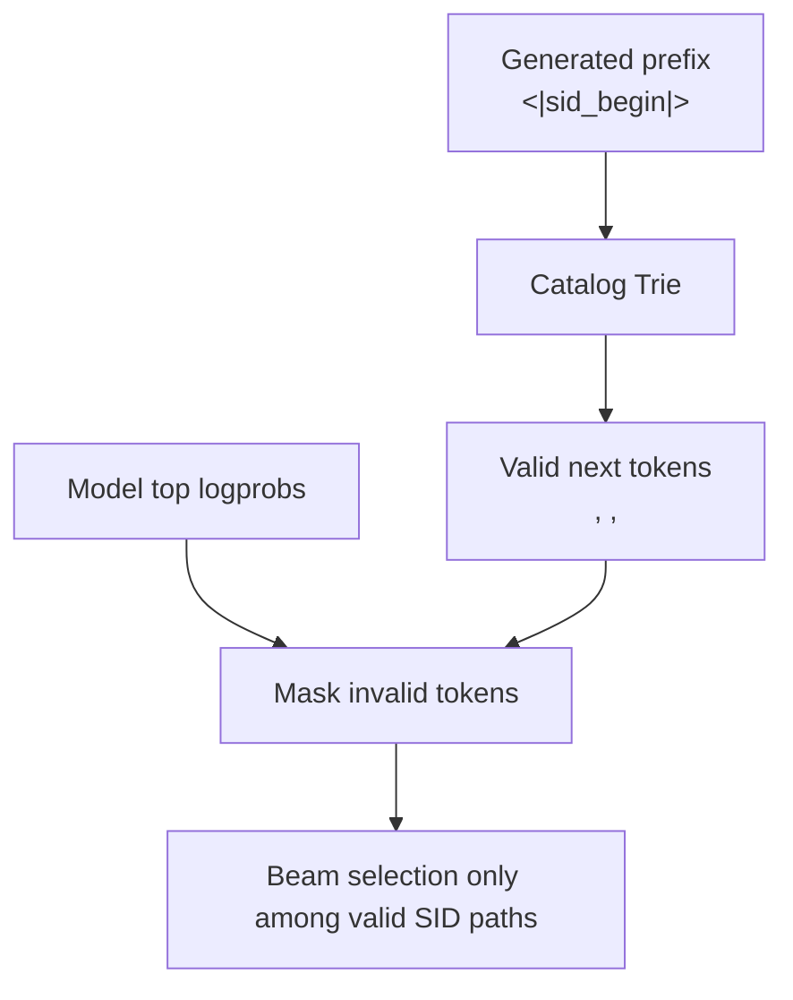

### 推荐 trie 图

```text
<|sid_begin|>
  ├── <s_a_1>
  │     ├── <s_b_3>
  │     │     └── <s_c_8>
  │     └── <s_b_4>
  └── <s_a_2>
        └── <s_b_9>
```

### PPT 讲法

这个优化利用了推荐任务的业务结构。它不仅提升效率，也提升最终 top-k 输出的有效性，因为 beam 不会浪费在 catalog 外的 item id 上。

## Slide 14. GPU 与 NPU 的支持边界

### 标题

哪些优化是通用的，哪些是 GPU 专属的

### 讲解要点

`vllm-gr-js` 宣称支持 GPU 和 Ascend NPU，但当前代码层面的优化边界要讲清楚。

通用层：

- beam search Python 优化
- FlatLogprobs
- ADD_BATCH
- BEAM_FORK
- catalog
- 部分 scheduler 优化
- LMCache adapter patch

GPU 专属：

- `--attention-backend CUSTOM`
- CUDA + FlashAttention varlen BeamAttention
- Triton LSE merge kernel

NPU 当前：

- 依赖 `vllm-ascend==0.14.0rc1`
- 主要使用 Python/Engine 层优化
- 当前未看到 NPU 版 BeamAttention kernel

### 推荐表格

| 优化模块 | GPU | NPU |
| --- | --- | --- |
| FlatLogprobs / 延迟重建 | 支持 | 支持 |
| ADD_BATCH | 支持 | 依赖 vLLM-Ascend API 兼容 |
| BEAM_FORK | 支持 | 依赖 vLLM-Ascend API 兼容 |
| Scheduler computed_blocks cache | 支持 | 理论支持 |
| Catalog trie | 支持 | 支持 |
| BeamAttention CUSTOM backend | 支持 CUDA/FA | 当前未实现 |
| Triton merge kernel | 支持 | 不适用 |
| LMCache patch | 支持 | 需实测 |

### PPT 讲法

这页要避免误解：NPU 可以吃到很多 orchestration 级优化，但 GPU 上的 shared-prefix BeamAttention 目前不是自动迁移到 NPU 的。后续 NPU 优化重点就是补齐这一层。

## Slide 15. 收益来源拆解

### 标题

性能收益来自多层重复开销消除

### 讲解要点

收益不是单点优化，而是逐层减少重复：

- Python：少复制 beam 状态，少构造 logprobs。
- API/Engine：少发请求，后续 fork 而不是完整 add。
- Hash/Cache：复用父 block hashes，缓存 computed blocks。
- Attention：共享 prefix KV 不再被每个 beam 重复 attention。
- 业务：catalog 过滤无效路径。

### 推荐瀑布图结构

PPT 中建议画成 waterfall 或 stacked bar：

```text
Baseline Latency
  - Python logprobs/beam copy
  - Request submission overhead
  - Full prompt rebuild/hash
  - Prefix cache repeated lookup
  - Shared prefix attention repeated compute
  - Invalid SID beam expansion
= Optimized Latency
```

### 推荐表格

| 层级 | 原始重复 | 优化方式 | 主要收益 |
| --- | --- | --- | --- |
| Beam loop | logprobs 复制 | FlatLogprobs + 延迟重建 | CPU/内存下降 |
| Request submit | N 个请求逐个提交 | ADD_BATCH | online 提交开销下降 |
| Beam state | 完整 request 重建 | BEAM_FORK | hash/preprocess 下降 |
| Scheduler | 重复 computed blocks 查询 | schedule 内缓存 | scheduler CPU 下降 |
| Attention | 每 beam 重复 prefix KV | BeamAttention | GPU decode step 下降 |
| Output validity | 无效 SID 占 beam | Catalog mask | 有效 beam 利用率上升 |

### PPT 讲法

如果没有真实 benchmark 数字，就不要给绝对提升倍数。可以强调“收益路径”和“在哪些 workload 下收益最大”：beam width 越大、共享 prompt 越长、decode 越短，越符合这个优化。

## Slide 16. 风险与维护成本

### 标题

当前实现强依赖 vLLM 内部 API

### 讲解要点

风险点：

- runtime 注入 `EngineCoreRequestType.ADD_BATCH` / `BEAM_FORK`。
- 替换 `EngineCoreProc.process_input_sockets`。
- 替换 `EngineCoreProc.run_engine_core`。
- patch `GPUModelRunner.execute_model` 和 `_build_attention_metadata`。
- 在 `BeamSearchSequence` 动态挂 `_lp_parent` / `_lp_step_data`。
- CUDA BeamAttention 对 FlashAttention 版本和 GPU capability 有要求。
- NPU 没有等价 custom attention。

### 推荐风险矩阵

| 风险 | 影响 | 缓解 |
| --- | --- | --- |
| vLLM 版本升级破坏内部 API | 高 | 增加版本检查和 patch signature 检查 |
| EngineCore monkey patch 失效 | 高 | 单元测试覆盖 ADD_BATCH/BEAM_FORK |
| BeamAttention backend 不可用 | 中 | fallback 到标准 attention |
| NPU 缺少 shared-prefix attention | 中高 | 开发 Ascend/CANN 等价实现 |
| beam cache 泄漏 | 高 | metrics + cleanup 测试 |

### PPT 讲法

这页体现工程判断。当前实现已经很有针对性，但越深入 vLLM 内部，维护成本越高。后续最好把成熟能力 upstream 或整理成稳定扩展点。

## Slide 17. 后续优化路线

### 标题

下一步优化建议

### 讲解要点

优先级建议：

1. NPU shared-prefix attention
   - 把 GPU BeamAttention 的核心收益带到 Ascend。
   - 需要 prefix/suffix metadata、两段 attention、LSE merge。

2. Catalog 查询加速
   - 当前是 Python trie。
   - 可做 C++ trie、批量查询、beam 上保存 trie state。

3. Candidate selection 加速
   - 当前使用 `np.argpartition`。
   - 仓库有 `minheap_cpp` 但未接入，可评估是否接入。

4. Metrics 细化
   - 拆 beam loop time、catalog time、fork time、scheduler time、attention group count。

5. 降低 monkey patch 脆弱性
   - 增加 vLLM 版本兼容检查。
   - 推动稳定 API 或 upstream。

### 推荐路线图

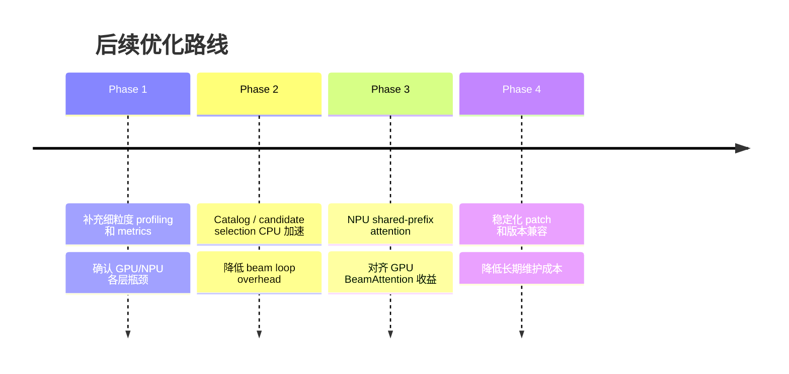

### PPT 讲法

把后续工作分成“性能继续提升”和“工程稳定性提升”两条线。NPU shared-prefix attention 是最有技术含量也最值得投入的方向。

## Slide 18. 总结页

### 标题

总结：vLLM-GR-JS 的核心价值

### 讲解要点

可以用三句话收束：

1. `vllm-gr-js` 利用生成式推荐的 workload 特征：大 beam、短 decode、共享长前缀、结构化输出。
2. 它通过 `ADD_BATCH + BEAM_FORK + Scheduler Prefix Group + BeamAttention + Catalog`，把通用 vLLM beam search 改造成 beam-aware execution。
3. 当前 GPU 优化链路更完整，NPU 主要具备 Python/Engine 层优化，后续最关键是补齐 NPU shared-prefix attention。

### 推荐最终图

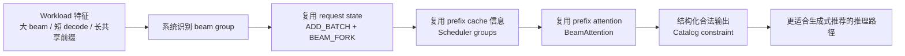

## 3. 图表制作建议

### 建议必须画的 6 张图

1. Workload 对比图
   - 普通聊天生成 vs 生成式推荐。

2. 原始 vLLM beam search 重复开销图
   - 多个 beams 全都走 full request。

3. vLLM-GR-JS 总架构图
   - Beam loop、ADD_BATCH、BEAM_FORK、scheduler、BeamAttention、catalog。

4. BEAM_FORK 生命周期图
   - parent beam -> child beams，block hashes 复用。

5. BeamAttention prefix/suffix 拆分图
   - shared prefix block table 和 suffix block table。

6. GPU/NPU 支持边界表
   - 哪些通用，哪些 GPU 专属，哪些 NPU 待补齐。

### 可选图

- LSE merge 数学图。
- 性能收益 waterfall 图。
- 后续优化 roadmap。
- catalog trie 图。

## 4. 讲解时的重点措辞

### 建议强调

- “这是推理系统优化，不是模型训练优化。”
- “核心是把 beam search 的共享结构暴露给 vLLM engine。”
- “`BEAM_FORK` 避免每步完整重建 request。”
- “BeamAttention 的 prefix/suffix 拆分不是近似，靠 LSE merge 保持等价。”
- “GPU 当前有完整 custom attention，NPU 主要是 engine orchestration 层优化。”

### 避免误导

- 不要说 NPU 已经有 BeamAttention kernel，当前代码没有。
- 不要说文档里的 HSTU executor 已实现，当前实际主线是 Qwen3/OpenOneRec beam search。
- 不要把 catalog 说成模型能力，它是 serving 侧合法 token 约束。
- 不要把 `ADD_BATCH` 和 vLLM 普通常规 batching 混为一谈，它是为了 beam 初始请求提交和 beam cache 建立新增的 EngineCore 消息。

## 5. 可直接放进 PPT 的精简版本

### 背景

OpenOneRec 推理使用 Qwen3 做生成式推荐，典型输出是结构化 SID。该任务具备大 beam width、短 decode、同请求内长前缀共享等特点，导致通用 vLLM beam search 在 Python orchestration、request 提交、prefix cache 查询和 attention 计算上存在重复开销。

### 方案

`vllm-gr-js` 通过 monkey patch 扩展 vLLM 0.14 推理路径，核心是 beam-aware execution：

- 用 FlatLogprobs 和延迟重建降低 beam loop CPU/内存开销。
- 用 `ADD_BATCH` 一次性提交第 0 步 beams。
- 用 `BEAM_FORK` 从父 beam 状态创建子 beam，复用 token state 和 block hashes。
- scheduler 根据 priority 和 block hashes 识别同组 beams 的共享 prefix。
- GPU BeamAttention 将 attention 拆成 shared prefix pass 和 per-beam suffix pass，并用 LSE merge 保持结果等价。
- catalog trie 约束结构化 SID 的合法生成路径。

### 收益路径

优化收益来自消除重复：

- 少复制 beam 状态。
- 少提交请求。
- 少重建完整 prompt。
- 少重复计算 block hash。
- 少重复查询 prefix cache。
- 少重复读取和计算共享 prefix KV。
- 少扩展无效 SID beam。

### 边界

当前 GPU 路径优化较完整，包括 CUDA/FlashAttention BeamAttention。NPU 路径主要继承 Python 和 Engine 层优化，依赖 vLLM-Ascend 0.14 的 API 兼容；当前仓库未实现 NPU 版 shared-prefix BeamAttention。

### 后续

后续优化重点建议放在：

- NPU shared-prefix attention。
- catalog 查询 C++/批量化。
- candidate selection 加速。
- 更细粒度 profiling metrics。
- 降低 monkey patch 对 vLLM 内部 API 的依赖。

